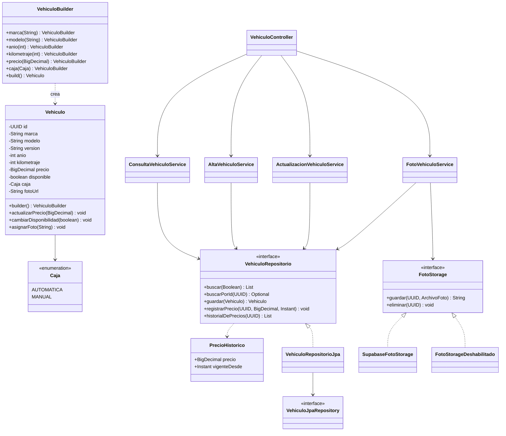

# Microservicio vehiculos

Especificación para desarrollar el servicio `vehiculos` del TP de Desarrollo de Aplicaciones II (UADE). Todo lo que figura acá está decidido. Los puntos que no bloquean el desarrollo están en la sección 15.

## Índice

1. [Contexto](#1-contexto)
2. [Diseño interno](#2-diseño-interno)
3. [Convenciones](#3-convenciones)
4. [Modelo de datos](#4-modelo-de-datos)
5. [API](#5-api)
6. [Reglas de negocio](#6-reglas-de-negocio)
7. [Fotos con Supabase Storage](#7-fotos-con-supabase-storage)
8. [Patrones de diseño](#8-patrones-de-diseño)
9. [Base de datos y migraciones](#9-base-de-datos-y-migraciones)
10. [Configuración y perfiles](#10-configuración-y-perfiles)
11. [Docker](#11-docker)
12. [Pruebas](#12-pruebas)
13. [Orden de trabajo](#13-orden-de-trabajo)
14. [Tecnologías y dependencias](#14-tecnologías-y-dependencias)
15. [Decisiones y pendientes](#15-decisiones-y-pendientes)

---

## 1. Contexto

### 1.1 El sistema

El TP es un CRM de calificación de leads para una agencia de autos usados. Un prospecto completa un preformulario, el sistema lo califica automáticamente (No potable, Potable, Muy potable) y un telemarketer ve una cola ordenada. Está hecho con microservicios Spring Boot, una base de datos por servicio y un API Gateway como entrada única del frontend. `vehiculos` es uno de esos servicios y lo desarrolla una sola persona.

### 1.2 Qué es vehiculos

Es el inventario de la agencia: unidades, sus precios, su historial de precios y sus fotos. Puerto 8083. Su base es un schema propio en un Postgres de Supabase y las fotos van a Supabase Storage.

### 1.3 Con quién interactúa

| Actor | Cómo | Para qué |
|---|---|---|
| Frontend (React), por el gateway | `GET /vehiculos?disponible=true` y `GET /vehiculos/{id}` | Selector de vehículos del preformulario. Filtra en memoria por marca, modelo, caja, año, precio y kilometraje |
| Servicio `calificacion`, REST directo | `GET /vehiculos/{id}/precio` | Calcular la cobertura de un lead: (anticipo + permuta computable) / precio de la unidad |
| API Gateway (lo hace otra persona, más adelante) | Ruteo | El front llama a `/api/vehiculos/...`, el gateway quita `/api` y el servicio expone `/vehiculos/...` |
| Supabase Postgres | JDBC | Persistencia |
| Supabase Storage | HTTPS | Fotos |

Los otros servicios del sistema (`leads`, `clientes`, `calificacion`) son independientes: `vehiculos` no los llama, no conoce sus modelos y no comparte código con ellos. Se relacionan solo por UUID de vehículo.

### 1.4 Lo que no hace

- No publica ni consume eventos (no usa Kafka).
- No maneja datos personales.
- No tiene autenticación de usuarios. Las escrituras se protegen con `X-Api-Key` (5.2).
- No tiene pantalla de alta o edición: el alta se hace desde Swagger o Insomnia y la edición solo cambia precio y disponibilidad.

### 1.5 Reglas de arquitectura que aplican

- Ningún servicio lee la base de otro. Las referencias entre servicios son por UUID, nunca por clave foránea.
- Todo se identifica por UUID.
- El dominio no depende de Spring Data ni de clientes HTTP: usa puertos que implementa la infraestructura.

---

## 2. Diseño interno

Capas, con la dependencia apuntando siempre al dominio:

| Capa | Contenido |
|---|---|
| `api` | Controller REST, DTOs de request y response, manejo global de errores, seguridad por `X-Api-Key` |
| `application` | Casos de uso, uno por servicio, con las transacciones |
| `domain` | `Vehiculo` y su Builder, `Caja`, excepciones de dominio, puertos `VehiculoRepositorio` y `FotoStorage` |
| `infrastructure` | Persistencia JPA y cliente de Supabase Storage |
| `config` | Propiedades validadas, filtro de `correlationId`, beans |

```
com.uade.crm.vehiculos
├── api
│   ├── VehiculoController
│   ├── dto            AltaVehiculoRequest, ActualizacionVehiculoRequest, VehiculoResponse, PrecioResponse,
│   │                  PrecioHistoricoResponse
│   ├── error          ApiExceptionHandler (@RestControllerAdvice), CodigoError
│   └── seguridad      ClaveServicioInterceptor, RequiereClaveServicio, ClaveServicioInvalidaException
├── application        ConsultaVehiculoService, AltaVehiculoService, ActualizacionVehiculoService, FotoVehiculoService
├── domain
│   ├── model          Vehiculo (con Builder), Caja, PrecioHistorico, ArchivoFoto, VehiculoNoEncontradoException,
│   │                  FotoInvalidaException, AlmacenamientoNoDisponibleException
│   └── port           VehiculoRepositorio, FotoStorage
├── infrastructure
│   ├── persistence    VehiculoEntity, VehiculoJpaRepository, VehiculoRepositorioJpa,
│   │                  PrecioHistorialEntity, PrecioHistorialJpaRepository
│   └── storage        SupabaseFotoStorage, FotoStorageDeshabilitado
└── config             VehiculosProperties, CorrelationIdFilter, DominioConfig, OpenApiConfig, WebConfig
```

Cada paquete lleva su `package-info.java`. El mapeo entre dominio, entidad y DTO es manual.

---

## 3. Convenciones

El servicio `clientes` ya está implementado por otro integrante y fija el estilo del equipo. `vehiculos` copia su estilo, no su dominio.

### 3.1 Código

- Código, nombres de dominio y mensajes de error en español. Palabras técnicas en inglés.
- Sin Lombok ni MapStruct. Los DTOs son `record` con un método estático `de(...)` que los construye desde el dominio. Los request recortan los textos en el constructor compacto antes de validar.
- Las entidades de dominio tienen constructor privado y `builder()` escrito a mano. La persistencia las reconstruye con el mismo builder. Los accesores no usan `get` (`id()`, `precio()`) y los campos opcionales devuelven `Optional`.
- Puerto de persistencia `VehiculoRepositorio` en `domain.port`. Adaptador `VehiculoRepositorioJpa` (visibilidad de paquete) en `infrastructure.persistence`, que delega en la interfaz Spring Data `VehiculoJpaRepository` y traduce con `aEntidad` y `aDominio`. La entidad JPA `VehiculoEntity` tiene getters y setters de paquete.
- Un servicio de aplicación por caso de uso, no una fachada única.
- `Clock` inyectado como bean (`DominioConfig`) para que el tiempo sea testeable.
- `spring.jpa.open-in-view: false` y `ddl-auto: validate`.
- Actuator expone solo `health`, con probes habilitados.
- Tipos: `UUID` para ids, `BigDecimal` para dinero, `Instant` para fechas y horas. En JSON los montos viajan como números. Los enums viajan en ASCII y mayúsculas (`AUTOMATICA`).
- Configuración con un `@ConfigurationProperties` record validado (prefijo `vehiculos`) y variables de entorno `VEHICULOS_*`. El servicio no arranca si falta una obligatoria o quedó un placeholder sin resolver. Los `toString` de las propiedades secretas devuelven `****`.
- Documentación con springdoc: `/v3/api-docs` y `/swagger-ui.html`.
- Migraciones con Flyway, una por cambio. Nunca se edita una migración ya mergeada.

### 3.2 Trazabilidad

`CorrelationIdFilter` toma `X-Correlation-Id` del request o genera un UUID, lo deja en el MDC con la clave `correlationId`, lo devuelve en la respuesta y lo escribe en cada línea de log con el patrón `[%X{correlationId:-}]`.

### 3.3 Errores

Todo error responde `application/problem+json` (`ProblemDetail`), con `codigo` estable, `correlationId` y, en validación, la lista `errores`. El `type` usa la base `https://crm.uade.local/errores/{slug}`. `ApiExceptionHandler` extiende `ResponseEntityExceptionHandler` y los códigos viven en el enum `CodigoError`.

```json
{
  "type": "https://crm.uade.local/errores/validacion",
  "title": "Datos inválidos",
  "status": 422,
  "detail": "Hay campos que no cumplen las validaciones",
  "instance": "/vehiculos",
  "codigo": "VALIDACION",
  "correlationId": "c0a8012e-7f3b-4d8a-b1c2-9d8e7f6a5b4c",
  "errores": [
    { "campo": "caja", "mensaje": "no debe ser nulo" }
  ]
}
```

| `codigo` | HTTP | Cuándo |
|---|---|---|
| `VALIDACION` | 422 | Falla de Bean Validation, o un valor que no se puede convertir al tipo del campo (por ejemplo un enum fuera de rango). Incluye `errores` con `campo` y `mensaje` |
| `JSON_INVALIDO` | 400 | Cuerpo mal formado |
| `SOLICITUD_INVALIDA` | 400 | Error 4xx que resuelve Spring MVC (método no permitido, ruta inexistente) |
| `CLAVE_SERVICIO_INVALIDA` | 401 | Falta `X-Api-Key` o no coincide. Se evalúa antes de validar el cuerpo |
| `ERROR_INTERNO` | 500 | Error no controlado. Se loguea con la excepción y se responde sin detalle |
| `VEHICULO_NO_ENCONTRADO` | 404 | El id no existe |
| `FOTO_INVALIDA` | 422 | El archivo no es JPEG, PNG o WebP, está vacío o supera el tamaño máximo |
| `ALMACENAMIENTO_NO_DISPONIBLE` | 503 | Storage no responde, rechazó la subida, o el modo de fotos es `deshabilitado` |

Ejemplo, vehículo inexistente:

```json
{
  "type": "https://crm.uade.local/errores/vehiculo-no-encontrado",
  "title": "Vehículo no encontrado",
  "status": 404,
  "detail": "No existe un vehículo con id 9e8d7c6b-5a4f-4e3d-2c1b-0a9f8e7d6c5b",
  "instance": "/vehiculos/9e8d7c6b-5a4f-4e3d-2c1b-0a9f8e7d6c5b",
  "codigo": "VEHICULO_NO_ENCONTRADO",
  "correlationId": "c0a8012e-7f3b-4d8a-b1c2-9d8e7f6a5b4c"
}
```

---

## 4. Modelo de datos

| Campo | Tipo | Obligatorio | Notas |
|---|---|---|---|
| `id` | UUID | Sí | Lo genera el servicio |
| `marca` | texto | Sí | |
| `modelo` | texto | Sí | |
| `version` | texto (por ejemplo "Exclusive CVT") | No | Versión comercial del modelo. No es la versión de concurrencia: no se usa `@Version` de JPA |
| `anio` | entero | Sí | |
| `kilometraje` | entero (km) | Sí | |
| `precio` | `BigDecimal` | Sí | |
| `disponible` | booleano | Sí | `true` por defecto en el alta |
| `caja` | `AUTOMATICA` o `MANUAL` | Sí | Enum `Caja` |
| `fotoUrl` | texto (URL) | No | URL pública de Storage |
| `creadoEn` | `Instant` | Sí | Interno. Lo fija el servicio al dar de alta. No viaja en la API |
| `actualizadoEn` | `Instant` | Sí | Interno. Se actualiza en cada cambio de precio, disponibilidad o foto. No viaja en la API |

El historial guarda, por cada vehículo, una fila por cada precio que rigió (`precio` y `vigenteDesde`).

---

## 5. API

### 5.1 Endpoints

| Método | Ruta | Respuesta | Uso |
|---|---|---|---|
| GET | `/vehiculos?disponible=true` | `200` con lista | Lista del preformulario. Sin el parámetro devuelve todas las unidades |
| GET | `/vehiculos/{id}` | `200` con el vehículo, `404` | Detalle. Responde `200` también si `disponible` es false |
| GET | `/vehiculos/{id}/precio` | `200` con `{ "precio": número, "disponible": booleano }`, `404` | Lo usa `calificacion` |
| GET | `/vehiculos/{id}/historial-precios` | `200` con la lista del más nuevo al más viejo, `404` | Historial de precios |
| POST | `/vehiculos` | `201` con el vehículo y `Location`, `422` | Alta |
| PUT | `/vehiculos/{id}` | `200` con el vehículo, `404`, `422` | Cambia `precio` y/o `disponible`. Si cambia el precio, registra una fila en el historial |
| PUT | `/vehiculos/{id}/foto` | `200` con el vehículo, `404`, `422` `FOTO_INVALIDA`, `503` `ALMACENAMIENTO_NO_DISPONIBLE` | Carga o reemplaza la foto (`multipart/form-data`, campo `archivo`) |

El `PUT /vehiculos/{id}` modifica solo algunos campos, así que su semántica es la de un `PATCH`. Se mantiene `PUT` porque así lo espera el contrato del equipo.

### 5.2 Seguridad de las escrituras

`POST /vehiculos` y ambos `PUT` exigen el header `X-Api-Key`, con la anotación `@RequiereClaveServicio` y un interceptor. La clave es un secreto compartido de al menos 32 caracteres, configurado en `VEHICULOS_CLAVE_ESCRITURA`, y se compara en tiempo constante. Sin ella el servicio responde `401` con `CLAVE_SERVICIO_INVALIDA` antes de leer el cuerpo. Las lecturas quedan abiertas. Es una medida de la API, no de la base de datos.

### 5.3 Ejemplos

Alta (`POST /vehiculos`):

```json
{
  "marca": "Toyota",
  "modelo": "Corolla",
  "version": "XEI CVT",
  "anio": 2021,
  "kilometraje": 45000,
  "precio": 10000000,
  "disponible": true,
  "caja": "AUTOMATICA"
}
```

Actualización (`PUT /vehiculos/{id}`): ambos campos son opcionales, pero al menos uno es obligatorio y `precio` debe ser mayor que cero. Cualquier otro campo se rechaza.

```json
{ "precio": 10500000, "disponible": false }
```

Respuesta de `GET /vehiculos/{id}` (datos ficticios; `<ref>` es el project-ref de Supabase):

```json
{
  "id": "9e8d7c6b-5a4f-4e3d-2c1b-0a9f8e7d6c5b",
  "marca": "Toyota",
  "modelo": "Corolla",
  "version": "XEI CVT",
  "anio": 2021,
  "kilometraje": 45000,
  "precio": 10000000,
  "disponible": true,
  "caja": "AUTOMATICA",
  "fotoUrl": "https://<ref>.supabase.co/storage/v1/object/public/vehiculos-fotos/9e8d7c6b-5a4f-4e3d-2c1b-0a9f8e7d6c5b.jpg"
}
```

Respuesta de `GET /vehiculos/{id}/precio`:

```json
{ "precio": 10000000, "disponible": true }
```

Respuesta de `GET /vehiculos/{id}/historial-precios`:

```json
[
  { "precio": 10500000, "vigenteDesde": "2026-10-07T18:20:00Z" },
  { "precio": 10000000, "vigenteDesde": "2026-09-22T14:03:11Z" }
]
```

---

## 6. Reglas de negocio

- **Invariantes** (en `Vehiculo.builder().build()` y al actualizar): precio positivo, kilometraje mayor o igual a 0, marca y modelo no vacíos, `caja` presente, año entre 1950 y el año actual más uno, calculado con el `Clock` inyectado.
- **Doble validación:** los DTOs de request se validan con Bean Validation y devuelven `VALIDACION` con `errores`. El Builder protege al dominio aunque el DTO falle.
- **Filtrado:** el servidor solo filtra por `disponible`. El front trae la lista completa y filtra en memoria. Sin paginación.
- **Precio disponible o no:** `GET /vehiculos/{id}/precio` y `GET /vehiculos/{id}` responden `200` aunque `disponible` sea false. `calificacion` puede procesar un lead después de la venta y el front puede mostrar una ficha vieja. `vehiculos` solo informa: la respuesta incluye `disponible` y quien consulta decide qué hacer. Si el id no existe, `404` con `VEHICULO_NO_ENCONTRADO`.
- **Rendimiento:** `/precio` está en el camino de cada calificación. Es una consulta por clave primaria, sin joins ni caché.
- **Historial de precios:** `precio_historial` guarda una fila por cada precio que rigió, con `vigente_desde`. Se escribe en la misma transacción que el alta (precio inicial) y que cada `PUT` que cambia el precio. Un `PUT` que solo cambia `disponible`, o que envía el mismo precio, no escribe nada. Es de solo agregado y su fila más reciente coincide siempre con `vehiculo.precio`.
- **Fechas:** `creado_en` y `actualizado_en` son `TIMESTAMPTZ` mapeadas como `Instant`, y las fija el servicio con el `Clock`. No viajan en la API.
- **Sin control de concurrencia optimista:** el último `PUT` gana. Alcanza porque las actualizaciones de precio son raras y las hace una persona.

---

## 7. Fotos con Supabase Storage

La foto vive en Storage y la base guarda solo el texto de `fotoUrl`. Son dos conexiones distintas: Postgres por JDBC (`VEHICULOS_DB_*`) y Storage por HTTPS (`VEHICULOS_SUPABASE_URL` y la clave secreta).

- **Bucket** `vehiculos-fotos`, público y ya creado. Las lecturas no requieren autenticación, así que el front muestra `fotoUrl` en un ``. Subir y borrar los hace solo el backend.
- **URL pública:** `{SUPABASE_URL}/storage/v1/object/public/{bucket}/{archivo}`.
- **Nombre del objeto:** `{vehiculoId}.{extensión}`. Una nueva carga con `x-upsert: true` pisa la anterior. Si cambia la extensión, se borra el objeto viejo.
- **Subida:** `POST {SUPABASE_URL}/storage/v1/object/{bucket}/{archivo}` con el cuerpo del archivo y su `Content-Type`. Se hace con el `RestClient` de Spring, con timeouts y sin dependencias nuevas.
- **Borrado:** `DELETE {SUPABASE_URL}/storage/v1/object/{bucket}` con cuerpo `{"prefixes": ["{archivo}"]}`.
- **Autenticación:** las claves `sb_secret_...` se envían en el header `apikey`, no como `Authorization: Bearer`.
- **Validaciones:** JPEG, PNG o WebP, no vacío, máximo 2 MB. El bucket también restringe tamaño y tipos como segunda barrera.
- **Falla parcial:** si la subida sale bien y el guardado en la base falla, queda un objeto huérfano. Es aceptable: el reintento escribe el mismo nombre.
- **Endpoints:** salen del código del cliente oficial de Supabase y no de su documentación REST. Si alguno responde distinto en la primera subida real, el cuerpo del error de Storage indica qué ajustar.

Flujo de `PUT /vehiculos/{id}/foto`: busca el vehículo (404 si no existe), valida el archivo (422), sube a Storage (503 si falla), arma la URL pública, la asigna al `Vehiculo` y actualiza `foto_url` y `actualizado_en`.

**Strategy `FotoStorage`.** Interfaz del dominio con dos implementaciones, elegidas por `vehiculos.fotos.modo`:

| Modo | Clase | Comportamiento |
|---|---|---|
| `supabase` | `SupabaseFotoStorage` | Sube y borra en Storage y devuelve la URL pública |
| `deshabilitado` | `FotoStorageDeshabilitado` | Rechaza la carga con `ALMACENAMIENTO_NO_DISPONIBLE`. Permite correr el servicio sin la clave de Storage |

Los tests usan una implementación falsa en memoria. Ningún test llama a Supabase.

---

## 8. Patrones de diseño

| Patrón | Clase | Por qué |
|---|---|---|
| Repository | `VehiculoRepositorio` (puerto) y `VehiculoRepositorioJpa` (adaptador sobre Spring Data) | Aísla el dominio de la persistencia |
| Builder | `Vehiculo.builder()` | La unidad tiene muchos campos y varios opcionales. Evita constructores de diez parámetros y valida invariantes en `build()` |
| Strategy | `FotoStorage` con `SupabaseFotoStorage` y `FotoStorageDeshabilitado` | Cambiar dónde se guardan las fotos no toca el resto del servicio |



En el código, `VehiculoBuilder` es la clase anidada `Vehiculo.Builder`.

---

## 9. Base de datos y migraciones

### 9.1 Supabase

La base es un Postgres de Supabase ya creado, con un rol y un schema propios. El equipo comparte las credenciales por un canal seguro y todos trabajan contra la misma base.

- **Conexión:** session pooler, puerto 5432, con `sslmode=require`. Es compatible con IPv4 y con Docker, y mantiene la sesión, así que Flyway y los prepared statements funcionan. No usar la conexión directa (solo IPv6) ni el transaction pooler del puerto 6543 (no soporta prepared statements del lado del servidor).
- **Usuario:** `vehiculos_app.<project-ref>`, un rol dedicado con permisos solo sobre su schema. Nunca el rol `postgres`. Usuario y clave van en variables separadas, no dentro de la URL, para no escapar caracteres reservados.
- **Schema propio `vehiculos`:** no se usa `public`, porque la Data API de Supabase lo expone. Se fija con `hibernate.default_schema` y `flyway.schemas` (sección 10).
- **Clave secreta `sb_secret_...`:** equivale al rol `service_role` y se salta Row Level Security. Solo vive en el backend, nunca en el frontend, el repo, los logs ni un chat.
- **Pausa:** el plan gratuito pausa el proyecto tras una semana sin actividad. Los datos se conservan, pero hay que reactivarlo desde el dashboard. Si el servicio no arranca por timeout de la base, revisar eso primero.
- **Migraciones en base compartida:** solo el responsable de `vehiculos` define y aplica migraciones. Si otro integrante corre una rama con una migración nueva contra la base compartida, Flyway la aplica y rompe la validación de los demás.

### 9.2 Migración V1

Migración Flyway `V1__vehiculo.sql` en `db/migration/`, que corre en el schema `vehiculos`:

```sql
CREATE TABLE vehiculo (
    id             UUID PRIMARY KEY,
    marca          VARCHAR(60)    NOT NULL,
    modelo         VARCHAR(80)    NOT NULL,
    version        VARCHAR(80),
    anio           INTEGER        NOT NULL,
    kilometraje    INTEGER        NOT NULL CHECK (kilometraje >= 0),
    precio         NUMERIC(14, 2) NOT NULL CHECK (precio > 0),
    disponible     BOOLEAN        NOT NULL DEFAULT TRUE,
    caja           VARCHAR(15)    NOT NULL CHECK (caja IN ('AUTOMATICA', 'MANUAL')),
    foto_url       VARCHAR(500),
    creado_en      TIMESTAMPTZ    NOT NULL,
    actualizado_en TIMESTAMPTZ    NOT NULL
);

CREATE INDEX ix_vehiculo_disponible ON vehiculo (disponible);

CREATE TABLE precio_historial (
    id            UUID PRIMARY KEY,
    vehiculo_id   UUID           NOT NULL REFERENCES vehiculo (id),
    precio        NUMERIC(14, 2) NOT NULL CHECK (precio > 0),
    vigente_desde TIMESTAMPTZ    NOT NULL
);

CREATE INDEX ix_precio_historial_vehiculo ON precio_historial (vehiculo_id, vigente_desde DESC);
```

Cada fila de `precio_historial` es un precio que empezó a regir en `vigente_desde`. La clave foránea es válida porque ambas tablas son de este servicio: la regla de no usar claves foráneas aplica entre servicios.

### 9.3 Seed

La carga inicial va en migraciones separadas del esquema (`db/seed/`), que se activan con el perfil `seed` sumando `classpath:db/seed` a `spring.flyway.locations`. Se corre con `SPRING_PROFILES_ACTIVE=local,seed`. Datos ficticios, con variedad de marcas, cajas, años, precios y kilometrajes para probar los filtros del front. Incluir al menos una unidad con `disponible = false`. Las fotos del seed quedan en `NULL`. Cada unidad del seed lleva su fila inicial en `precio_historial`.

---

## 10. Configuración y perfiles

Todo por variables de entorno, validado al arrancar con el record `VehiculosProperties` (prefijo `vehiculos`).

| Variable | Ejemplo | Uso |
|---|---|---|
| `VEHICULOS_DB_URL` | `jdbc:postgresql://aws-0-<region>.pooler.supabase.com:5432/postgres?sslmode=require` | Conexión por session pooler |
| `VEHICULOS_DB_USUARIO` | `vehiculos_app.<project-ref>` | Rol dedicado. No se commitea |
| `VEHICULOS_DB_CLAVE` | | Contraseña. No se commitea |
| `VEHICULOS_FOTOS_MODO` | `supabase` o `deshabilitado` | Estrategia de `FotoStorage` |
| `VEHICULOS_SUPABASE_URL` | `https://<project-ref>.supabase.co` | Solo en modo `supabase` |
| `VEHICULOS_SUPABASE_CLAVE_SECRETA` | `sb_secret_...` | Solo en modo `supabase`. Nunca en logs |
| `VEHICULOS_FOTOS_BUCKET` | `vehiculos-fotos` | Bucket público de Storage |
| `VEHICULOS_CLAVE_ESCRITURA` | mínimo 32 caracteres | Secreto de los endpoints de escritura (`X-Api-Key`) |

Perfiles: `local` (por defecto, para correr con `spring-boot:run` contra Supabase) y `docker` (el del compose). El schema se fija así:

```yaml
spring:
  jpa:
    properties:
      hibernate:
        default_schema: vehiculos
  flyway:
    schemas: vehiculos
```

Spring Boot no lee archivos `.env` por sí solo. Para correr en local se cargan las variables de `infra/.env` en la sesión de la terminal con un script (`scripts/cargar-env.ps1` en Windows, `scripts/cargar-env.sh` en Linux y macOS). El script se corre antes de `spring-boot:run`.

---

## 11. Docker

Un solo modo: el servicio corre en un contenedor y se conecta a Supabase con las credenciales compartidas.

1. Copiar `infra/.env.example` a `infra/.env` y completar las variables de la sección 10.
2. `docker compose -f infra/docker-compose.yml up --build`.
3. Probar en `http://localhost:8083/swagger-ui.html` o con Insomnia.

- `Dockerfile` multi-stage con contexto en la raíz del repo: build con `maven:3.9-eclipse-temurin-21` copiando primero los `pom.xml` para cachear dependencias, y runtime `eclipse-temurin:21-jre` con `curl` para el healthcheck y un usuario sin privilegios. No se usa Maven Wrapper.
- El compose tiene solo el servicio `vehiculos`: sin Postgres, porque la base está en Supabase, y sin Kafka, porque el servicio no lo usa. Publica el puerto 8083 al host. Su healthcheck consulta `/actuator/health`.
- Las variables obligatorias usan `${VAR:?mensaje}`, así que el compose falla con un mensaje claro si falta alguna.
- `.env.example` va commiteado con placeholders y `.env` real en `.gitignore`.
- Los tests de integración no usan Supabase: levantan su propio PostgreSQL con Testcontainers, que necesita Docker abierto.

---

## 12. Pruebas

**Automáticas**

- Unitarias del Builder: cada invariante rechaza el valor inválido y acepta el límite; `caja` ausente falla.
- Unitarias de los servicios con Mockito.
- Repositorio y migraciones contra PostgreSQL real con Testcontainers (`PostgresDePrueba` con `@ServiceConnection` y la anotación `@PruebaIntegracion`), incluido el filtro `disponible`.
- Controllers con MockMvc (`PruebaWebMvc`): códigos de estado, forma del `ProblemDetail` (`codigo`, `correlationId`, `errores`), `X-Api-Key` faltante o inválida (401 antes de validar el cuerpo) y `caja` fuera del enum (422 con los valores aceptados).
- Fotos con un `FotoStorage` falso: tipo inválido, tamaño excedido y falla del almacenamiento.
- Historial: el alta y cada `PUT` que cambia el precio agregan una fila; un `PUT` que solo cambia `disponible` no agrega nada.
- La clave secreta de Supabase y la de escritura no aparecen en ninguna línea de log.

**Manuales con Insomnia.** Base `http://localhost:8083`. Importar `http://localhost:8083/v3/api-docs` genera la colección. Guardar la `X-Api-Key` en un entorno de Insomnia y no dentro de cada request. Casos mínimos:

| # | Request | Resultado esperado |
|---|---|---|
| 1 | `GET /vehiculos?disponible=true` | `200`, solo unidades disponibles |
| 2 | `GET /vehiculos/{id}` y `GET /vehiculos/{id}/precio` | `200`; el precio incluye `disponible` |
| 3 | `GET /vehiculos/{id-inexistente}` | `404`, `codigo` `VEHICULO_NO_ENCONTRADO` |
| 4 | `POST /vehiculos` sin `X-Api-Key` | `401`, `CLAVE_SERVICIO_INVALIDA` |
| 5 | `POST /vehiculos` con clave y sin `caja` | `422`, `errores` con el campo `caja` |
| 6 | `POST /vehiculos` con `caja` igual a `"Automática"` | `422`, con los valores aceptados |
| 7 | `POST /vehiculos` válido | `201` con `Location`; aparece en el listado |
| 8 | `PUT /vehiculos/{id}` con `{"precio": ...}` | `200`; el historial suma una fila |
| 9 | `PUT /vehiculos/{id}` con `{}` o con `precio` en 0 | `422` |
| 10 | `PUT /vehiculos/{id}/foto` con un PNG (Body Multipart, campo `archivo`) | `200`; la `fotoUrl` abre en el navegador |
| 11 | `PUT /vehiculos/{id}/foto` con un PDF | `422`, `FOTO_INVALIDA` |
| 12 | `GET /vehiculos/{id}/historial-precios` | `200`, del más nuevo al más viejo |

---

## 13. Orden de trabajo

La base, el rol, el schema y el bucket de Supabase ya existen. El orden es:

1. Esqueleto: POM padre con solo el módulo `vehiculos-service`, perfil local y script de variables.
2. Transversal: `ApiExceptionHandler` con `CodigoError`, `CorrelationIdFilter`, `logback-spring.xml`, OpenAPI, Actuator y `VehiculosProperties`.
3. Dominio: `Vehiculo`, `Caja` y Builder con invariantes.
4. Persistencia: Flyway, entidades de `vehiculo` y de `precio_historial`, `VehiculoRepositorio` y su adaptador JPA, seed y tests con Testcontainers.
5. API de lectura: listado, detalle, `/precio` e historial.
6. Alta y actualización de precio y disponibilidad, con `X-Api-Key` y registro en el historial.
7. Fotos: puerto `FotoStorage`, `SupabaseFotoStorage`, `FotoStorageDeshabilitado` y el endpoint de carga.
8. Docker: Dockerfile y compose.
9. Prueba de punta a punta con Insomnia sobre el contenedor.

---

## 14. Tecnologías y dependencias

| Componente | Tecnología |
|---|---|
| Lenguaje y framework | Java 21, Spring Boot 3.5.x |
| Persistencia | Spring Data JPA, Flyway, PostgreSQL de Supabase en ejecución y `postgres:16-alpine` en los tests |
| Fotos | Supabase Storage, con `RestClient` de Spring y timeouts |
| Validación | Bean Validation (`spring-boot-starter-validation`) |
| Documentación | springdoc-openapi 2.9.1 (`/v3/api-docs`, `/swagger-ui.html`) |
| Observabilidad | Actuator (solo `health`) y Logback con `[%X{correlationId:-}]` |
| Pruebas | JUnit 5, Mockito, AssertJ, Testcontainers. Pruebas manuales con Insomnia |
| Build y despliegue | Maven, Docker, Docker Compose |

Dependencias Maven de `vehiculos-service`: `spring-boot-starter-web`, `spring-boot-starter-validation`, `spring-boot-starter-data-jpa`, `spring-boot-starter-actuator`, `flyway-core`, `flyway-database-postgresql`, `postgresql` (runtime), `springdoc-openapi-starter-webmvc-ui` 2.9.1. En test: `spring-boot-starter-test`, `spring-boot-testcontainers`, `testcontainers` (`junit-jupiter` y `postgresql`) y `assertj-core`. No lleva `spring-kafka`, `resilience4j` ni `libphonenumber`.

---

## 15. Decisiones y pendientes

### Decisiones

| ID | Decisión | Alternativa descartada | Por qué |
|---|---|---|---|
| DV-01 | Base en Supabase (cloud) | Neon; solo Postgres local | Un proveedor para base y fotos. Costo: pausa a la semana y 2 proyectos activos por cuenta |
| DV-02 | Fotos en Supabase Storage detrás del puerto `FotoStorage` (Strategy) | No cargar fotos | Las fotos entran en esta entrega y el Strategy aporta el tercer patrón con un uso real |
| DV-03 | `caja` obligatoria | Opcional | El front filtra por ese campo y toda unidad tiene caja |
| DV-04 | `caja` como enum `AUTOMATICA` y `MANUAL` | Texto con acentos | Es un conjunto cerrado que se valida con 422. En ASCII evita errores de codificación con `curl.exe` en Windows |
| DV-05 | `fotoUrl` y `version` opcionales, ambos texto | Obligatorios | No toda unidad tiene foto ni versión comercial |
| DV-06 | `PUT /vehiculos/{id}` solo cambia `precio` y/o `disponible` | Reemplazo completo | El resto de los datos no cambia después del alta |
| DV-07 | `/precio` responde también si la unidad no está disponible | 404 o 409 | `calificacion` puede procesar un lead después de la venta |
| DV-08 | Schema propio `vehiculos` y rol `vehiculos_app` | `public` y el rol `postgres` | La Data API expone `public` y `postgres` tiene control total del proyecto |
| DV-09 | Credenciales compartidas por un canal seguro (mensaje directo o gestor de contraseñas), nunca por commits, issues ni capturas. Se comparten solo la clave del rol, la clave secreta de Storage y `X-Api-Key`, no el acceso a la cuenta. Se rotan al terminar la entrega | Una base por integrante | Todos trabajan contra la misma base y cualquiera puede correr el repo |
| DV-10 | Historial de precios: una fila por cada precio que rigió | Solo el precio actual | Trazabilidad de la cobertura que calcula `calificacion`. Costo mínimo: una tabla y un insert en la misma transacción |
| DV-11 | Las escrituras exigen `X-Api-Key` | Escrituras abiertas | Sin autenticación de usuarios, cualquiera que llegue al gateway podría cambiar un precio |
| DV-12 | Sin atributo `tipo` de vehículo | Agregarlo porque lo pidió otro servicio | Cada servicio define su propio modelo |
| DV-13 | Sin módulo `contracts` compartido | Copiarlo del servicio `clientes` | Hoy solo tiene enums de otros servicios y `vehiculos` no consume eventos |
| DV-14 | Sin OpenSpec. Se trabaja con `CLAUDE.md`, este archivo y pruebas manuales con Insomnia | Desarrollo guiado por especificaciones | Decisión del responsable |

### Pendientes que no bloquean

- Avisar al equipo del front que `caja` viaja como `AUTOMATICA` o `MANUAL` y que `/precio` ahora incluye `disponible`.
- Coordinar con `calificacion` qué hace con una unidad no disponible y si le conviene el historial de precios en lugar de guardar el precio que usó.
- Confirmar en el primer arranque que el session pooler acepta el rol `vehiculos_app`.
- Ruta del servicio en el gateway, cuando haya responsable: `Path=/api/vehiculos/**` con `StripPrefix=1` hacia `http://vehiculos:8083`.
