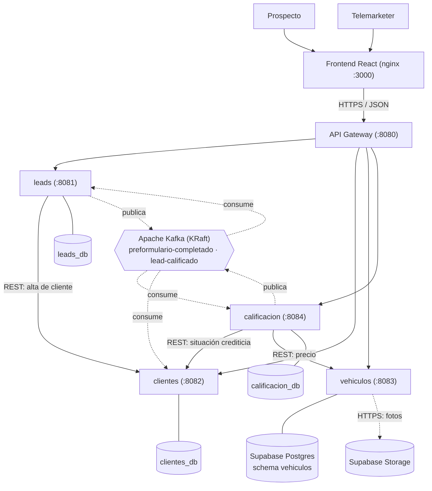
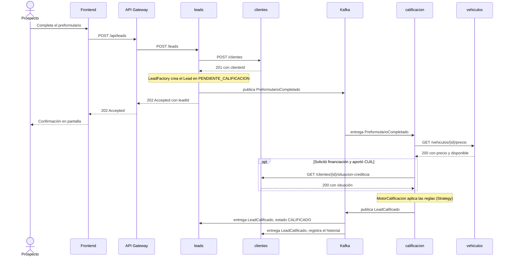
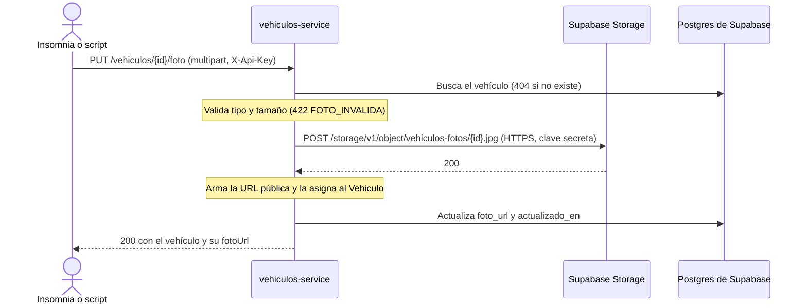

# Arquitectura del sistema de calificación de leads

Referencia de desarrollo del TP de Desarrollo de Aplicaciones II (UADE). Resume el *Documento de arquitectura v1.1* (octubre 2026) y el archivo `contratos-backend.md`, con foco en lo transversal a todos los servicios y en el microservicio `vehiculos`. Las convenciones de código se alinean con el repo de `clientes-service` (`ClientMicroservice`), que es el primer servicio implementado.

**Cómo leer las marcas**

- Sin marca: está definido en el documento de arquitectura v1.1.
- **[Decidido]**: lo decidió el responsable de `vehiculos` y no figura en el documento.
- **[Propuesta]**: no figura en el documento y no está acordado. Necesita acuerdo del equipo antes de darse por válido.
- **[A confirmar]**: punto abierto en el documento, en los contratos o en el repo de otro servicio.
- "como clientes-service": convención ya implementada en ese repo.

Si este archivo contradice al documento de arquitectura v1.1, se corrige este archivo. Las referencias `Doc §n` apuntan a secciones de ese documento.

## Índice

1. [Contexto y alcance](#1-contexto-y-alcance)
2. [Visión general](#2-visión-general)
3. [Comunicación entre servicios](#3-comunicación-entre-servicios)
4. [Diseño interno de un servicio](#4-diseño-interno-de-un-servicio)
5. [Convenciones transversales](#5-convenciones-transversales)
6. [Patrones de diseño](#6-patrones-de-diseño)
7. [Decisiones de arquitectura](#7-decisiones-de-arquitectura)
8. [Requerimientos no funcionales](#8-requerimientos-no-funcionales)
9. [Despliegue y trabajo en equipo](#9-despliegue-y-trabajo-en-equipo)
10. [Servicio vehiculos](#10-servicio-vehiculos)
11. [Puntos abiertos y diferencias entre documentos](#11-puntos-abiertos-y-diferencias-entre-documentos)
12. [Tecnologías aplicables a vehiculos](#12-tecnologías-aplicables-a-vehiculos)

---

## 1. Contexto y alcance

### 1.1 Problema

Una agencia de autos usados recibe unos 150 contactos por día (180 en picos de campaña) y los trabaja con chats, planillas y un cuaderno. Cuatro telemarketers tienen que calificar todos esos contactos sin una herramienta que los ordene. Las consecuencias: los contactos se enfrían, el vendedor recibe prospectos que no pueden comprar y el prospecto llega con la ficha incompleta (sobre todo sin situación crediticia).

El caso viene de un relevamiento real, pero la agencia no avanzó con el proyecto. El equipo lo usa como caso de estudio y las reglas de calificación son decisiones de diseño, no reglas validadas por un cliente real.

### 1.2 MVP

El prospecto completa un preformulario, el sistema lo califica automáticamente en tres niveles (**No potable**, **Potable**, **Muy potable**) y el telemarketer lo ve en una cola ordenada, con el motivo de cada clasificación y la posibilidad de corregirla.

### 1.3 Alcance por entrega

| Entrega | Qué se construye |
|---|---|
| Primera Parte | Servicios `leads`, `clientes`, `vehiculos` y `calificacion` sobre Spring Boot. API Gateway y Kafka con los eventos `PreformularioCompletado` y `LeadCalificado`. Motor de reglas con patrones. Precalificación crediticia simulada detrás de una interfaz. Frontend mínimo (preformulario y cola). Diagramas y documentación de patrones. |
| Segunda Parte | Servicio `precalificacion` (SOAP, API del BCRA), servicio `ia-resumen` (LLM, asincrónico por Kafka), contratos REST con OpenAPI y evidencias de prueba. Servicio `monitor` opcional. |
| Integrador | RNF del componente de IA, pruebas funcionales, de integración y de carga básica, patrón outbox, manual de despliegue y demo. |

**Fuera de alcance:** WhatsApp, Instagram, Facebook y Meta Ads; bandeja compartida; agenda y alertas; tablero de indicadores; integración con las financieras; gestión completa de stock desde la planilla de Drive; perfiles de acceso. La autenticación no forma parte de la Primera Parte y se evalúa para el Integrador.

### 1.4 Glosario mínimo

| Término | Definición |
|---|---|
| Lead | Contacto que completó el preformulario. Es la unidad de trabajo del sistema. |
| Preformulario | Formulario en dos pasos. El paso 2 (CUIL y consentimiento) solo aplica a quien solicita financiación. |
| Anticipo | Monto en efectivo que el cliente puede entregar. |
| Permuta | Vehículo usado que el cliente entrega como parte de pago. |
| Clavo | Permuta invendible. No se computa para calificar. |
| Cobertura | (anticipo + permuta computable) / precio de la unidad. Por eso `calificacion` necesita el precio que sirve `vehiculos`. |
| Nivel de calificación | No potable (menos de 20 puntos), Potable (20 a 59), Muy potable (60 o más). |
| Historial de calificaciones | Registro, en `clientes`, de todas las calificaciones de un cliente, con el lead de cada una. |

---

## 2. Visión general

### 2.1 Estilo arquitectónico

Microservicios con una base de datos por servicio, un API Gateway como único punto de entrada del frontend y Apache Kafka como bus de eventos. Cada servicio es dueño de sus datos y solo se accede a ellos por su API o por los eventos que publica. **Ningún servicio lee la base de otro.** Las relaciones entre servicios son por identificador (UUID), nunca por clave foránea.

### 2.2 Arquitectura de la Primera Parte



Las flechas continuas son llamadas REST sincrónicas y conexiones a bases. Las punteadas son eventos asincrónicos por Kafka, salvo la de `vehiculos` a Supabase Storage, que es una llamada HTTPS saliente.

### 2.3 Servicios, responsables y puertos

| Servicio | Responsable | Puerto | Base | Responsabilidad |
|---|---|---|---|---|
| `leads` | Iván | 8081 | `leads_db` | Recibe el preformulario, es dueño del lead (estructura completa del formulario), su ciclo de vida y la cola del telemarketer. |
| `clientes` | Juan | 8082 | `clientes_db` | Solo datos personales del cliente, CUIL y consentimiento; situación crediticia; historial de calificaciones. |
| `vehiculos` | Naim | 8083 | Supabase (schema `vehiculos`) | Inventario de unidades, historial de precios y fotos. |
| `calificacion` | Manual | 8084 | `calificacion_db` | Motor de reglas, calificación vigente y correcciones manuales. |
| `gateway` | A definir más adelante | 8080 | no tiene | Entrada única, ruteo, CORS y `correlationId`. |
| frontend | Franco y Joaco | 3000 | no tiene | Preformulario y cola del telemarketer. |
| `monitor` (opcional, Segunda Parte) | A definir | 8085 | propia | Verifica salud y flujo entre servicios con datos de prueba. |

Los servicios de negocio solo son accesibles desde la red interna de Docker. Solo el frontend y el gateway exponen puertos al exterior. Mientras el gateway no esté integrado, cada servicio publica su puerto al host en su propio compose (como clientes-service).

---

## 3. Comunicación entre servicios

### 3.1 Cuándo REST y cuándo eventos

Si el que llama necesita la respuesta para seguir, se usa REST. Si solo necesita avisar que algo pasó, se publica un evento.

- `leads` necesita el `clienteId` para guardar el lead: llama a `clientes` por REST.
- `calificacion` necesita el precio para calcular la cobertura: llama a `vehiculos` por REST.
- `leads` no necesita esperar la calificación para responderle al prospecto: publica un evento y responde `202 Accepted`.

Si `calificacion` está lenta o caída, los eventos esperan en Kafka y se procesan cuando vuelve.

### 3.2 Flujo del MVP



El repo de `clientes-service` propone cambiar el orden del alta (el frontend registra primero al cliente y luego al lead). Está registrado en la [sección 11](#11-puntos-abiertos-y-diferencias-entre-documentos) y no cambia nada para `vehiculos`.

### 3.3 Eventos de dominio y eventos de integración

- **Eventos de dominio:** viven dentro de un servicio y se publican con `ApplicationEventPublisher` de Spring. Ejemplo: `CalificacionCalculada` en `calificacion`.
- **Eventos de integración:** cruzan servicios por Kafka. Son contratos públicos: cambiarlos exige versionarlos. No llevan datos personales ni CUIL, solo identificadores y datos del negocio.

### 3.4 Tópicos de Kafka

| Tópico | Productor | Consumidores | Clave | Entrega |
|---|---|---|---|---|
| `preformulario-completado` | `leads` | `calificacion` | `leadId` | Primera |
| `lead-calificado` | `calificacion` | `leads`, `clientes`, `ia-resumen` | `leadId` | Primera (`ia-resumen` en la Segunda) |
| `resumen-generado` | `ia-resumen` | `leads` | `leadId` | Segunda |
| `{tópico}.DLT` | error handler | monitoreo manual | `leadId` | Primera |

La clave `leadId` garantiza que los eventos de un mismo lead caigan en la misma partición y se procesen en orden. Los tópicos `.DLT` (dead letter topic) reciben los mensajes que fallaron tras los reintentos configurados, para que uno con error no bloquee al resto.

`LeadCalificado` lleva `leadId`, `clienteId`, `nivel`, `puntaje`, `origen` y los motivos de cada regla, para que `clientes` registre el historial sin consultar a `calificacion`.

### 3.5 Sobre común de los eventos

```json
{
  "eventId": "8f2c1a4e-6b1d-4c2a-9e3f-1a2b3c4d5e6f",
  "eventType": "PreformularioCompletado",
  "version": 1,
  "occurredAt": "2026-09-22T14:03:11Z",
  "correlationId": "c0a8012e-7f3b-4d8a-b1c2-9d8e7f6a5b4c",
  "payload": {
    "leadId": "3b9d6c2e-1f4a-4e8b-9c7d-2a1b3c4d5e6f",
    "clienteId": "a1b2c3d4-e5f6-4a7b-8c9d-0e1f2a3b4c5d",
    "vehiculoId": "9e8d7c6b-5a4f-4e3d-2c1b-0a9f8e7d6c5b",
    "anticipo": 3000000,
    "tienePermuta": true,
    "valorPermutaDeclarado": 3000000,
    "permutaComputable": true,
    "provincia": "BUENOS_AIRES",
    "solicitaFinanciacion": false
  }
}
```

- `eventId` permite descartar duplicados: Kafka garantiza entrega al menos una vez.
- `correlationId` permite seguir un flujo en los logs de todos los servicios.
- Los records de los eventos viven en el módulo `contracts`, compartido por todos los servicios (AD-08). Un cambio en un contrato se discute en un pull request que revisan los responsables de productores y consumidores.

**`vehiculos` no publica ni consume eventos en la Primera Parte.**

---

## 4. Diseño interno de un servicio

Todos los servicios siguen la misma estructura de capas. La dependencia apunta siempre hacia el dominio: el dominio no conoce Spring Data, Kafka ni clientes HTTP, sino interfaces (puertos) que la infraestructura implementa.

| Capa | Contenido |
|---|---|
| Presentación / adaptadores de entrada | Controllers REST, DTOs de request y response, listeners de Kafka, manejo global de errores |
| Aplicación / servicios | Casos de uso, Facades, transacciones, publicación de eventos de dominio |
| Dominio | Entidades, value objects, reglas de negocio, eventos de dominio, puertos (interfaces) |
| Infraestructura / adaptadores de salida | Persistencia (repositorios JPA), clientes HTTP de otros servicios, productores de Kafka, almacenamiento externo |
| Transversal | Configuración externalizada, logging estructurado, `correlationId`, validación |

Estructura de paquetes de referencia (ejemplo de `calificacion`, Doc §10.1):

```
com.uade.crm.calificacion
├── api              controllers REST, DTOs, listeners de Kafka, @ControllerAdvice
├── application      CalificacionFacade, casos de uso, listeners de eventos de dominio
├── domain
│   ├── model        Calificacion, MotivoCalificacion, NivelCalificacion
│   ├── reglas       ReglaCalificacion y sus implementaciones, MotorCalificacion
│   ├── event        CalificacionCalculada
│   └── port         VehiculosPort, SituacionCrediticiaPort
├── infrastructure
│   ├── persistence  entidades JPA y repositorios
│   ├── client       VehiculosRestClient, ClientesRestClient
│   └── messaging    LeadCalificadoPublisher
└── config           propiedades de umbrales y puntos, beans
```

La estructura de `vehiculos` está en la [sección 10.10](#1010-estructura-de-paquetes).

---

## 5. Convenciones transversales

### 5.1 Convenciones generales

| Tema | Convención |
|---|---|
| Identificadores | UUID en todos los servicios. Todo se identifica por UUID (`clienteId`, `leadId`, `vehiculoId`). |
| Tipos de datos | `UUID` para ids, `BigDecimal` para dinero, `Instant` para fechas y horas (como clientes-service). En JSON los montos viajan como números, no como strings. |
| Enums en JSON | ASCII en mayúsculas con guion bajo (`BUENOS_AIRES`, `INSTAGRAM`). Un enum que usan varios servicios vive en `contracts`; uno que usa un solo servicio es local. |
| Errores REST | `ProblemDetail` (RFC 7807) con `codigo` estable, `correlationId` y, en validación, la lista `errores`. Ver 5.3. |
| Trazabilidad | `CorrelationIdFilter`: toma `X-Correlation-Id` del request o genera un UUID, lo deja en el MDC, lo devuelve en la respuesta y lo escribe en cada línea de log. El gateway lo genera (AD-10) y los servicios lo propagan a logs, llamadas salientes y eventos. El front no lo envía. |
| Autenticación | Ninguna de usuarios en la Primera Parte. Los endpoints internos de escritura pueden exigir `X-Api-Key` (clientes-service lo hace en `POST /clientes`). |
| CORS | Lo resuelve el gateway. |
| Documentación de APIs | OpenAPI con springdoc: `/v3/api-docs` y Swagger UI en `/swagger-ui.html`. |
| Migraciones | Flyway en cada servicio, una migración por cambio. Nunca se edita una migración ya mergeada. |
| Configuración | `@ConfigurationProperties` como record validado, con prefijo por servicio y variables de entorno `{SERVICIO}_*`. Perfiles `local` y `docker`. El servicio no arranca si falta una variable obligatoria (RNF-07). |
| Privacidad | El CUIL solo existe en `clientes`. Nunca viaja en rutas, parámetros, eventos ni logs sin enmascarar. |
| Secretos | Nunca en el repo, en logs ni en chats. `.env` en `.gitignore` y `.env.example` commiteado con placeholders. |
| Idempotencia | Los consumidores descartan eventos con un `eventId` ya procesado (RNF-04). |
| Datos de prueba | Ficticios en todos los entornos. |
| Pruebas | JUnit 5, Mockito, AssertJ y Testcontainers. Los tests nunca usan servicios cloud. |

### 5.2 Convenciones de código (como clientes-service)

- Código, nombres de dominio y mensajes de error en español. Palabras técnicas en inglés.
- Sin Lombok ni MapStruct. Los DTOs son `record` con un método estático `de(...)` para construirse desde el dominio. Los request recortan los textos en el constructor compacto antes de validar.
- Las entidades de dominio tienen constructor privado y `builder()` escrito a mano. La persistencia las reconstruye con el mismo builder. Los accesores no usan `get` (`id()`, `precio()`) y los campos opcionales devuelven `Optional`.
- Puerto de persistencia en `domain.port` con nombre `XxxRepositorio`; adaptador `XxxRepositorioJpa` (visibilidad de paquete) en `infrastructure.persistence`, que delega en una interfaz Spring Data `XxxJpaRepository` y traduce con `aEntidad` y `aDominio`. La entidad JPA `XxxEntity` tiene getters y setters de paquete.
- Servicios de aplicación por caso de uso (`AltaXxxService`, `ConsultaXxxService`), no una fachada única, salvo que el patrón Facade lo justifique.
- `Clock` inyectado como bean (`DominioConfig`) para que el tiempo sea testeable.
- `spring.jpa.open-in-view: false` y `ddl-auto: validate`.
- Un `package-info.java` por paquete.
- Actuator expone solo `health`, con probes habilitados.
- Spring Boot 3.5.x (clientes-service usa 3.5.16), Java 21, springdoc 2.9.1. POM padre `crm-parent`, groupId `com.uade.crm`.
- Estructura de tests: `PostgresDePrueba` (contenedor PostgreSQL con `@ServiceConnection`), la anotación `@PruebaIntegracion` que arma el contexto completo, y `PruebaWebMvc` para controllers.

### 5.3 Errores

Todo error de la API responde `application/problem+json`. Ejemplo de validación:

```json
{
  "type": "https://crm.uade.local/errores/validacion",
  "title": "Datos inválidos",
  "status": 422,
  "detail": "Hay campos que no cumplen las validaciones",
  "instance": "/vehiculos",
  "codigo": "VALIDACION",
  "correlationId": "c0a8012e-7f3b-4d8a-b1c2-9d8e7f6a5b4c",
  "errores": [
    { "campo": "caja", "mensaje": "no debe ser nulo" }
  ]
}
```

Catálogo base de códigos comunes a los servicios:

| `codigo` | HTTP | Cuándo |
|---|---|---|
| `VALIDACION` | 422 | Falla de Bean Validation, o un valor que no se puede convertir al tipo del campo (por ejemplo un enum fuera de rango). Incluye la lista `errores` con `campo` y `mensaje`. |
| `JSON_INVALIDO` | 400 | Cuerpo mal formado. |
| `SOLICITUD_INVALIDA` | 400 | Error 4xx que resuelve Spring MVC (método no permitido, ruta inexistente). |
| `CLAVE_SERVICIO_INVALIDA` | 401 | Falta `X-Api-Key` o no coincide, en un endpoint que la exige. Se evalúa antes de validar el cuerpo. |
| `ERROR_INTERNO` | 500 | Error no controlado. Se loguea con la excepción y se responde sin detalle. |

Cada servicio agrega sus propios códigos (por ejemplo `CLIENTE_NO_ENCONTRADO`, `VEHICULO_NO_ENCONTRADO`). **[Propuesta]** adoptar este formato en todos los servicios. Cierra el punto "formato de errores por campo" que figuraba como [A confirmar].

### 5.4 Rutas a través del gateway

El documento dice que cada servicio se expone bajo `/api/{servicio}` y que las tablas de endpoints listan rutas internas. Eso deja ambigua la URL final (`/api/vehiculos/vehiculos` o `/api/vehiculos`). **[A confirmar]**

**[Propuesta]** El frontend llama a `/api/{recurso}`, el gateway quita el primer segmento (`StripPrefix=1`) y cada servicio expone `/{recurso}`. Coincide con lo que ya asume `src/utils/constants.js` del frontend y con el README de clientes-service.

| Frontend llama a | Gateway enruta a | Ruta interna del servicio |
|---|---|---|
| `/api/leads` | `leads:8081` | `/leads` |
| `/api/clientes` | `clientes:8082` | `/clientes` |
| `/api/vehiculos` | `vehiculos:8083` | `/vehiculos` |
| `/api/calificaciones` | `calificacion:8084` | `/calificaciones` |

---

## 6. Patrones de diseño

La consigna de la Primera Parte pide Factory, Repository, Strategy, Observer y Facade. El documento recomienda además patrones por servicio para que cada uno tenga al menos tres (AD-15).

| Servicio | Patrones |
|---|---|
| `vehiculos` | Repository, Builder, Strategy (almacenamiento de fotos) |
| `clientes` | Decorator, Factory, Observer (y Repository) |
| `leads` | Factory, State, Facade (y Observer) |
| `calificacion` | Strategy, Factory, Facade (y Observer) |
| `gateway` | Chain of Responsibility |
| `monitor` (opcional) | Strategy, Observer, Composite |

| Patrón | Dónde | Qué resuelve |
|---|---|---|
| Strategy | `ReglaCalificacion` y sus implementaciones; `FotoStorage` con `SupabaseFotoStorage` y `FotoStorageDeshabilitado`; `Verificacion` | Cada criterio o variante es una clase intercambiable; agregar una no toca el resto. |
| Factory | `MotorCalificacionFactory`, `LeadFactory`, `ClienteFactory` | Construye objetos aplicando configuración o invariantes en un solo lugar. |
| Facade | `CalificacionFacade`, `RegistrarLeadFacade` | Una operación única que oculta la coordinación entre varias piezas. |
| Repository | `VehiculoRepositorio` (puerto) y `VehiculoRepositorioJpa` (adaptador); equivalentes en cada servicio | Aísla al dominio de la persistencia. |
| Observer | Eventos de dominio de Spring y eventos de integración de Kafka | Quien produce un hecho no conoce a quienes reaccionan. |
| Builder | `Vehiculo.builder()` | Evita constructores con muchos parámetros y valida invariantes en `build()`. |
| Decorator | `PrecalificacionConCache`, `PrecalificacionConLog` | Agrega responsabilidades a una interfaz sin tocar el adaptador. |
| State | `EstadoLead` | Cada estado decide qué transiciones permite. |
| Chain of Responsibility | Filtros del gateway | Cada filtro procesa la solicitud y la pasa al siguiente. |
| Composite | `VerificacionCompuesta` | Trata un conjunto de chequeos como uno solo. |

En Spring todos los beans son singleton por defecto, pero eso no se cuenta como patrón implementado.

---

## 7. Decisiones de arquitectura

| ID | Decisión | Alternativa descartada | Por qué |
|---|---|---|---|
| AD-01 | Microservicios desde la Primera Parte | Monolito modular | La Segunda Parte exige servicios SOAP, REST y mensajería; las entregas siguientes agregan servicios sin migrar. Costo: más infraestructura al inicio. |
| AD-02 | Una base por servicio, en una sola instancia de PostgreSQL | Base compartida | Independencia de datos entre servicios con poco consumo de memoria. |
| AD-03 | Apache Kafka en modo KRaft | RabbitMQ | Retiene eventos (reprocesar y auditar) y la partición por `leadId` da orden por lead. |
| AD-04 | Datos personales y CUIL aislados en `clientes` | Datos personales en `leads` | Minimización de datos de la Ley 25.326. |
| AD-05 | Calificación por reglas deterministas y configurables | Modelo de IA | El negocio necesita el motivo de cada clasificación. |
| AD-06 | `POST /leads` responde 202 y la calificación es asincrónica | Calificar en la misma request | Un pico de campaña o una caída de `calificacion` no pierden leads. |
| AD-07 | Sin transacciones distribuidas: el evento se publica después del commit | Two-phase commit o saga | Riesgo de perder el evento si el servicio cae justo después del commit; se resuelve con outbox en el Integrador. |
| AD-08 | Monorepo Maven multi-módulo con módulo `contracts` | Un repositorio por servicio | Productor y consumidor compilan contra el mismo contrato. |
| AD-09 | Precalificación detrás de un puerto, con adaptador simulado | Integrar el BCRA desde el inicio | Se cambia solo el adaptador en la Segunda Parte. |
| AD-10 | API Gateway desde la Primera Parte | Frontend llamando a cada servicio | Un único origen, CORS centralizado y un punto donde generar el `correlationId`. |
| AD-11 | Historial de calificaciones en `clientes` | Historial en `calificacion` | Pertenece al cliente, que puede tener más de un lead. |
| AD-12 | `clientes` guarda solo datos personales; el Lead es la estructura completa del preformulario | Ubicación, vehículo y permuta en `clientes` | Son datos del negocio, no del cliente. |
| AD-13 | CUIL obligatorio y validado si se solicita financiación; todo se identifica por UUID | CUIL opcional o usado como clave | Sin CUIL no hay situación crediticia; como clave no sirve y quedaría en los logs. |
| AD-14 | Servicio `monitor` opcional en la Segunda Parte | Solo chequeos de salud | Verifica con datos de prueba que la cadena completa integra bien. |
| AD-15 | Patrones de diseño recomendados por servicio | Limitarse a los cinco de la consigna | Al menos tres patrones por servicio. |

Las decisiones propias de `vehiculos` (DV-01 a DV-11) están en la [sección 10.3](#103-decisiones-de-vehiculos).

---

## 8. Requerimientos no funcionales

| ID | Atributo | Requerimiento | Aplica a `vehiculos` |
|---|---|---|---|
| RNF-01 | Disponibilidad de la ingesta | Ningún preformulario se pierde aunque `calificacion` esté caída. | Indirecto |
| RNF-02 | Rendimiento | Soportar 200 contactos diarios en pico; `POST /leads` responde en menos de 1 s. | `GET /vehiculos/{id}/precio` está en el camino de la calificación: consulta por clave primaria |
| RNF-03 | Privacidad | CUIL solo en `clientes` y enmascarado en logs y respuestas. | No maneja datos personales |
| RNF-04 | Idempotencia | Procesar dos veces el mismo evento no genera dos calificaciones. | No consume eventos |
| RNF-05 | Trazabilidad | Todo flujo se sigue por `correlationId`. | Sí: `CorrelationIdFilter` y `correlationId` en cada log |
| RNF-06 | Manejo de errores | `ProblemDetail`; reintentos acotados y DLT en consumidores. | Sí: `ProblemDetail` con `codigo` |
| RNF-07 | Configuración externalizada | Umbrales, URLs y credenciales por variables de entorno y perfiles. | Sí: incluye credenciales de Supabase |
| RNF-08 | Portabilidad | Todo se levanta con `docker compose up` en una máquina limpia. | Sí: con `infra/.env` completo con las credenciales compartidas del equipo |
| RNF-09 | Componente de IA | A definir en el Integrador. | No |

---

## 9. Despliegue y trabajo en equipo

### 9.1 Despliegue en laboratorio

Todo corre en contenedores orquestados con Docker Compose sobre la red interna `crm-net`. Los servicios se comunican por nombre de contenedor. Cada servicio puede tener además su propio `infra/docker-compose.yml` para trabajar solo (como clientes-service); el compose integrador reúne los de todos.

| Contenedor | Puerto | Observación |
|---|---|---|
| `frontend` | 3000 | Build estático servido por nginx |
| `gateway` | 8080 | Único punto de entrada para la API |
| `leads`, `clientes`, `vehiculos`, `calificacion` | 8081, 8082, 8083, 8084 | Solo accesibles desde la red interna. Cada compose individual los publica al host mientras no haya gateway |
| `kafka` | 9092 | Un broker en modo KRaft |
| `postgres` | 5432 | Una base por servicio, creadas por script de inicialización. `vehiculos` no lo usa: su base está en Supabase |
| `kafka-ui` | 8090 | Opcional, para inspeccionar tópicos |
| `monitor` | 8085 | Opcional, Segunda Parte |

### 9.2 Estructura del repositorio

El documento define un monorepo Maven multi-módulo (AD-08):

```
crm-leads/
├── pom.xml                  POM padre con versiones comunes
├── contracts/               records de eventos y enums compartidos
├── gateway/
├── leads-service/
├── clientes-service/
├── vehiculos-service/
├── calificacion-service/
├── monitor-service/         opcional, Segunda Parte
├── frontend/
├── infra/
│   ├── docker-compose.yml
│   └── postgres/init.sql
└── docs/
    ├── arquitectura.md      este documento
    └── diagramas/           fuentes editables de las figuras
```

Hoy `clientes-service` se desarrolla en un repo propio con esa misma raíz (POM padre `crm-parent`, módulo `contracts` y su servicio). `vehiculos` replica la estructura: copia el POM padre y `contracts` y agrega `vehiculos-service`. **[A confirmar]** cómo se unen los repos al integrar y cómo se mantiene un único `contracts`, para que las copias no diverjan.

### 9.3 Convenciones de Git

- `main` está protegida y solo recibe cambios por pull request con al menos una revisión.
- Ramas: `feature/{servicio}-{tema}`, por ejemplo `feature/vehiculos-fotos-supabase`.
- Commits: `tipo(servicio): descripción`, por ejemplo `feat(vehiculos): endpoint de precio`.
- Un cambio en `contracts` requiere la revisión de los responsables de todos los servicios afectados.

### 9.4 Reproducibilidad entre máquinas

Para que nadie dependa de su versión local de nada (como clientes-service):

- `Dockerfile` multi-stage con contexto en la raíz del repo: build con `maven:3.9-eclipse-temurin-21`, copiando primero los `pom.xml` para cachear dependencias, y runtime `eclipse-temurin:21-jre` con `curl` para el healthcheck y un usuario sin privilegios. No se usa Maven Wrapper.
- Compose con `healthcheck` sobre `/actuator/health` y `depends_on` con `condition: service_healthy`.
- Variables obligatorias con `${VAR:?mensaje}` para que el compose falle con un mensaje claro si falta una.
- `.env.example` commiteado y `.env` real en `.gitignore`.
- Java y Maven viven solo dentro del contenedor. Fuera de Docker, `mvn -pl {servicio}-service -am spring-boot:run` con el perfil `local` es opcional y requiere Java 21.

### 9.5 Base de datos en la nube: Supabase

**[Decidido]** `vehiculos` usa Supabase (PostgreSQL gestionado y Storage) desde el inicio. Cada servicio tiene su propia base y solo ese servicio se conecta a ella. El proyecto de Supabase de `vehiculos` lo comparte el equipo: el responsable pasa las credenciales por un canal seguro.

**Frente a Neon.** Solo como base, Neon es mejor en el plan gratuito: hasta 100 proyectos y sin pausa. El plan gratuito de Supabase incluye 2 proyectos activos, 500 MB de base, 1 GB de Storage y 5 GB de egress, y pausa los proyectos tras una semana sin actividad (valores consultados el 7 de octubre de 2026; conviene reverificarlos). Se elige Supabase porque Storage resuelve las fotos con el mismo proveedor y la misma cuenta.

**Conexión desde Spring.**

- **Session pooler, puerto 5432:** es el que usa el servicio. Es compatible con IPv4, funciona desde contenedores Docker y mantiene la sesión, así que Flyway y los prepared statements funcionan. Usuario `postgres.[project-ref]`, host `aws-0-[region].pooler.supabase.com` (se copia de la pestaña JDBC de Connect).
- **Conexión directa:** resuelve solo a IPv6. Falla en redes IPv4 y en Docker sin IPv6. No usarla salvo con el add-on IPv4 de pago.
- **Transaction pooler, puerto 6543:** no usarlo como datasource principal. Supabase lo desaconseja para ORMs porque no soporta prepared statements del lado del servidor.
- `sslmode=require` explícito: el valor por defecto `prefer` puede caer a una conexión sin cifrar.
- Usuario y clave van en variables separadas, no dentro de la URL, para no tener que escapar caracteres reservados (`&`, `#`, `?`, espacio).

**Seguridad.**

- **Schema propio.** Supabase otorga por defecto permisos sobre las tablas de `public` a los roles `anon`, `authenticated` y `service_role`, y una tabla sin Row Level Security expuesta por la Data API es accesible con esos roles. El servicio usa un schema propio (`vehiculos`) fuera de los schemas expuestos, como hace la guía de Supabase para Spring Boot con su schema `app`. Verificar en Settings > Data API que el schema no figure como expuesto. Esto aplica también a `clientes` si usa Supabase, porque guarda datos personales.
- **Clave secreta.** La clave `sb_secret_...` equivale al rol `service_role` y se salta Row Level Security. Solo vive en el backend: nunca en el frontend, el repo, los logs, un chat ni un mail. Una clave por componente. Si se filtra, se elimina de inmediato en el dashboard.
- **Pausa.** Pasada una semana sin actividad el proyecto se pausa. Los datos se conservan, pero hay que reactivarlo a mano desde el dashboard. Verificarlo antes de cada demo o entrega.
- **Credenciales compartidas [Decidido].** El equipo comparte las credenciales de este proyecto por un canal seguro (mensaje directo o gestor de contraseñas), nunca por issues, commits, el chat del repo ni capturas de pantalla. Se comparten solo la contraseña del rol del servicio, la clave secreta de Storage y la clave de escritura (`X-Api-Key`), no el acceso a la cuenta de Supabase. Se rotan al terminar la entrega.
- **Base compartida entre integrantes.** Cuando todos usan la misma base, solo el responsable de `vehiculos` define y aplica las migraciones. Si otro integrante corre contra la base compartida una rama con una migración nueva, Flyway la aplica y rompe la validación de los demás.

**Rol dedicado [Propuesta].** El servicio no se conecta con el rol `postgres`, que tiene control total sobre el proyecto. Se crea una vez, desde el SQL Editor de Supabase, un rol con permisos solo sobre su schema:

```sql
CREATE ROLE vehiculos_app LOGIN PASSWORD '<clave-larga-generada>';
CREATE SCHEMA vehiculos AUTHORIZATION vehiculos_app;
```

El usuario del pooler pasa a ser `vehiculos_app.[project-ref]`. Con este rol, un error o la filtración de la clave expone solo `vehiculos` y no el resto del proyecto. Verificar en la primera conexión que el pooler acepta el rol.

Fuentes: [precios de Supabase](https://supabase.com/pricing), [guía de Spring Boot](https://supabase.com/docs/guides/getting-started/quickstarts/spring-boot), [compatibilidad IPv4 e IPv6](https://supabase.com/docs/guides/troubleshooting/supabase--your-network-ipv4-and-ipv6-compatibility-cHe3BP), [límites de archivo de Storage](https://supabase.com/docs/guides/storage/uploads/file-limits), [API keys](https://supabase.com/docs/guides/api/api-keys), [protección de la Data API](https://supabase.com/docs/guides/api/securing-your-api).

---

## 10. Servicio vehiculos

### 10.1 Rol

Representa el inventario de la agencia: unidades, sus precios y sus fotos. En la propuesta original se leía de una planilla de Drive; en el TP tiene su propia base en Supabase con una carga inicial por script. Responsable: Naim. Puerto 8083.

### 10.2 Quién lo usa y qué no hace

| Consumidor | Qué usa | Para qué |
|---|---|---|
| Frontend (por el gateway) | `GET /vehiculos?disponible=true`, `GET /vehiculos/{id}` | Selector de vehículos del preformulario y sus filtros (RF01, RF05, RF11) |
| `calificacion` (REST directo) | `GET /vehiculos/{id}/precio` | Calcular la cobertura al calificar (RF05) |

Lo que **no** hace en la Primera Parte:

- No publica ni consume eventos de Kafka.
- No maneja datos personales ni CUIL.
- No tiene autenticación de usuarios.
- No tiene pantalla de alta o edición en el front: el alta se hace por Swagger o Insomnia y la edición solo cambia precio y disponibilidad (RF11).

### 10.3 Decisiones de vehiculos

| ID | Decisión | Alternativa descartada | Por qué |
|---|---|---|---|
| DV-01 **[Decidido]** | Base de `vehiculos` en Supabase (cloud) | Neon; solo Postgres local | Un proveedor para base y fotos. Costo: pausa a la semana y 2 proyectos activos por cuenta (9.5). |
| DV-02 **[Decidido]** | Fotos en Supabase Storage detrás del puerto `FotoStorage` (Strategy) | No cargar fotos; carpeta local servida por el servicio | Las fotos entran en esta entrega y el Strategy cubre el tercer patrón (AD-15) con un uso real. |
| DV-03 **[Decidido]** | `caja` obligatoria | Opcional | El front filtra por ese campo y toda unidad tiene caja. |
| DV-04 **[Propuesta]** | `caja` como enum `AUTOMATICA` y `MANUAL` en el JSON | Texto `Automática` y `Manual` | Es un conjunto cerrado que se valida y devuelve 422 con los valores aceptados. En ASCII evita los errores de codificación con acentos que clientes-service ya documentó con `curl.exe` en Windows. El front muestra la etiqueta. |
| DV-05 **[Decidido]** | `fotoUrl` y `version` opcionales, ambos texto | Obligatorios | No toda unidad tiene foto ni versión comercial. |
| DV-06 **[Decidido]** | `PUT /vehiculos/{id}` solo cambia `precio` y/o `disponible` | Reemplazo completo del vehículo | RF11: el resto de los datos no cambia después del alta. |
| DV-07 **[Decidido]** | `GET /vehiculos/{id}/precio` responde también si la unidad no está disponible | 404 o 409 | `calificacion` puede procesar un lead después de la venta. Riesgos y controles en 10.7. |
| DV-08 **[Propuesta]** | Schema propio `vehiculos` y rol dedicado `vehiculos_app` | `public` y el rol `postgres` | La Data API de Supabase expone `public`, y el rol `postgres` tiene control total sobre el proyecto (9.5). |
| DV-09 **[Decidido]** | El equipo comparte las credenciales del proyecto de Supabase por un canal seguro | Una base por integrante; modo local sin credenciales | Todos trabajan contra la misma base y cualquiera puede correr el repo. Se rotan al terminar la entrega. |
| DV-10 **[Decidido]** | Historial de precios: una fila por cada precio que rigió | Guardar solo el precio actual | Trazabilidad de la cobertura que calcula `calificacion`. Costo mínimo: una tabla y un insert en la misma transacción (10.6). |
| DV-11 **[Decidido]** | Las escrituras (`POST` y ambos `PUT`) exigen `X-Api-Key` | Escrituras abiertas | La Primera Parte no tiene autenticación de usuarios; sin esto cualquiera que llegue al gateway puede cambiar un precio. |

### 10.4 Modelo de datos

| Campo | Tipo | Obligatorio | Estado |
|---|---|---|---|
| `id` | UUID | Sí | Definido |
| `marca` | texto | Sí | Definido |
| `modelo` | texto | Sí | Definido |
| `anio` | entero | Sí | Definido |
| `kilometraje` | entero (km) | Sí | Definido |
| `precio` | numérico (`BigDecimal`) | Sí | Definido |
| `disponible` | booleano | Sí (por defecto `true` en el alta) | Definido |
| `caja` | `AUTOMATICA` o `MANUAL` | **Sí** | **[Decidido]** obligatoria. Estaba como opcional en el Builder del Doc §11 y como [A confirmar] en los contratos |
| `fotoUrl` | URL | No | **[Decidido]** opcional. En el Doc §8.3 |
| `version` | texto (por ejemplo "Exclusive CVT") | No | **[Decidido]** opcional. Es la versión comercial del modelo, no la versión de concurrencia: `vehiculos` no usa `@Version` de JPA |
| `creadoEn` | `Instant` | Sí | Interno. Lo fija el servicio al dar de alta. No viaja en la API |
| `actualizadoEn` | `Instant` | Sí | Interno. Se actualiza en cada cambio de precio, disponibilidad o foto. No viaja en la API |

Equivalencias con el mock actual del front (`src/data/vehicles.js`):

| Mock (`src/data/vehicles.js`) | Backend |
|---|---|
| `brand` | `marca` |
| `model` | `modelo` |
| `year` | `anio` |
| `km` | `kilometraje` |
| `transmission` (`Automática`, `Manual`) | `caja` (`AUTOMATICA`, `MANUAL`) |
| `price` | `precio` |
| `detail` | `version` |
| `fotoUrl` | `fotoUrl` |
| `tone`, `mark` | No viajan: son solo visuales del front |

### 10.5 API

| Método | Ruta (interna) | Respuesta | Uso |
|---|---|---|---|
| GET | `/vehiculos?disponible=true` | `200` con lista | Lista del preformulario. Sin el parámetro devuelve todas las unidades |
| GET | `/vehiculos/{id}` | `200` con el vehículo, `404` si no existe | Detalle. Responde `200` también si `disponible` es false |
| GET | `/vehiculos/{id}/precio` | `200` con `{ "precio": número, "disponible": booleano }`, `404` si no existe | Lo usa `calificacion`; el front no lo necesita |
| POST | `/vehiculos` | `201` con el vehículo y `Location`, `422` si es inválido | Alta |
| PUT | `/vehiculos/{id}` | `200` con el vehículo, `404`, `422` | Cambia `precio` y/o `disponible` (RF11). Si cambia el precio, registra una fila en el historial |
| PUT | `/vehiculos/{id}/foto` | `200` con el vehículo, `404`, `422` `FOTO_INVALIDA`, `503` `ALMACENAMIENTO_NO_DISPONIBLE` | **[Decidido]** Carga o reemplaza la foto (`multipart/form-data`, campo `archivo`) |
| GET | `/vehiculos/{id}/historial-precios` | `200` con la lista del más nuevo al más viejo, `404` si no existe | Historial de precios (DV-10) |

El documento solo dice `PUT /vehiculos`; la ruta con `{id}` es **[Propuesta]**. Como el `PUT` modifica solo algunos campos, su semántica es la de un `PATCH`; se mantiene `PUT` porque así figura en el documento y en el contrato, y el front no lo usa.

**[Decidido]** Los endpoints de escritura (`POST` y ambos `PUT`) exigen el header `X-Api-Key`, igual que `POST /clientes`, con la anotación `@RequiereClaveServicio`. La clave es un secreto compartido de al menos 32 caracteres que se configura en `VEHICULOS_CLAVE_ESCRITURA`. Sin ella el servicio responde `401` con `CLAVE_SERVICIO_INVALIDA` antes de leer el cuerpo. Las lecturas quedan abiertas. Es una medida de la API, no de la base: evita que cualquiera que llegue al gateway cambie un precio o suba una foto.

Alta (`POST /vehiculos`):

```json
{
  "marca": "Toyota",
  "modelo": "Corolla",
  "version": "XEI CVT",
  "anio": 2021,
  "kilometraje": 45000,
  "precio": 10000000,
  "disponible": true,
  "caja": "AUTOMATICA"
}
```

Actualización (`PUT /vehiculos/{id}`): ambos campos son opcionales, pero al menos uno es obligatorio y `precio` debe ser mayor que cero. Cualquier otro campo se rechaza.

```json
{ "precio": 10500000, "disponible": false }
```

Respuesta de `GET /vehiculos/{id}` (datos ficticios; `<ref>` es el project-ref del proyecto de Supabase):

```json
{
  "id": "9e8d7c6b-5a4f-4e3d-2c1b-0a9f8e7d6c5b",
  "marca": "Toyota",
  "modelo": "Corolla",
  "version": "XEI CVT",
  "anio": 2021,
  "kilometraje": 45000,
  "precio": 10000000,
  "disponible": true,
  "caja": "AUTOMATICA",
  "fotoUrl": "https://<ref>.supabase.co/storage/v1/object/public/vehiculos-fotos/9e8d7c6b-5a4f-4e3d-2c1b-0a9f8e7d6c5b.jpg"
}
```

Respuesta de `GET /vehiculos/{id}/precio`:

```json
{ "precio": 10000000, "disponible": true }
```

Respuesta de `GET /vehiculos/{id}/historial-precios`:

```json
[
  { "precio": 10500000, "vigenteDesde": "2026-10-07T18:20:00Z" },
  { "precio": 10000000, "vigenteDesde": "2026-09-22T14:03:11Z" }
]
```

Error de ejemplo, vehículo inexistente:

```json
{
  "type": "https://crm.uade.local/errores/vehiculo-no-encontrado",
  "title": "Vehículo no encontrado",
  "status": 404,
  "detail": "No existe un vehículo con id 9e8d7c6b-5a4f-4e3d-2c1b-0a9f8e7d6c5b",
  "instance": "/vehiculos/9e8d7c6b-5a4f-4e3d-2c1b-0a9f8e7d6c5b",
  "codigo": "VEHICULO_NO_ENCONTRADO",
  "correlationId": "c0a8012e-7f3b-4d8a-b1c2-9d8e7f6a5b4c"
}
```

Códigos propios de `vehiculos` (además del catálogo base de 5.3):

| `codigo` | HTTP | Cuándo |
|---|---|---|
| `VEHICULO_NO_ENCONTRADO` | 404 | El id no existe. |
| `FOTO_INVALIDA` | 422 | El archivo no es JPEG, PNG o WebP, está vacío o supera el tamaño máximo. |
| `ALMACENAMIENTO_NO_DISPONIBLE` | 503 | Supabase Storage no responde, rechazó la subida, o el modo de fotos es `deshabilitado`. |

### 10.6 Reglas y comportamiento

- **Invariantes** (validadas en `Vehiculo.builder().build()` y al actualizar): precio positivo, kilometraje mayor o igual a 0, marca y modelo no vacíos, `caja` presente. **[Propuesta]** rango de año: entre 1950 y el año actual más uno, calculado con el `Clock` inyectado.
- **Validación en el borde:** los DTOs de request se validan con Bean Validation y devuelven `VALIDACION` con la lista `errores`. El Builder protege al dominio aunque el DTO falle.
- **Filtrado:** el servidor solo filtra por `disponible`. El front trae la lista completa una vez y filtra en memoria (marca, modelo, caja, año, rangos de precio y kilometraje). Sin paginación en el MVP; si el stock creciera mucho, habría que paginar o filtrar en el servidor.
- **Precio:** `BigDecimal` en el servicio y número en el JSON. El front muestra el formato.
- **Historial de precios (DV-10):** `precio_historial` guarda una fila por cada precio que rigió, con `vigente_desde`. Se escribe en la misma transacción que el alta (precio inicial) y que cada `PUT` que cambia el precio. Un `PUT` que solo cambia `disponible`, o que envía el mismo precio, no escribe nada. Es de solo agregado: nunca se edita ni se borra, y la fila más reciente coincide siempre con `vehiculo.precio`.
- **Fechas:** `creado_en` y `actualizado_en` son columnas `TIMESTAMPTZ` mapeadas como `Instant`, y las fija el servicio con el `Clock` inyectado. Sirven para auditar y depurar; no viajan en la API.
- **Sin control de concurrencia optimista:** el último `PUT` gana. Alcanza porque las actualizaciones de precio son raras y las hace una persona.

### 10.7 Disponibilidad y precio: riesgos y controles

`GET /vehiculos/{id}/precio` responde `200` aunque la unidad no esté disponible (DV-07). Para el equipo y para el front:

| Riesgo | Control |
|---|---|
| Un consumidor lee el precio de una unidad vendida como si estuviera vigente. | La respuesta incluye `disponible`. Es un campo agregado al contrato actual `{ "precio": número }` y no rompe a quien lo ignore. |
| `calificacion` puede calificar un lead contra una unidad ya vendida. | `vehiculos` solo informa. El responsable de `calificacion` decide si califica igual y deja la no disponibilidad en los motivos, o si marca el lead para revisión. |
| El precio cambia entre la calificación y una lectura posterior (RF11). | `vehiculos` guarda el historial (`GET /vehiculos/{id}/historial-precios`). Aun así, `calificacion` debe persistir el precio que usó al calcular, para no depender de una consulta posterior. |
| La ficha de un lead referencia un vehículo vendido. | `GET /vehiculos/{id}` también responde `200` con `disponible: false`. El front tiene que tolerarlo y mostrar "No disponible". La lista del preformulario ya filtra por `disponible=true`. |
| El id no existe. | `404` con `VEHICULO_NO_ENCONTRADO`. `calificacion` tiene que manejarlo: no hay precio, no hay cobertura. |
| El endpoint está en el camino de cada calificación (RNF-02). | Consulta por clave primaria, sin joins ni caché en la Primera Parte. |

### 10.8 Fotos con Supabase Storage

**[Decidido]** Las fotos se guardan en Supabase Storage y la base guarda solo `fotoUrl`.

- **Bucket público** `vehiculos-fotos`: las lecturas no requieren autenticación, así que el front muestra `fotoUrl` con un `` común. Subir, reemplazar y borrar sí están controlados.
- **URL pública:** `{SUPABASE_URL}/storage/v1/object/public/{bucket}/{archivo}`.
- **Nombre del objeto:** `{vehiculoId}.{extensión}`. Una nueva carga con `x-upsert: true` pisa la anterior; si cambia la extensión, se borra el objeto viejo.
- **Subida:** `POST {SUPABASE_URL}/storage/v1/object/{bucket}/{archivo}` con el cuerpo del archivo y su `Content-Type`. La hace el backend con la clave secreta de Supabase, nunca el front. Se usa `RestClient` de Spring con timeouts, sin dependencias nuevas.
- **Autenticación de la llamada:** las claves `sb_secret_...` se envían en el header `apikey`, no en `Authorization: Bearer`. Las claves legacy `service_role` (JWT) siguen funcionando hasta que Supabase las retire y van como `Bearer`.
- **Validaciones [Propuesta]:** JPEG, PNG o WebP, no vacío, máximo 2 MB. El límite global de Storage en el plan gratuito es 50 MB por archivo, así que el tope de 2 MB lo impone el servicio.
- **Cuotas del plan gratuito:** 1 GB de Storage y 5 GB de egress, compartidos con el resto del proyecto.
- **Falla parcial:** si la subida sale bien y el guardado en la base falla, queda un objeto huérfano. Es aceptable: el reintento escribe el mismo nombre.
- **Foto ausente:** si `fotoUrl` es nulo o la imagen no carga, el front muestra un bloque de color con iniciales.

Los endpoints de la subida se derivaron del código fuente de `storage-js`, el cliente oficial de Supabase, no de la documentación REST. No requieren una verificación aparte: los casos 10 y 11 de Insomnia (10.15) los ejercitan en la primera subida real, y si alguno falla el error de Storage indica qué ajustar.

**Cómo llega la URL a la base.** El archivo viaja a Storage por HTTPS y la base guarda solo el texto de la URL. Son dos conexiones distintas: Postgres por JDBC (`VEHICULOS_DB_*`) y Storage por HTTP (`VEHICULOS_SUPABASE_URL` y la clave secreta).



El bucket `vehiculos-fotos` se crea una vez a mano en el dashboard, como público, con tamaño máximo de 2 MB y tipos permitidos `image/jpeg`, `image/png` e `image/webp`. Storage permite fijar esas restricciones por bucket, como segunda barrera detrás de la validación del servicio.

**Strategy `FotoStorage`.** Una interfaz del dominio con dos implementaciones, elegidas por `vehiculos.fotos.modo` (como `situacion-crediticia.modo` en clientes-service):

| Modo | Clase | Comportamiento |
|---|---|---|
| `supabase` | `SupabaseFotoStorage` | Sube y borra en Supabase Storage y devuelve la URL pública. |
| `deshabilitado` | `FotoStorageDeshabilitado` | Rechaza la carga con `ALMACENAMIENTO_NO_DISPONIBLE`. Permite correr el servicio sin credenciales. |

Los tests usan una implementación falsa en memoria. Ningún test llama a Supabase.

### 10.9 Patrones aplicados

| Patrón | Clase | Por qué |
|---|---|---|
| Repository | `VehiculoRepositorio` (puerto) y `VehiculoRepositorioJpa` (adaptador sobre Spring Data) | Aísla el dominio de la persistencia. Es el patrón más natural en un inventario con altas, consultas y actualizaciones. |
| Builder | `Vehiculo.builder()` | La unidad tiene muchos campos y varios opcionales (`version`, `fotoUrl`). Evita constructores de diez parámetros y valida invariantes en `build()`. |
| Strategy | `FotoStorage` con `SupabaseFotoStorage` y `FotoStorageDeshabilitado` | Cambiar dónde se guardan las fotos no toca el resto del servicio. |


En el código, `VehiculoBuilder` es la clase anidada `Vehiculo.Builder`.

### 10.10 Estructura de paquetes

**[Propuesta]** Sigue las capas de la sección 4 y los nombres de clientes-service.

```
com.uade.crm.vehiculos
├── api
│   ├── VehiculoController
│   ├── dto            AltaVehiculoRequest, ActualizacionVehiculoRequest, VehiculoResponse, PrecioResponse,
│   │                  PrecioHistoricoResponse
│   ├── error          ApiExceptionHandler (@RestControllerAdvice), CodigoError
│   └── seguridad      ClaveServicioInterceptor, RequiereClaveServicio, ClaveServicioInvalidaException
├── application        ConsultaVehiculoService, AltaVehiculoService, ActualizacionVehiculoService, FotoVehiculoService
├── domain
│   ├── model          Vehiculo (con Builder), Caja, PrecioHistorico, ArchivoFoto, VehiculoNoEncontradoException,
│   │                  FotoInvalidaException, AlmacenamientoNoDisponibleException
│   └── port           VehiculoRepositorio, FotoStorage
├── infrastructure
│   ├── persistence    VehiculoEntity, VehiculoJpaRepository, VehiculoRepositorioJpa,
│   │                  PrecioHistorialEntity, PrecioHistorialJpaRepository
│   └── storage        SupabaseFotoStorage, FotoStorageDeshabilitado
└── config             VehiculosProperties, CorrelationIdFilter, DominioConfig, OpenApiConfig, WebConfig
```

Cada paquete lleva su `package-info.java`. El mapeo entre dominio, entidad y DTO es manual.

### 10.11 Datos y migraciones

**[Propuesta]** Migración Flyway `V1__vehiculo.sql` en el schema `vehiculos`, que se crea una vez junto con el rol `vehiculos_app` (9.5):

```sql
CREATE TABLE vehiculo (
    id             UUID PRIMARY KEY,
    marca          VARCHAR(60)    NOT NULL,
    modelo         VARCHAR(80)    NOT NULL,
    version        VARCHAR(80),
    anio           INTEGER        NOT NULL,
    kilometraje    INTEGER        NOT NULL CHECK (kilometraje >= 0),
    precio         NUMERIC(14, 2) NOT NULL CHECK (precio > 0),
    disponible     BOOLEAN        NOT NULL DEFAULT TRUE,
    caja           VARCHAR(15)    NOT NULL CHECK (caja IN ('AUTOMATICA', 'MANUAL')),
    foto_url       VARCHAR(500),
    creado_en      TIMESTAMPTZ    NOT NULL,
    actualizado_en TIMESTAMPTZ    NOT NULL
);

CREATE INDEX ix_vehiculo_disponible ON vehiculo (disponible);

CREATE TABLE precio_historial (
    id            UUID PRIMARY KEY,
    vehiculo_id   UUID           NOT NULL REFERENCES vehiculo (id),
    precio        NUMERIC(14, 2) NOT NULL CHECK (precio > 0),
    vigente_desde TIMESTAMPTZ    NOT NULL
);

CREATE INDEX ix_precio_historial_vehiculo ON precio_historial (vehiculo_id, vigente_desde DESC);
```

Cada fila de `precio_historial` es un precio que empezó a regir en `vigente_desde`; el precio anterior es la fila previa. La clave foránea es válida porque ambas tablas son del mismo servicio: la regla de no usar claves foráneas aplica entre servicios.

La carga inicial va en migraciones de seed (`db/seed/`), activadas por perfil, separadas del esquema (`db/migration/`). Datos ficticios, con variedad de marcas, cajas, años, precios y kilometrajes para probar los filtros del front. Incluir al menos una unidad con `disponible = false`. Las fotos del seed quedan en `NULL`. Cada unidad del seed lleva su fila inicial en `precio_historial`.

### 10.12 Configuración y perfiles

**[Propuesta]** Todo por variables de entorno (RNF-07), validado al arrancar con un record `VehiculosProperties` (prefijo `vehiculos`). El servicio no arranca si falta una variable obligatoria o si quedó un placeholder sin resolver, y los `toString` de las propiedades secretas devuelven `****`.

| Variable | Ejemplo | Uso |
|---|---|---|
| `VEHICULOS_DB_URL` | `jdbc:postgresql://aws-0-<region>.pooler.supabase.com:5432/postgres?sslmode=require` | Conexión por session pooler |
| `VEHICULOS_DB_USUARIO` | `vehiculos_app.<project-ref>` | Rol dedicado del servicio (9.5). No se commitea |
| `VEHICULOS_DB_CLAVE` | | Contraseña. No se commitea |
| `VEHICULOS_FOTOS_MODO` | `supabase` o `deshabilitado` | Estrategia de `FotoStorage`. `deshabilitado` sirve para correr el servicio con las credenciales de la base pero sin la clave de Storage |
| `VEHICULOS_SUPABASE_URL` | `https://<project-ref>.supabase.co` | Solo en modo `supabase` |
| `VEHICULOS_SUPABASE_CLAVE_SECRETA` | `sb_secret_...` | Solo en modo `supabase`. Nunca en logs |
| `VEHICULOS_FOTOS_BUCKET` | `vehiculos-fotos` | Bucket público de Storage |
| `VEHICULOS_CLAVE_ESCRITURA` | mínimo 32 caracteres | Secreto compartido de los endpoints de escritura (`X-Api-Key`). Se genera con `openssl rand -base64 32` |

Perfiles: `local` (por defecto, para correr desde el IDE contra Supabase) y `docker` (el del compose). El schema se fija así:

```yaml
spring:
  jpa:
    properties:
      hibernate:
        default_schema: vehiculos
  flyway:
    schemas: vehiculos
```

### 10.13 Ejecución con Docker

**[Decidido]** Un solo modo: el servicio corre en un contenedor y se conecta a Supabase con las credenciales compartidas del equipo (DV-09).

1. Copiar `infra/.env.example` a `infra/.env` y completar las variables de 10.12 con las credenciales recibidas.
2. `docker compose -f infra/docker-compose.yml up --build`.
3. Probar en `http://localhost:8083/swagger-ui.html` o con Insomnia.

El compose tiene solo el servicio `vehiculos`: no incluye Postgres, porque la base está en Supabase, ni Kafka, porque el servicio no lo usa. Publica el puerto 8083 al host mientras el gateway no esté integrado, y su healthcheck consulta `/actuator/health`. Las variables obligatorias usan `${VAR:?mensaje}`, así que el compose falla con un mensaje claro si falta alguna. Si el servicio no arranca por timeout de la base, revisar en el dashboard que el proyecto no esté pausado. Los tests de integración no usan Supabase: levantan su propio PostgreSQL con Testcontainers.

### 10.14 Ruta en el gateway

**[Propuesta]** Con Spring Boot 3:

```yaml
spring:
  cloud:
    gateway:
      routes:
        - id: vehiculos
          uri: http://vehiculos:8083
          predicates:
            - Path=/api/vehiculos/**
          filters:
            - StripPrefix=1
```

### 10.15 Pruebas

- Unitarias del Builder: cada invariante rechaza el valor inválido y acepta el límite; `caja` ausente falla.
- Unitarias de los servicios con Mockito.
- Repositorio y migraciones contra PostgreSQL real con Testcontainers (`PostgresDePrueba` y `@PruebaIntegracion`, como clientes-service), incluido el filtro `disponible`.
- Controllers con MockMvc: códigos de estado y forma del `ProblemDetail` (`codigo`, `correlationId`, `errores`), `X-Api-Key` faltante o inválida (401 antes de validar el cuerpo) y `caja` fuera del enum (422 con los valores aceptados).
- Carga de fotos con un `FotoStorage` falso: tipo inválido, tamaño excedido y falla del almacenamiento.
- La clave secreta de Supabase y la de escritura no aparecen en ninguna línea de log.
- Historial de precios: el alta y cada `PUT` que cambia el precio agregan una fila; un `PUT` que solo cambia `disponible` no agrega nada.
- Verificable en Swagger UI: los endpoints responden con la carga inicial.

**Pruebas manuales con Insomnia.** Base `http://localhost:8083`. Importar `http://localhost:8083/v3/api-docs` genera la colección. Guardar la `X-Api-Key` en un entorno de Insomnia y no dentro de cada request. Casos mínimos:

| # | Request | Resultado esperado |
|---|---|---|
| 1 | `GET /vehiculos?disponible=true` | `200`, solo unidades disponibles |
| 2 | `GET /vehiculos/{id}` y `GET /vehiculos/{id}/precio` | `200`; el precio incluye `disponible` |
| 3 | `GET /vehiculos/{id-inexistente}` | `404`, `codigo` `VEHICULO_NO_ENCONTRADO` |
| 4 | `POST /vehiculos` sin `X-Api-Key` | `401`, `CLAVE_SERVICIO_INVALIDA` |
| 5 | `POST /vehiculos` con clave y sin `caja` | `422`, `errores` con el campo `caja` |
| 6 | `POST /vehiculos` con `caja` igual a `"Automática"` | `422`, con los valores aceptados |
| 7 | `POST /vehiculos` válido | `201` con `Location`; aparece en el listado |
| 8 | `PUT /vehiculos/{id}` con `{"precio": ...}` | `200`; el historial suma una fila |
| 9 | `PUT /vehiculos/{id}` con `{}` o con `precio` en 0 | `422` |
| 10 | `PUT /vehiculos/{id}/foto` con un PNG (Body Multipart, campo `archivo`) | `200`; la `fotoUrl` abre en el navegador |
| 11 | `PUT /vehiculos/{id}/foto` con un PDF | `422`, `FOTO_INVALIDA` |
| 12 | `GET /vehiculos/{id}/historial-precios` | `200`, del más nuevo al más viejo |

### 10.16 Orden de trabajo

1. Esqueleto: POM padre y `contracts` copiados de clientes-service, módulo `vehiculos-service`, `Dockerfile` y compose con healthcheck, sin Postgres.
2. Supabase, una sola vez: proyecto, rol `vehiculos_app`, schema `vehiculos` y bucket público `vehiculos-fotos`.
3. Transversal: `ApiExceptionHandler` con `CodigoError`, `CorrelationIdFilter`, `logback-spring.xml`, OpenAPI, Actuator y `VehiculosProperties`.
4. Dominio: `Vehiculo`, `Caja` y Builder con invariantes.
5. Persistencia: Flyway, entidades de `vehiculo` y de `precio_historial`, `VehiculoRepositorio` y su adaptador JPA, seed y tests con Testcontainers.
6. API de lectura: listado, detalle, `/precio` e historial.
7. Alta y actualización de precio y disponibilidad, con `X-Api-Key` y registro en el historial.
8. Fotos: puerto `FotoStorage`, `SupabaseFotoStorage`, `FotoStorageDeshabilitado` y el endpoint de carga.
9. Prueba de punta a punta con Insomnia sobre el contenedor de Docker.
10. Ruta en el gateway, cuando haya responsable.

### 10.17 Puntos abiertos de vehiculos

- **`/precio` con `disponible`:** coordinar con `calificacion` y con el front la lectura del campo nuevo y qué hacer con unidades no disponibles.
- **`caja` como `AUTOMATICA` y `MANUAL`:** avisar a Franco y Joaco para que mapeen la etiqueta.
- **Historial de precios para `calificacion`:** si le conviene consultar el precio vigente a la fecha del evento en lugar de guardar el que usó.
- **`contracts` entre repos:** cómo se mantiene una sola versión.
- **Rol `vehiculos_app`:** confirmar en el primer arranque que el session pooler acepta el rol.

---

## 11. Puntos abiertos y diferencias entre documentos

### Diferencias detectadas

- `contratos-backend.md` marca `caja` y `fotoUrl` como **[A confirmar]**, pero el documento v1.1 (§8.3) ya los incluye en el modelo de `vehiculos`. Ahora `caja` es obligatoria, `fotoUrl` y `version` son opcionales. Actualizar los contratos, incluidos `/precio` con `disponible` y el endpoint de foto.
- El Doc §14.3 asigna "vehiculos + gateway" a un responsable sin nombre, y el Doc §16.3.1 solo lista `vehiculos` (Naim). El responsable del gateway se define más adelante.
- `calificacion` es el nombre del servicio, pero su ruta es `/calificaciones`. Por eso el patrón `/api/{servicio}` del Doc §8 no sirve literalmente para todos.

### Diferencias con clientes-service (repo `ClientMicroservice`)

Informativas para el equipo; ninguna bloquea a `vehiculos`.

- Guarda `provincia`, `localidad` y `canalOrigen` en el cliente, lo que contradice AD-12 (ubicación pertenece al Lead).
- Implementa la deduplicación por email. El documento recomienda no deduplicar en el MVP y los contratos lo dejaban como [A confirmar].
- `POST /clientes` exige `X-Api-Key`. El CUIL y el consentimiento llegan en un cambio posterior, así que el contrato de alta que hoy asume `leads` (con CUIL) todavía no existe.
- Su documento semilla propone que el frontend registre primero al cliente y después al lead (AC-01), lo que cambia el flujo de 3.2.
- Propone a `vehiculos` un atributo `tipo` (AC-06). **[Decidido]** no se agrega: cada microservicio define su propio modelo y un vehículo no se modela con los criterios de un cliente.
- Su documento semilla lista patrones distintos a los de `contratos-backend.md`: Factory, Repository, Strategy con Adapter, Observer y Value Object, contra Decorator, Factory y Observer. Alinear la documentación del TP.
- Usa Maven sin wrapper, Spring Boot 3.5.16 y desarrollo guiado por especificaciones con OpenSpec (`openspec/`, `.claude/`). `vehiculos` no usa OpenSpec: **[Decidido]** se trabaja con `CLAUDE.md`, este documento y pruebas manuales con Insomnia.

### Abiertos transversales

- Prefijo final de las URLs a través del gateway.
- Valores del enum `provincia` y formato de `nivel` y `estado` en las respuestas.
- Si `GET /leads/{id}` devuelve el `clienteId`.
- Cómo se alimenta el historial en `clientes` (el evento `LeadCalificado` debe llevar `clienteId` y motivos).
- Si habrá un captcha verificado en servidor.
- Si se hace el `monitor`, cómo se marcan los datos sintéticos.
- Cómo se unen los repos de cada servicio y cómo se mantiene un único `contracts`.
- Schema propio en Supabase para `clientes` si lo usa, por los datos personales (9.5).
- Adopción del formato de errores de clientes-service en todos los servicios (5.3).

---

## 12. Tecnologías aplicables a vehiculos

Cruce de la tabla de tecnologías del documento (Doc §13.2) con el alcance de `vehiculos`.

| Componente | Tecnología del documento | ¿Aplica a vehiculos? | Para qué |
|---|---|---|---|
| Lenguaje y framework | Java 21 · Spring Boot 3 | Sí | Servicio REST. Spring Boot 3.5.x. |
| Persistencia | PostgreSQL 16 · Spring Data JPA · Flyway | Sí | Postgres de Supabase en ejecución y `postgres:16-alpine` en los tests con Testcontainers. JPA para el acceso a datos y Flyway para el esquema y el seed. |
| Documentación de APIs | springdoc-openapi (Swagger UI) | Sí | `/v3/api-docs` y `/swagger-ui.html`. |
| Pruebas | JUnit 5 · Mockito · Testcontainers | Sí | Más AssertJ y `spring-boot-testcontainers`. |
| Build y despliegue | Maven multi-módulo · Docker · Docker Compose | Sí | POM padre `crm-parent`, módulo `contracts`, Dockerfile multi-stage y compose propio. |
| Gateway | Spring Cloud Gateway | Solo la ruta | `vehiculos` no lo implementa; únicamente se le agrega la ruta de 10.14. |
| Mensajería | Apache Kafka en modo KRaft · Spring for Apache Kafka | No | `vehiculos` no publica ni consume eventos en la Primera Parte. |
| SOAP (Segunda Parte) | Spring Web Services | No | Lo usa el servicio `precalificacion`. |
| Frontend | React con Vite | No | Es consumidor de la API. |

Tecnologías que usa `vehiculos` y no figuran en la tabla del documento:

| Tecnología | Para qué |
|---|---|
| Supabase (PostgreSQL gestionado y Storage) | Base cloud y fotos. **[Decidido]** (DV-01 y DV-02). |
| `RestClient` de Spring | Llamadas HTTP a la API de Storage, con timeouts. |
| Bean Validation (`spring-boot-starter-validation`) | Validación de los DTOs de request. |
| Spring Boot Actuator | `/actuator/health` para el healthcheck del compose. |
| Insomnia | Pruebas manuales de la API; importa el contrato desde `/v3/api-docs`. |
| Logback con patrón `[%X{correlationId:-}]` | Trazabilidad por `correlationId`. |

Dependencias Maven de `vehiculos-service` (mismas versiones que clientes-service): `contracts`, `spring-boot-starter-web`, `spring-boot-starter-validation`, `spring-boot-starter-data-jpa`, `spring-boot-starter-actuator`, `flyway-core`, `flyway-database-postgresql`, `postgresql` (runtime), `springdoc-openapi-starter-webmvc-ui` 2.9.1; en test, `spring-boot-starter-test`, `spring-boot-testcontainers`, `testcontainers` (`junit-jupiter` y `postgresql`) y `assertj-core`. No lleva `spring-kafka`, `resilience4j` ni `libphonenumber`.
