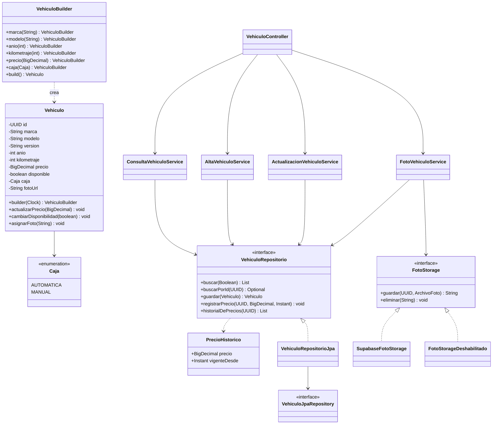

# Microservicio vehiculos

Especificación para desarrollar el servicio `vehiculos` del TP de Desarrollo de Aplicaciones II (UADE). Todo lo que figura acá está decidido. Los puntos que no bloquean el desarrollo están en la sección 15.

## Índice

1. [Contexto](#1-contexto)
2. [Diseño interno](#2-diseño-interno)
3. [Convenciones](#3-convenciones)
4. [Modelo de datos](#4-modelo-de-datos)
5. [API](#5-api)
6. [Reglas de negocio](#6-reglas-de-negocio)
7. [Fotos con Supabase Storage](#7-fotos-con-supabase-storage)
8. [Patrones de diseño](#8-patrones-de-diseño)
9. [Base de datos y migraciones](#9-base-de-datos-y-migraciones)
10. [Configuración y perfiles](#10-configuración-y-perfiles)
11. [Docker](#11-docker)
12. [Pruebas](#12-pruebas)
13. [Orden de trabajo](#13-orden-de-trabajo)
14. [Tecnologías y dependencias](#14-tecnologías-y-dependencias)
15. [Decisiones y pendientes](#15-decisiones-y-pendientes)

---

## 1. Contexto

### 1.1 El sistema

El TP es un CRM de calificación de leads para una agencia de autos usados. Un prospecto completa un preformulario, el sistema lo califica automáticamente (No potable, Potable, Muy potable) y un telemarketer ve una cola ordenada. Está hecho con microservicios Spring Boot, una base de datos por servicio y un API Gateway como entrada única del frontend. `vehiculos` es uno de esos servicios y lo desarrolla una sola persona.

### 1.2 Qué es vehiculos

Es el inventario de la agencia: unidades, sus precios, su historial de precios y sus fotos. Puerto 8083. Su base es un schema propio en un Postgres de Supabase y las fotos van a Supabase Storage.

### 1.3 Con quién interactúa

| Actor | Cómo | Para qué |
|---|---|---|
| Frontend (React), por el gateway | `GET /vehiculos?disponible=true` y `GET /vehiculos/{id}` | Selector de vehículos del preformulario. Filtra en memoria por marca, modelo, caja, año, precio y kilometraje |
| Servicio `calificacion`, REST directo | `GET /vehiculos/{id}/precio` | Calcular la cobertura de un lead: (anticipo + permuta computable) / precio de la unidad |
| API Gateway (lo hace otra persona, más adelante) | Ruteo | El front llama a `/api/vehiculos/...`, el gateway quita `/api` y el servicio expone `/vehiculos/...` |
| Supabase Postgres | JDBC | Persistencia |
| Supabase Storage | HTTPS | Fotos |

Los otros servicios del sistema (`leads`, `clientes`, `calificacion`) son independientes: `vehiculos` no los llama, no conoce sus modelos y no comparte código con ellos. Se relacionan solo por UUID de vehículo.

### 1.4 Lo que no hace

- No publica ni consume eventos (no usa Kafka).
- No maneja datos personales.
- No tiene autenticación de usuarios. Las escrituras se protegen con `X-Api-Key` (5.2).
- No tiene pantalla de alta o edición: el alta se hace desde Swagger o Postman y la edición solo cambia precio y disponibilidad.

### 1.5 Reglas de arquitectura que aplican

- Ningún servicio lee la base de otro. Las referencias entre servicios son por UUID, nunca por clave foránea.
- Todo se identifica por UUID.
- El dominio no depende de Spring Data ni de clientes HTTP: usa puertos que implementa la infraestructura.

---

## 2. Diseño interno

Capas, con la dependencia apuntando siempre al dominio:

| Capa | Contenido |
|---|---|
| `api` | Controller REST, DTOs de request y response, manejo global de errores, seguridad por `X-Api-Key` |
| `application` | Casos de uso, uno por servicio, con las transacciones |
| `domain` | `Vehiculo` y su Builder, `Caja`, excepciones de dominio, puertos `VehiculoRepositorio` y `FotoStorage` |
| `infrastructure` | Persistencia JPA y cliente de Supabase Storage |
| `config` | Propiedades validadas, filtro de `correlationId`, beans |

```
com.uade.crm.vehiculos
├── api
│   ├── VehiculoController
│   ├── dto            AltaVehiculoRequest, ActualizacionVehiculoRequest, VehiculoResponse, PrecioResponse,
│   │                  PrecioHistoricoResponse
│   ├── error          ApiExceptionHandler (@RestControllerAdvice), CodigoError
│   └── seguridad      ClaveServicioInterceptor, RequiereClaveServicio, ClaveServicioInvalidaException
├── application        ConsultaVehiculoService, AltaVehiculoService, ActualizacionVehiculoService, FotoVehiculoService
├── domain
│   ├── model          Vehiculo (con Builder), Caja, PrecioHistorico, ArchivoFoto, TipoFoto, VehiculoInvalidoException,
│   │                  VehiculoNoEncontradoException, FotoInvalidaException, AlmacenamientoNoDisponibleException
│   └── port           VehiculoRepositorio, FotoStorage
├── infrastructure
│   ├── persistence    VehiculoEntity, VehiculoJpaRepository, VehiculoRepositorioJpa,
│   │                  PrecioHistorialEntity, PrecioHistorialJpaRepository
│   └── storage        SupabaseFotoStorage, FotoStorageDeshabilitado, FotoStorageConfig
└── config             VehiculosProperties, CorrelationIdFilter, DominioConfig, OpenApiConfig, WebConfig
```

Cada paquete lleva su `package-info.java`. El mapeo entre dominio, entidad y DTO es manual.

---

## 3. Convenciones

El servicio `clientes` ya está implementado por otro integrante y fija el estilo del equipo. `vehiculos` copia su estilo, no su dominio.

### 3.1 Código

- Código, nombres de dominio y mensajes de error en español. Palabras técnicas en inglés.
- Sin Lombok ni MapStruct. Los DTOs son `record` con un método estático `de(...)` que los construye desde el dominio. Los request recortan los textos en el constructor compacto antes de validar.
- Las entidades de dominio tienen constructor privado y `builder()` escrito a mano. La persistencia las reconstruye con el mismo builder. Los accesores no usan `get` (`id()`, `precio()`) y los campos opcionales devuelven `Optional`.
- Puerto de persistencia `VehiculoRepositorio` en `domain.port`. Adaptador `VehiculoRepositorioJpa` (visibilidad de paquete) en `infrastructure.persistence`, que delega en la interfaz Spring Data `VehiculoJpaRepository` y traduce con `aEntidad` y `aDominio`. La entidad JPA `VehiculoEntity` tiene getters y setters de paquete.
- Un servicio de aplicación por caso de uso, no una fachada única.
- `Clock` inyectado como bean (`DominioConfig`) para que el tiempo sea testeable.
- `spring.jpa.open-in-view: false` y `ddl-auto: validate`.
- Actuator expone solo `health`, con probes habilitados.
- Tipos: `UUID` para ids, `BigDecimal` para dinero, `Instant` para fechas y horas. En JSON los montos viajan como números. Los enums viajan en ASCII y mayúsculas (`AUTOMATICA`).
- Configuración con un `@ConfigurationProperties` record validado (prefijo `vehiculos`) y variables de entorno `VEHICULOS_*`. El servicio no arranca si falta una obligatoria o quedó un placeholder sin resolver. Los `toString` de las propiedades secretas devuelven `****`.
- Documentación con springdoc: `/v3/api-docs` y `/swagger-ui.html`.
- Migraciones con Flyway, una por cambio. Nunca se edita una migración ya mergeada.

### 3.2 Trazabilidad

`CorrelationIdFilter` toma `X-Correlation-Id` del request o genera un UUID, lo deja en el MDC con la clave `correlationId`, lo devuelve en la respuesta y lo escribe en cada línea de log con el patrón `[%X{correlationId:-}]`.

### 3.3 Errores

Todo error responde `application/problem+json` (`ProblemDetail`), con `codigo` estable, `correlationId` y, en validación, la lista `errores`. El `type` usa la base `https://crm.uade.local/errores/{slug}`. `ApiExceptionHandler` extiende `ResponseEntityExceptionHandler` y los códigos viven en el enum `CodigoError`.

```json
{
  "type": "https://crm.uade.local/errores/validacion",
  "title": "Datos inválidos",
  "status": 422,
  "detail": "Hay campos que no cumplen las validaciones",
  "instance": "/vehiculos",
  "codigo": "VALIDACION",
  "correlationId": "c0a8012e-7f3b-4d8a-b1c2-9d8e7f6a5b4c",
  "errores": [
    { "campo": "caja", "mensaje": "no debe ser nulo" }
  ]
}
```

| `codigo` | HTTP | Cuándo |
|---|---|---|
| `VALIDACION` | 422 | Falla de Bean Validation, un valor que no se puede convertir al tipo del campo (por ejemplo un enum fuera de rango) o un campo no admitido en el cuerpo (`mensaje`: `campo no admitido`, en el `POST` y en el `PUT`). Incluye `errores` con `campo` y `mensaje`. Excepción: el 422 que nace en el dominio (`DatosInvalidosException`) lleva el mensaje en `detail` y no trae `errores`, porque `VehiculoInvalidoException` no sabe qué campo falló; hoy no se alcanza porque el DTO cubre todas las reglas del Builder |
| `JSON_INVALIDO` | 400 | Cuerpo que no se puede leer: JSON mal formado o ausente |
| `SOLICITUD_INVALIDA` | 400 (o el 4xx que resuelve Spring) | Error 4xx que resuelve Spring MVC. Conserva su status real: 405 método no permitido, 404 ruta inexistente, 415 tipo de contenido no soportado. Un id de ruta que no es UUID da 400 |
| `CLAVE_SERVICIO_INVALIDA` | 401 | Falta `X-Api-Key` o no coincide. Se evalúa antes de validar el cuerpo |
| `ERROR_INTERNO` | 500 | Error no controlado. Se loguea con la excepción y se responde sin detalle |
| `VEHICULO_NO_ENCONTRADO` | 404 | El id no existe |
| `FOTO_INVALIDA` | 422 | El archivo no es JPEG, PNG o WebP, está vacío o supera 2 MB. También cuando supera el límite multipart de Spring (3 MB, `MaxUploadSizeExceededException`), en vez del 413 |
| `ALMACENAMIENTO_NO_DISPONIBLE` | 503 | Storage no responde, rechazó la subida, o el modo de fotos es `deshabilitado` |

Ejemplo, vehículo inexistente:

```json
{
  "type": "https://crm.uade.local/errores/vehiculo-no-encontrado",
  "title": "Vehículo no encontrado",
  "status": 404,
  "detail": "No existe un vehículo con id 9e8d7c6b-5a4f-4e3d-2c1b-0a9f8e7d6c5b",
  "instance": "/vehiculos/9e8d7c6b-5a4f-4e3d-2c1b-0a9f8e7d6c5b",
  "codigo": "VEHICULO_NO_ENCONTRADO",
  "correlationId": "c0a8012e-7f3b-4d8a-b1c2-9d8e7f6a5b4c"
}
```

---

## 4. Modelo de datos

| Campo | Tipo | Obligatorio | Notas |
|---|---|---|---|
| `id` | UUID | Sí | Lo genera el servicio |
| `marca` | texto | Sí | |
| `modelo` | texto | Sí | |
| `version` | texto (por ejemplo "Exclusive CVT") | No | Versión comercial del modelo. No es la versión de concurrencia: no se usa `@Version` de JPA |
| `anio` | entero | Sí | |
| `kilometraje` | entero (km) | Sí | |
| `precio` | `BigDecimal` | Sí | |
| `disponible` | booleano | Sí | `true` por defecto en el alta |
| `caja` | `AUTOMATICA` o `MANUAL` | Sí | Enum `Caja` |
| `fotoUrl` | texto (URL) | No | URL pública de Storage |
| `creadoEn` | `Instant` | Sí | Interno. Lo fija el servicio al dar de alta. No viaja en la API |
| `actualizadoEn` | `Instant` | Sí | Interno. Se actualiza en cada cambio de precio, disponibilidad o foto. No viaja en la API |

El historial guarda, por cada vehículo, una fila por cada precio que rigió (`precio` y `vigenteDesde`).

---

## 5. API

### 5.1 Endpoints

| Método | Ruta | Respuesta | Uso |
|---|---|---|---|
| GET | `/vehiculos?disponible=true` | `200` con lista | Lista del preformulario. Sin el parámetro devuelve todas las unidades |
| GET | `/vehiculos/{id}` | `200` con el vehículo, `404` | Detalle. Responde `200` también si `disponible` es false |
| GET | `/vehiculos/{id}/precio` | `200` con `{ "precio": número, "disponible": booleano }`, `404` | Lo usa `calificacion` |
| GET | `/vehiculos/{id}/historial-precios` | `200` con la lista del más nuevo al más viejo, `404` | Historial de precios |
| POST | `/vehiculos` | `201` con el vehículo y `Location`, `422` | Alta |
| PUT | `/vehiculos/{id}` | `200` con el vehículo, `404`, `422` | Cambia `precio` y/o `disponible`. Si cambia el precio, registra una fila en el historial |
| PUT | `/vehiculos/{id}/foto` | `200` con el vehículo, `400` sin el campo `archivo`, `404`, `415` si no es multipart, `422` `FOTO_INVALIDA`, `503` `ALMACENAMIENTO_NO_DISPONIBLE` | Carga o reemplaza la foto (`multipart/form-data`, campo `archivo`) |

El `PUT /vehiculos/{id}` modifica solo algunos campos, así que su semántica es la de un `PATCH`. Se mantiene `PUT` porque así lo espera el contrato del equipo.

### 5.2 Seguridad de las escrituras

`POST /vehiculos` y ambos `PUT` exigen el header `X-Api-Key`, con la anotación `@RequiereClaveServicio` y un interceptor. La clave es un secreto compartido de al menos 32 caracteres, configurado en `VEHICULOS_CLAVE_ESCRITURA`, y se compara en tiempo constante. Sin ella el servicio responde `401` con `CLAVE_SERVICIO_INVALIDA` antes de leer el cuerpo. En `PUT /vehiculos/{id}/foto` vale igual porque el multipart se resuelve en diferido (`spring.servlet.multipart.resolve-lazily: true`): sin eso, Spring leería el archivo antes de correr el interceptor. Las lecturas quedan abiertas. Es una medida de la API, no de la base de datos.

### 5.3 Ejemplos

Alta (`POST /vehiculos`):

```json
{
  "marca": "Toyota",
  "modelo": "Corolla",
  "version": "XEI CVT",
  "anio": 2021,
  "kilometraje": 45000,
  "precio": 10000000,
  "disponible": true,
  "caja": "AUTOMATICA"
}
```

Actualización (`PUT /vehiculos/{id}`): ambos campos son opcionales, pero al menos uno es obligatorio y `precio` debe ser mayor que cero. Sin ninguno de los dos (`{}`, o ambos en `null`) responde `422` con `errores: [{campo: "precioODisponible", mensaje: "hay que informar precio, disponible o ambos"}]`. Cualquier otro campo se rechaza con `422 VALIDACION` y `errores: [{campo: "<nombre>", mensaje: "campo no admitido"}]`; lo mismo vale para el alta, porque `fail-on-unknown-properties` es global.

```json
{ "precio": 10500000, "disponible": false }
```

Respuesta de `GET /vehiculos/{id}` (datos ficticios; `<ref>` es el project-ref de Supabase):

```json
{
  "id": "9e8d7c6b-5a4f-4e3d-2c1b-0a9f8e7d6c5b",
  "marca": "Toyota",
  "modelo": "Corolla",
  "version": "XEI CVT",
  "anio": 2021,
  "kilometraje": 45000,
  "precio": 10000000,
  "disponible": true,
  "caja": "AUTOMATICA",
  "fotoUrl": "https://<ref>.supabase.co/storage/v1/object/public/vehiculos-fotos/9e8d7c6b-5a4f-4e3d-2c1b-0a9f8e7d6c5b.jpg"
}
```

Respuesta de `GET /vehiculos/{id}/precio`:

```json
{ "precio": 10000000, "disponible": true }
```

Respuesta de `GET /vehiculos/{id}/historial-precios`:

```json
[
  { "precio": 10500000, "vigenteDesde": "2026-10-07T18:20:00Z" },
  { "precio": 10000000, "vigenteDesde": "2026-09-22T14:03:11Z" }
]
```

---

## 6. Reglas de negocio

- **Invariantes** (en `Vehiculo.builder().build()` y al actualizar): precio positivo, kilometraje mayor o igual a 0, marca y modelo no vacíos, `caja` presente, año entre 1950 y el año actual más uno, calculado con el `Clock` inyectado.
- **Doble validación:** los DTOs de request se validan con Bean Validation y devuelven `VALIDACION` con `errores`. El Builder protege al dominio aunque el DTO falle.
- **Filtrado:** el servidor solo filtra por `disponible`. El front trae la lista completa y filtra en memoria. Sin paginación.
- **Precio disponible o no:** `GET /vehiculos/{id}/precio` y `GET /vehiculos/{id}` responden `200` aunque `disponible` sea false. `calificacion` puede procesar un lead después de la venta y el front puede mostrar una ficha vieja. `vehiculos` solo informa: la respuesta incluye `disponible` y quien consulta decide qué hacer. Si el id no existe, `404` con `VEHICULO_NO_ENCONTRADO`.
- **Rendimiento:** `/precio` está en el camino de cada calificación. Es una consulta por clave primaria, sin joins ni caché.
- **Historial de precios:** `precio_historial` guarda una fila por cada precio que rigió, con `vigente_desde`. Se escribe en la misma transacción que el alta (precio inicial) y que cada `PUT` que cambia el precio. Un `PUT` que solo cambia `disponible`, o que envía el mismo precio, no escribe nada. Es de solo agregado y su fila más reciente coincide siempre con `vehiculo.precio`.
- **Fechas:** `creado_en` y `actualizado_en` son `TIMESTAMPTZ` mapeadas como `Instant`, y las fija el adaptador `VehiculoRepositorioJpa` con el `Clock`: en el alta, ambas; en cada `guardar` posterior, conserva `creado_en` y renueva `actualizado_en`. No viajan en la API. `vigente_desde` lo toma el servicio con `clock.instant()` antes de `guardar`, así que en producción queda unos microsegundos antes que `actualizado_en`. La fila más reciente del historial coincide igual con `vehiculo.precio` porque todo va en la misma transacción.
- **Sin control de concurrencia optimista:** el último `PUT` gana. Alcanza porque las actualizaciones de precio son raras y las hace una persona.

---

## 7. Fotos con Supabase Storage

La foto vive en Storage y la base guarda solo el texto de `fotoUrl`. Son dos conexiones distintas: Postgres por JDBC (`VEHICULOS_DB_*`) y Storage por HTTPS (`VEHICULOS_SUPABASE_URL` y la clave secreta).

- **Bucket** `vehiculos-fotos`, público y ya creado. Las lecturas no requieren autenticación, así que el front muestra `fotoUrl` en un ``. Subir y borrar los hace solo el backend.
- **URL pública:** `{SUPABASE_URL}/storage/v1/object/public/{bucket}/{archivo}`.
- **Nombre del objeto:** `{vehiculoId}.{extensión}`. Una nueva carga con `x-upsert: true` pisa la anterior. Si cambia la extensión (la URL nueva es distinta de la vieja), se borra el objeto viejo después de confirmar en la base. Si ese borrado falla, se loguea un WARN y la respuesta sigue siendo `200`: el objeto queda huérfano.
- **Subida:** `POST {SUPABASE_URL}/storage/v1/object/{bucket}/{archivo}` con el cuerpo del archivo y su `Content-Type`. Se hace con el `RestClient` de Spring sobre el cliente HTTP del JDK (`JdkClientHttpRequestFactory`, que admite `DELETE` con cuerpo), con 5 s para conectar y 15 s para leer, y sin dependencias nuevas. Las respuestas no se deserializan (`toBodilessEntity`), así que `fail-on-unknown-properties` no las afecta.
- **Borrado:** `DELETE {SUPABASE_URL}/storage/v1/object/{bucket}` con cuerpo `{"prefixes": ["{archivo}"]}`.
- **Autenticación:** las claves `sb_secret_...` se envían en el header `apikey`, no como `Authorization: Bearer`.
- **Validaciones:** JPEG, PNG o WebP, no vacío, máximo 2 MiB (2 097 152 bytes, inclusive). El tipo se detecta por los primeros bytes (`FF D8 FF`, `89 PNG`, `RIFF....WEBP`); el nombre y el `Content-Type` que manda el cliente se ignoran, y la extensión y el `Content-Type` de la subida salen del tipo detectado. El bucket también restringe tamaño y tipos como segunda barrera.
- **Límite multipart:** Spring corta en 1 MB por defecto. `spring.servlet.multipart.max-file-size` y `max-request-size` están en 3 MB, así que entre 2 y 3 MB rechaza el servicio y por encima de 3 MB rechaza Spring; en los dos casos responde `422 FOTO_INVALIDA`.
- **Falla parcial:** si la subida sale bien y el guardado en la base falla, queda un objeto huérfano. Es aceptable: el reintento escribe el mismo nombre.
- **Endpoints:** salen del código del cliente oficial de Supabase y no de su documentación REST. Se verificaron contra Supabase el 2026-10-10 y funcionaron sin ajustes. Si alguno cambia, el cuerpo del error de Storage indica qué ajustar.
- **Errores de Storage:** cualquier error del `RestClient` (4xx, 5xx o timeout) termina en `AlmacenamientoNoDisponibleException`. Se loguea la operación, el objeto, el status y el cuerpo de la respuesta, nunca los headers (`apikey`). Un objeto inexistente responde HTTP 400 con `"statusCode":"404"` y `NoSuchKey` en el cuerpo.
- **Caché de la CDN:** Cloudflare puede seguir sirviendo un objeto ya borrado o reemplazado (`cf-cache-status: HIT`). Un borrado se verifica listando el bucket (`POST /storage/v1/object/list/{bucket}`) o pidiendo la URL con `?v=...`.

Flujo de `PUT /vehiculos/{id}/foto`: el interceptor exige `X-Api-Key` (401); `FotoVehiculoService` busca el vehículo (404 si no existe), valida el archivo con `ArchivoFoto.de(...)` (422) y sube a Storage (503 si falla), todo sin transacción abierta: la llamada HTTP no retiene una conexión de la base. Después abre una transacción corta (`TransactionOperations`) que vuelve a leer la unidad, le asigna la URL pública y llama a `guardar` una sola vez (actualiza `foto_url` y `actualizado_en`). Releer evita pisar un cambio de precio hecho por otro `PUT` durante la subida. Por último, si cambió la extensión, borra el objeto viejo. El orden de errores es 401 → 404 → 422 → 503, también en modo `deshabilitado`: el servicio no conoce el modo.

**Strategy `FotoStorage`.** Interfaz del dominio (`guardar(UUID, ArchivoFoto)` devuelve la URL pública; `eliminar(String fotoUrl)` ignora una URL que no sea de su proyecto y bucket) con dos implementaciones de visibilidad de paquete. Las elige `FotoStorageConfig` con un `switch` sobre `VehiculosProperties.modoFotos()` (variable `VEHICULOS_FOTOS_MODO`, sin distinguir mayúsculas); no se usa `@ConditionalOnProperty(havingValue = ...)`, que sí las distingue:

| Modo | Clase | Comportamiento |
|---|---|---|
| `supabase` | `SupabaseFotoStorage` | Sube y borra en Storage y devuelve la URL pública |
| `deshabilitado` | `FotoStorageDeshabilitado` | Rechaza la carga con `ALMACENAMIENTO_NO_DISPONIBLE`. Permite correr el servicio sin la clave de Storage |

Los tests usan una implementación falsa en memoria (`FotoStorageEnMemoria`) y `SupabaseFotoStorage` se prueba con `MockRestServiceServer`. Ningún test automático llama a Supabase Storage: las subidas reales se prueban a mano.

---

## 8. Patrones de diseño

| Patrón | Clase | Por qué |
|---|---|---|
| Repository | `VehiculoRepositorio` (puerto) y `VehiculoRepositorioJpa` (adaptador sobre Spring Data) | Aísla el dominio de la persistencia |
| Builder | `Vehiculo.builder()` | La unidad tiene muchos campos y varios opcionales. Evita constructores de diez parámetros y valida invariantes en `build()` |
| Strategy | `FotoStorage` con `SupabaseFotoStorage` y `FotoStorageDeshabilitado` | Cambiar dónde se guardan las fotos no toca el resto del servicio |



En el código, `VehiculoBuilder` es la clase anidada `Vehiculo.Builder`. Se obtiene con `Vehiculo.builder(clock)`: el `Clock` es obligatorio porque `build()` lo usa para validar el rango del año. Las invariantes rotas lanzan `VehiculoInvalidoException`.

---

## 9. Base de datos y migraciones

### 9.1 Supabase

La base es un Postgres de Supabase ya creado, con un rol y un schema propios. El equipo comparte las credenciales por un canal seguro y todos trabajan contra la misma base.

- **Conexión:** session pooler, puerto 5432, con `sslmode=require`. Es compatible con IPv4 y con Docker, y mantiene la sesión, así que Flyway y los prepared statements funcionan. No usar la conexión directa (solo IPv6) ni el transaction pooler del puerto 6543 (no soporta prepared statements del lado del servidor).
- **Usuario:** `vehiculos_app.<project-ref>`, un rol dedicado con permisos solo sobre su schema. Nunca el rol `postgres`. Usuario y clave van en variables separadas, no dentro de la URL, para no escapar caracteres reservados.
- **Schema propio `vehiculos`:** no se usa `public`, porque la Data API de Supabase lo expone. Se fija con `hibernate.default_schema` y `flyway.schemas` (sección 10).
- **Clave secreta `sb_secret_...`:** equivale al rol `service_role` y se salta Row Level Security. Solo vive en el backend, nunca en el frontend, el repo, los logs ni un chat.
- **Pausa:** el plan gratuito pausa el proyecto tras una semana sin actividad. Los datos se conservan, pero hay que reactivarlo desde el dashboard. Si el servicio no arranca por timeout de la base, revisar eso primero.
- **Migraciones en base compartida:** solo el responsable de `vehiculos` define y aplica migraciones. Si otro integrante corre una rama con una migración nueva contra la base compartida, Flyway la aplica y rompe la validación de los demás.

### 9.2 Migración V1

Migración Flyway `V1__vehiculo.sql` en `db/migration/`, que corre en el schema `vehiculos`:

```sql
CREATE TABLE vehiculo (
    id             UUID PRIMARY KEY,
    marca          VARCHAR(60)    NOT NULL,
    modelo         VARCHAR(80)    NOT NULL,
    version        VARCHAR(80),
    anio           INTEGER        NOT NULL,
    kilometraje    INTEGER        NOT NULL CHECK (kilometraje >= 0),
    precio         NUMERIC(14, 2) NOT NULL CHECK (precio > 0),
    disponible     BOOLEAN        NOT NULL DEFAULT TRUE,
    caja           VARCHAR(15)    NOT NULL CHECK (caja IN ('AUTOMATICA', 'MANUAL')),
    foto_url       VARCHAR(500),
    creado_en      TIMESTAMPTZ    NOT NULL,
    actualizado_en TIMESTAMPTZ    NOT NULL
);

CREATE INDEX ix_vehiculo_disponible ON vehiculo (disponible);

CREATE TABLE precio_historial (
    id            UUID PRIMARY KEY,
    vehiculo_id   UUID           NOT NULL REFERENCES vehiculo (id),
    precio        NUMERIC(14, 2) NOT NULL CHECK (precio > 0),
    vigente_desde TIMESTAMPTZ    NOT NULL
);

CREATE INDEX ix_precio_historial_vehiculo ON precio_historial (vehiculo_id, vigente_desde DESC);
```

Cada fila de `precio_historial` es un precio que empezó a regir en `vigente_desde`. La clave foránea es válida porque ambas tablas son de este servicio: la regla de no usar claves foráneas aplica entre servicios.

### 9.3 Seed

La carga inicial vive en `vehiculos-service/src/main/resources/db/seed/R__seed_vehiculos.sql`, separada de `db/migration/`. Se activa con el perfil `seed`: `application-seed.yml` fija `spring.flyway.locations: classpath:db/migration,classpath:db/seed` (repite `db/migration` porque las listas de YAML se reemplazan, no se mezclan). Se corre con `SPRING_PROFILES_ACTIVE=local,seed`; solo `seed` dejaría al perfil `local` sin cargar y faltaría el datasource.

- **Migración repetible, no versionada.** Flyway valida que toda migración versionada esté aplicada y en orden: un `V1000__seed` haría fallar a la base compartida cuando se agregue una `V2` de esquema. La `R__` corre siempre después de las versionadas y se vuelve a ejecutar solo si cambia su contenido.
- **Idempotente.** Ids fijos (`a0000000-0000-4000-8000-0000000000NN` para `vehiculo`, `b0000000-...` para `precio_historial`) y `ON CONFLICT (id) DO NOTHING`. No duplica filas, pero tampoco actualiza las ya cargadas: para cambiar un dato sembrado hay que borrar la fila (primero `precio_historial`, después `vehiculo`, porque la FK no tiene `ON DELETE`) y dejar que el seed la recree.
- **Contenido.** 10 unidades ficticias: Toyota Corolla, Ford Fiesta, Volkswagen Amarok, Chevrolet Onix, Renault Sandero, Peugeot 208, Fiat Cronos, Honda Civic, Nissan Kicks y Citroën C3. Años 2009 a 2025, kilometrajes de 8.000 a 178.000, precios de 7,2 a 52 millones, ambas cajas, `version` presente en algunas y ausente en otras. Dos unidades con `disponible = false` (Sandero y Civic). Todas con `foto_url` en `NULL`.
- **Historial.** Cada unidad tiene su fila inicial en `precio_historial`, con el mismo precio que `vehiculo.precio` y `vigente_desde` igual a `creado_en`. Como el SQL no pasa por el `Clock`, las fechas son explícitas (septiembre de 2026, una por día, para que el orden `creado_en DESC` del listado sea estable).
- **Pruebas.** `SeedTest`, `ArranqueSinSeedTest` y `VehiculoApiSeedTest` comparten un contexto con `@PruebaIntegracionSeed` (`@PruebaIntegracion` + `@ActiveProfiles({"test", "seed"})` + `@Tag("seed")`). `SeedTest` comprueba las 10 filas, la variedad, las fotos en `NULL`, el historial y la idempotencia. Ninguna otra clase activa el perfil, así que los demás tests siguen viendo la base vacía.
- **Base compartida.** Antes de activar `seed` contra Supabase hay que avisar al equipo (regla 4 de `CLAUDE.md`).

---

## 10. Configuración y perfiles

Todo por variables de entorno, validado al arrancar con el record `VehiculosProperties` (prefijo `vehiculos`).

| Variable | Ejemplo | Uso |
|---|---|---|
| `VEHICULOS_DB_URL` | `jdbc:postgresql://aws-0-<region>.pooler.supabase.com:5432/postgres?sslmode=require` | Conexión por session pooler |
| `VEHICULOS_DB_USUARIO` | `vehiculos_app.<project-ref>` | Rol dedicado. No se commitea |
| `VEHICULOS_DB_CLAVE` | | Contraseña. No se commitea |
| `VEHICULOS_FOTOS_MODO` | `supabase` o `deshabilitado` | Estrategia de `FotoStorage` |
| `VEHICULOS_SUPABASE_URL` | `https://<project-ref>.supabase.co` | Solo en modo `supabase` |
| `VEHICULOS_SUPABASE_CLAVE_SECRETA` | `sb_secret_...` | Solo en modo `supabase`. Nunca en logs |
| `VEHICULOS_FOTOS_BUCKET` | `vehiculos-fotos` | Bucket público de Storage |
| `VEHICULOS_CLAVE_ESCRITURA` | mínimo 32 caracteres | Secreto de los endpoints de escritura (`X-Api-Key`) |

Perfiles: `local` (por defecto, para correr con `spring-boot:run` contra Supabase), `docker` (el del compose) y `seed` (se suma a los otros, ver 9.3). El schema se fija así:

```yaml
spring:
  jpa:
    properties:
      hibernate:
        default_schema: vehiculos
  flyway:
    schemas: vehiculos
```

Spring Boot no lee archivos `.env` por sí solo. Para correr en local se cargan las variables de `infra/.env` en la sesión de la terminal con un script (`scripts/cargar-env.ps1` en Windows, `scripts/cargar-env.sh` en Linux y macOS). El script se corre antes de `spring-boot:run`.

---

## 11. Docker

Un solo modo: el servicio corre en un contenedor y se conecta a Supabase con las credenciales compartidas.

1. Copiar `infra/.env.example` a `infra/.env` y completar las variables de la sección 10.
2. `docker compose -f infra/docker-compose.yml up --build`.
3. Probar en `http://localhost:8083/swagger-ui.html` o con Postman.

- `Dockerfile` multi-stage con contexto en la raíz del repo: build con `maven:3.9-eclipse-temurin-21` copiando primero los `pom.xml` para cachear dependencias, y runtime `eclipse-temurin:21-jre` con `curl` para el healthcheck y un usuario sin privilegios. No se usa Maven Wrapper.
- El compose tiene solo el servicio `vehiculos`: sin Postgres, porque la base está en Supabase, y sin Kafka, porque el servicio no lo usa. Publica el puerto 8083 al host. Su healthcheck consulta `/actuator/health`.
- Las variables obligatorias usan `${VAR:?mensaje}`, así que el compose falla con un mensaje claro si falta alguna.
- `.env.example` va commiteado con placeholders y `.env` real en `.gitignore`.
- Docker se usa solo para levantar el servicio. El contenedor se conecta a la base de Supabase, no a un Postgres local.
- Los tests de integración por defecto levantan su propio PostgreSQL con Testcontainers, que necesita Docker abierto. La suite contra Supabase es aparte (sección 12).

---

## 12. Pruebas

**Automáticas**

- Unitarias del Builder: cada invariante rechaza el valor inválido y acepta el límite; `caja` ausente falla.
- Unitarias de los servicios con Mockito.
- Repositorio y migraciones contra PostgreSQL real con Testcontainers (`PostgresDePrueba` con `@ServiceConnection` y la anotación `@PruebaIntegracion`), incluido el filtro `disponible`. `@PruebaIntegracion` levanta el servidor en un puerto aleatorio (`RANDOM_PORT`) e importa `RelojDePrueba` y `FotoStorageEnMemoria` (`@Primary`, con `reiniciar()`). Las consultas nativas toman el schema de `spring.jpa.properties.hibernate.default_schema` (`@Value`), para correr igual en `vehiculos` y en `vehiculos_test`. El seed se cubre con `@PruebaIntegracionSeed` (sección 9.3). La suite tiene 6 contextos: 2 con base y 4 `@WebMvcTest`.
- Controllers con MockMvc (`PruebaWebMvc`): códigos de estado, forma del `ProblemDetail` (`codigo`, `correlationId`, `errores`), `X-Api-Key` faltante o inválida (401 antes de validar el cuerpo) y `caja` fuera del enum (422 con los valores aceptados).
- Fotos: `ArchivoFotoTest` (firmas, vacío, límite de 2 MiB); `FotoVehiculoServiceTest` con `FotoStorageEnMemoria` (tipo inválido, PDF renombrado, tamaño excedido, reemplazo con otra extensión, falla del almacenamiento, modo deshabilitado y orden de errores); `SupabaseFotoStorageTest` con `MockRestServiceServer` (URL, método, `apikey`, `x-upsert`, cuerpo, y 4xx, 5xx y timeout); `FotoApiTest` con el servidor real, porque MockMvc no aplica los límites multipart (1,5 MB pasa, 2,5 MB y 4 MB dan 422, 4 MB sin clave da 401).
- Historial: el alta y cada `PUT` que cambia el precio agregan una fila; un `PUT` que solo cambia `disponible` no agrega nada.
- La clave secreta de Supabase y la de escritura no aparecen en ninguna línea de log: `SecretosEnLogsTest` sube a TRACE los loggers de la app y de Spring Web, provoca fallas de Storage y revisa la salida.

**Suite contra Supabase (opcional).** La base de `vehiculos` vive en Supabase, así que la misma batería de tests de integración también se puede correr contra ella, sin tocar los datos del equipo:

- `mvn -pl vehiculos-service -am verify` corre en Testcontainers y no necesita credenciales. Es lo que corre cualquier integrante y lo que tiene que pasar siempre.
- `mvn -pl vehiculos-service -am verify -Psupabase`, con las variables `VEHICULOS_*` cargadas, corre la misma batería contra Supabase en el schema `vehiculos_test`. Nunca contra `vehiculos`, que tiene el seed y los datos del equipo.
- El schema se crea una sola vez desde el SQL Editor: `CREATE SCHEMA vehiculos_test AUTHORIZATION vehiculos_app;`.
- Protecciones obligatorias: la suite se niega a arrancar si el schema configurado no es `vehiculos_test`, y solo en ese schema puede borrar y recrear tablas para dejarlo limpio en cada corrida.
- Cubre la base (migraciones, repositorio, servicios con datos reales). Storage sigue con el `FotoStorage` falso.
- Con el perfil `supabase`, `PostgresDePrueba` no levanta contenedor: cada contexto hace `clean` + `migrate` sobre `vehiculos_test` al arrancar. `-Psupabase` corre dos JVM en serie, una sin y otra con la etiqueta `seed`, para que los dos contextos no se pisen los datos.
- La guarda `GuardaSchemaDePrueba` (un `EnvironmentPostProcessor` de test) se niega a arrancar si el schema no es exactamente `vehiculos_test` o si faltan las `VEHICULOS_DB_*`.
- Es más lenta (unos 53 s con 346 tests, contra unos 18 s en Testcontainers), necesita red y el proyecto activo (no pausado). Por eso es opt-in y no es parte de `verify` por defecto.

**Manuales con Postman.** Base `http://localhost:8083`. Importar `http://localhost:8083/v3/api-docs` genera la colección. Guardar la `X-Api-Key` en un entorno de Postman y no dentro de cada request. Casos mínimos:

| # | Request | Resultado esperado |
|---|---|---|
| 1 | `GET /vehiculos?disponible=true` | `200`, solo unidades disponibles |
| 2 | `GET /vehiculos/{id}` y `GET /vehiculos/{id}/precio` | `200`; el precio incluye `disponible` |
| 3 | `GET /vehiculos/{id-inexistente}` | `404`, `codigo` `VEHICULO_NO_ENCONTRADO` |
| 4 | `POST /vehiculos` sin `X-Api-Key` | `401`, `CLAVE_SERVICIO_INVALIDA` |
| 5 | `POST /vehiculos` con clave y sin `caja` | `422`, `errores` con el campo `caja` |
| 6 | `POST /vehiculos` con `caja` igual a `"Automática"` | `422`, con los valores aceptados |
| 7 | `POST /vehiculos` válido | `201` con `Location`; aparece en el listado |
| 8 | `PUT /vehiculos/{id}` con `{"precio": ...}` | `200`; el historial suma una fila |
| 9 | `PUT /vehiculos/{id}` con `{}` o con `precio` en 0 | `422` |
| 10 | `PUT /vehiculos/{id}/foto` con un PNG (Body Multipart, campo `archivo`) | `200`; la `fotoUrl` abre en el navegador |
| 11 | `PUT /vehiculos/{id}/foto` con un PDF | `422`, `FOTO_INVALIDA` |
| 12 | `GET /vehiculos/{id}/historial-precios` | `200`, del más nuevo al más viejo |
| 13 | `PUT /vehiculos/{id}` con un campo no admitido (por ejemplo `{"precio": 100, "marca": "X"}`) | `422`, `errores` con `campo` `marca` y `mensaje` `campo no admitido` |
| 14 | `POST /vehiculos` con `anio` 2028 | `422`, `errores` con el campo `anio` |

---

## 13. Orden de trabajo

La base, el rol, el schema y el bucket de Supabase ya existen. El orden es:

1. Esqueleto: POM padre con solo el módulo `vehiculos-service`, perfil local y script de variables.
2. Transversal: `ApiExceptionHandler` con `CodigoError`, `CorrelationIdFilter`, `logback-spring.xml`, OpenAPI, Actuator y `VehiculosProperties`.
3. Dominio: `Vehiculo`, `Caja` y Builder con invariantes.
4. Persistencia: Flyway, entidades de `vehiculo` y de `precio_historial`, `VehiculoRepositorio` y su adaptador JPA, seed y tests con Testcontainers.
5. API de lectura: listado, detalle, `/precio` e historial.
5.1. Suite de tests contra Supabase en el schema `vehiculos_test` (sección 12).
6. Alta y actualización de precio y disponibilidad, con `X-Api-Key` y registro en el historial.
7. Fotos: puerto `FotoStorage`, `SupabaseFotoStorage`, `FotoStorageDeshabilitado` y el endpoint de carga.
8. Docker: Dockerfile y compose.
9. Prueba de punta a punta con Postman sobre el contenedor.

### Pendientes que dejó la etapa 1 (esqueleto)

El esqueleto arrancó contra Supabase real el 2026-10-08: el session pooler acepta el rol `vehiculos_app`, Flyway creó `vehiculos.flyway_schema_history` (schema vacío, 0 migraciones) y `/actuator/health` respondió `UP`. Lo que quedó para las etapas siguientes:

- **Etapa 4 (persistencia):**
  - **[Resuelto en la etapa 4]** Supabase corre PostgreSQL 17 (el log de arranque dice 17.11). `PostgresDePrueba` usa `postgres:17-alpine` y la sección 14 ya lo dice. La línea de Stack de `CLAUDE.md` también dice `postgres:17-alpine`.
  - **[Resuelto: verificado en la etapa 7]** Al arrancar contra Supabase el 2026-10-10, Flyway validó 2 migraciones (la V1 y el seed) y no apareció el WARN `No migrations found`. `vehiculos.flyway_schema_history` ya existe en la base compartida, creada sin migraciones. La `V1__vehiculo.sql` no crea esa tabla. El WARN `No migrations found` del arranque desaparece cuando la V1 se aplique en Supabase (ver etapa 9 en los pendientes de la etapa 4).
- **Etapa 8 (Docker):**
  - **[Resuelto en la etapa 8: se mantiene habilitado; el contenedor muestra los dos WARN de springdoc y nada más]** springdoc queda habilitado: el arranque avisa con WARN que conviene deshabilitarlo en producción, pero Postman importa `/v3/api-docs`. No hace falta tocarlo en el TP.
- **Etapa 9 (punta a punta):**
  - `scripts/cargar-env.ps1` nunca se ejecutó en PowerShell: se desarrolló y probó solo `cargar-env.sh`, en Linux. Probarlo en Windows antes de la demo.
  - `curl` a `/swagger-ui.html` responde 302 hacia `/swagger-ui/index.html`. Usar `curl -L` o abrirlo en el navegador.

Especificaciones de la etapa 1 que las etapas siguientes deben respetar:

- Los scripts de carga leen `infra/.env` línea por línea: ignoran comentarios y líneas vacías, pelan comillas y un `export` inicial, y aceptan `=` dentro del valor. No expanden `$VAR` ni soportan valores multilínea. Solo imprimen los nombres de las variables, nunca los valores.
- `cargar-env.sh` hay que cargarlo con `source`; ejecutado como proceso aparte avisa y falla. Las variables viven en esa terminal: cargarlas y correr `mvn` en la misma sesión.
- Cada variable del `.env` va en su propia línea. Si se pegan dos juntas, la URL queda con texto de más y el arranque falla con `Invalid sslmode value: require...`.
- `mvn -pl vehiculos-service spring-boot:run` se corre desde la raíz del repo, donde está el POM padre.

### Pendientes que dejó la etapa 2 (transversal)

`ApiExceptionHandler` ya expone `responder(CodigoError, detalle, request)` y `CodigoError` trae los 8 códigos. Lo que quedó para las etapas siguientes, además de los mapeos de excepciones de dominio que detalla la etapa 3:

- **Etapa 4 (persistencia):**
  - **[Resuelto en la etapa 4]** `ConfiguracionTransversalTest` ya no excluye DataSource, JPA ni Flyway: usa `@PruebaIntegracion` (PostgreSQL de Testcontainers) y comprueba que el health incluye la base. No se puede volver a excluirlos: `VehiculoRepositorioJpa` necesita el repositorio Spring Data.
  - **[Resuelto en la etapa 4]** Los tests de integración reutilizan `@PropiedadesDePrueba` (a través de `@PruebaIntegracion`) para no depender de las `VEHICULOS_*` del shell.
  - **[Resuelto: verificado en la auditoría final, `ConfiguracionTransversalTest.healthIncluyeLaBaseDeDatos`]** Con DataSource activo, `/actuator/health` incluye la base: si el proyecto de Supabase está pausado, da `DOWN`, y con él el healthcheck del compose. La respuesta HTTP solo muestra `status` (no se expone el detalle de los componentes).
- **[Resuelto en la etapa 5: queda 400, así lo documentan los `@ApiResponse` del controller]** **Etapa 5 (lectura):** un id de ruta que no es UUID responde hoy 400 `SOLICITUD_INVALIDA` (`MethodArgumentTypeMismatchException`, cubierto por un test). Si se prefiere 422 `VALIDACION`, decidirlo acá.
- **Etapa 6 (escrituras):**
  - **[Resuelto en la etapa 6]** `ClaveServicioInvalidaException` se mapea a `CLAVE_SERVICIO_INVALIDA` 401 con `responder(...)`.
  - **[Resuelto en la etapa 6]** El interceptor compara `VehiculosProperties.claveEscritura()` en tiempo constante (`MessageDigest.isEqual`).
  - **[Resuelto en las etapas 6 y 7]** Anotar las operaciones de escritura con `@SecurityRequirement(name = OpenApiConfig.ESQUEMA_CLAVE_SERVICIO)`. El esquema existe en `OpenApiConfig` pero ninguna operación lo usa, así que Swagger todavía no manda `X-Api-Key`.
- **Etapa 7 (fotos):**
  - **[Resuelto en la etapa 7]** Spring limita las subidas a 1 MB por defecto. Para que el límite de 2 MB lo aplique el servicio (422 `FOTO_INVALIDA`), subir `spring.servlet.multipart.max-file-size` y `max-request-size`, y mapear `MaxUploadSizeExceededException` a `FOTO_INVALIDA`. Si no, una foto de 1,5 MB falla antes de llegar al servicio.
  - **[Resuelto en la etapa 7]** Elegir el `FotoStorage` con `VehiculosProperties.modoFotos()` (enum). No usar `@ConditionalOnProperty(havingValue = "supabase")`: distingue mayúsculas y `VEHICULOS_FOTOS_MODO=SUPABASE` dejaría el contexto sin bean.
  - **[Resuelto en la etapa 7: `SecretosEnLogsTest`]** Falta el test de la sección 12 que verifica que ni la clave de Supabase ni la de escritura aparecen en los logs (hoy solo se prueba `toString`). Al loguear errores de `RestClient`, no volcar headers (`apikey`).
- **Etapa 8 (Docker):**
  - **[Resuelto en la etapa 8]** En el compose, `VEHICULOS_SUPABASE_URL` y `VEHICULOS_SUPABASE_CLAVE_SECRETA` van con `${VAR:-}` y no con `${VAR:?}`: son opcionales en modo `deshabilitado`.
  - **[Resuelto en la etapa 8: se creó `application-docker.yml`, porque sin `local` activo no hay datasource]** El perfil `docker` de la sección 10 no existe (solo hay `application-local.yml`): crear `application-docker.yml` o confirmar que las variables del compose alcanzan.
  - **[Resuelto en la etapa 8: no se valida. La validación en `VehiculosProperties` no corre antes de que Flyway y JPA se conecten y se revirtió; el error del arranque ya nombra el placeholder (`UnknownHostException: <host-pooler>`, `tenant/user vehiculos_app.<project-ref> not found`). Ver `docs/mejoras.md`]** `VehiculosProperties` no valida `VEHICULOS_DB_*` (las resuelve `spring.datasource`). Un `.env` copiado de `.env.example` sin completar el host falla recién al conectar.
- **[Parcial: en la etapa 8 se probaron sobre el contenedor `/actuator/health` y el arranque sin `VEHICULOS_CLAVE_ESCRITURA`; falta la ruta inexistente con `X-Correlation-Id` (A10 del paso a paso)]** **Etapa 9 (punta a punta):** la etapa 2 se probó solo con MockMvc. Falta ejecutar con Supabase real: `curl` a `/actuator/health` y a una ruta inexistente con `X-Correlation-Id`, y comprobar que sin `VEHICULOS_CLAVE_ESCRITURA` el servicio no arranca.

### Pendientes que dejó la etapa 3 (dominio)

El dominio ya está (`Vehiculo`, `Caja`, `PrecioHistorico` y las excepciones). Estas tareas quedaron para las etapas siguientes:

- **Etapa 4 (persistencia):**
  - **[Resuelto en la etapa 4]** `creadoEn` y `actualizadoEn` no están en `Vehiculo`: los fija el adaptador `VehiculoRepositorioJpa` con el `Clock` (alta: ambos; cada `guardar` posterior: conserva `creado_en` y renueva `actualizado_en`).
  - **[Resuelto en la etapa 4]** `aDominio` reconstruye con `Vehiculo.builder(clock)`, informando `id`; el adaptador recibe el `Clock` por constructor. Sigue siendo cierto que un dato guardado con año fuera de rango hace fallar la lectura con `VehiculoInvalidoException`.
  - **[Resuelto en la etapa 4]** Puerto `VehiculoRepositorio` con su `package-info.java` en `domain.port` y `DominioConfig` con el bean `Clock` (`Clock.systemUTC()`).
- **[Resuelto en la etapa 5]** **Etapa 5 (lectura):** mapear `VehiculoNoEncontradoException` a `VEHICULO_NO_ENCONTRADO` 404 en `ApiExceptionHandler`, con el patrón `responder(CodigoError, detalle, request)`. Hasta entonces daría 500.
- **Etapa 6 (alta y actualización):**
  - **[Resuelto en la etapa 6, con otro enfoque: no se mapea de forma global; cada servicio la convierte en `DatosInvalidosException` solo para la entrada del cliente]** Mapear `VehiculoInvalidoException` a `VALIDACION` 422. Es la segunda barrera: el DTO valida primero.
  - **[Resuelto en la etapa 6]** Usar `Vehiculo.actualizarPrecio` y `cambiarDisponibilidad` en `ActualizacionVehiculoService`. No reimplementar la regla de precio en el servicio.
  - **[Resuelto en la etapa 6]** Comparar el precio nuevo con el actual para decidir si se escribe en el historial.
- **Etapa 7 (fotos):**
  - **[Resuelto en la etapa 7]** Mapear `FotoInvalidaException` a `FOTO_INVALIDA` 422 y `AlmacenamientoNoDisponibleException` a `ALMACENAMIENTO_NO_DISPONIBLE` 503.
  - **[Resuelto en la etapa 7]** Crear `ArchivoFoto` y el puerto `FotoStorage`.
  - **[Resuelto en la etapa 7]** Usar `Vehiculo.asignarFoto`.

Decisiones de la etapa 3 que las etapas siguientes deben respetar:

- `Vehiculo.builder(clock)` exige el `Clock`. `build()` genera un `id` si no se informa.
- `marca`, `modelo` y `version` se recortan en el dominio. Una `version` en blanco equivale a ausente.
- Las invariantes rotas lanzan `VehiculoInvalidoException`, que falla en la primera regla incumplida.

### Pendientes que dejó la etapa 4 (persistencia)

Están hechos: `V1__vehiculo.sql`, `VehiculoEntity`, `PrecioHistorialEntity`, sus repositorios Spring Data, el puerto `VehiculoRepositorio`, el adaptador `VehiculoRepositorioJpa`, `DominioConfig` y los tests con Testcontainers (`PostgresDePrueba`, `@PruebaIntegracion`, `RelojDePrueba`, `MigracionesTest`, `VehiculoRepositorioJpaTest`). **El seed se hizo después, ver "Pendientes que dejó el seed"**; la V1 ya corrió contra Supabase (ver etapa 9). Lo que quedó para las etapas siguientes:

- **[Resuelto en la etapa del seed, sección 9.3] Seed:**
  - Flyway valida que toda migración versionada esté aplicada y en orden. Si el seed fuera `V1000__...` y después se agrega una `V2` de esquema, la base compartida falla al validar (migración resuelta pero no aplicada, con una versión mayor ya aplicada). Recomendación: hacer el seed una **migración repetible e idempotente** (`R__seed_vehiculos.sql`, con `ON CONFLICT (id) DO NOTHING` y ids fijos) en `db/seed`, que corre siempre después de las versionadas.
  - Contenido: datos ficticios variados (marcas, cajas, años, precios, kilometrajes), al menos una unidad con `disponible = false`, fotos en `NULL` y una fila inicial en `precio_historial` por unidad, con el mismo precio que `vehiculo.precio`. Como el SQL no pasa por el `Clock`, `creado_en`, `actualizado_en` y `vigente_desde` van con valores explícitos y coherentes entre sí.
  - Antes de activar el perfil `seed` contra Supabase, avisar al equipo: es la base compartida (regla 4 de `CLAUDE.md`).
- **Etapas 5 y 6 (servicios):**
  - **[Resuelto en la etapa 6]** La transacción de negocio la abre el servicio (`@Transactional`); el adaptador se une a ella. El alta o el `PUT` que cambia el precio llaman a `guardar` y a `registrarPrecio` dentro de la misma transacción.
  - **[Resuelto en la etapa 6]** `registrarPrecio` no comprueba que el precio coincida con `vehiculo.precio`: mantener "la fila más reciente coincide con el precio actual" es responsabilidad del servicio. Tampoco decide si escribir: el servicio compara el precio nuevo con el actual y no registra nada si solo cambia `disponible` o si el precio es igual.
  - **[Resuelto en la etapa 6]** `guardar` renueva `actualizado_en` en cada llamada, aunque no haya cambios. El servicio no debe llamarlo si no cambió nada.
  - **[Resuelto en la etapa 6]** `registrarPrecio` con un `vehiculoId` inexistente lanza `DataIntegrityViolationException` (clave foránea), no `VehiculoNoEncontradoException`: el servicio debe buscar la unidad antes (y ya lo hace para el 404).
  - **[Resuelto: verificado en la auditoría final, `VehiculoRepositorioJpaTest.buscarSinFiltroDevuelveTodasDeLaMasNuevaALaMasVieja` y la descripción de `GET /vehiculos`]** `buscar(Boolean)` devuelve las unidades de la más nueva a la más vieja (`creado_en DESC`, desempate por `id`); el doc de la API no define otro orden. `historialDePrecios` va del más nuevo al más viejo.
  - **[Resuelto en la etapa 6: un dato guardado inválido da 500 y solo la entrada del cliente da 422]** Un `GET` de una unidad con datos cargados a mano fuera de las invariantes (por ejemplo `anio` fuera de rango) lanza `VehiculoInvalidoException` al leer. Mientras esa excepción no esté mapeada da 500, y cuando la etapa 6 la mapee a `VALIDACION` 422, un `GET` respondería 422 por un dato guardado. Decidir si conviene distinguir "dato de entrada inválido" de "dato guardado inválido".
- **Etapa 9 (punta a punta):**
  - **[Resuelto en la etapa 8: el contenedor quedó `healthy`, Flyway validó 2 migraciones sin `No migrations found`; la auditoría final confirmó en la base las dos filas con `success = true`]** **[Verificado el 2026-10-09]** La V1 se aplicó contra Supabase al arrancar con `spring-boot:run` (perfil `local`): tablas e índices creados en el schema `vehiculos` y `/actuator/health` en `UP`. Queda como lista de chequeo para repetirlo en la prueba de punta a punta (sobre el contenedor): que el rol `vehiculos_app` tenga permiso para crear tablas e índices en el schema `vehiculos`, que existan `vehiculo` y `precio_historial` en el dashboard, que `/actuator/health` dé `UP` y que desaparezca el WARN `No migrations found`.
  - Esa migración ya no se edita una vez mergeada: cualquier cambio de esquema es una `V2` (regla 4 de `CLAUDE.md`).
- **Pruebas:** los tests de integración necesitan Docker abierto. Usan `postgres:17-alpine` y arrancan un contenedor por ejecución (compartido por todas las clases que comparten contexto). Los tests de repositorio corren dentro de una transacción que se revierte; las consultas nativas en tests deben calificar el schema tomándolo de `spring.jpa.properties.hibernate.default_schema` (`@Value`), porque `hibernate.default_schema` solo aplica a las consultas de Hibernate y la suite corre en `vehiculos` y en `vehiculos_test`. `RelojDePrueba` es un bean compartido: cada test que lo avanza debe reiniciarlo (`reiniciar()`).

Decisiones de la etapa 4 que las etapas siguientes deben respetar:

- Las entidades y los repositorios Spring Data son de visibilidad de paquete: el resto del servicio solo ve el puerto `VehiculoRepositorio`.
- `PrecioHistorialEntity` referencia al vehículo por `vehiculoId` (sin relación JPA) y no tiene setters: el historial es de solo agregado.
- `guardar` y `registrarPrecio` usan `saveAndFlush`, para que las violaciones de restricciones salten en la llamada y no al cerrar la transacción.

---

### Pendientes que dejó el seed

Está hecho: `db/seed/R__seed_vehiculos.sql`, `application-seed.yml` y `SeedTest` (sección 9.3). `mvn -pl vehiculos-service -am verify` pasa completo (104 tests). **No se cargó en Supabase ni se probó por HTTP**: los tests usan Testcontainers (regla 5 de `CLAUDE.md`) y todavía no hay controllers (`GET /vehiculos` da 404 hasta la etapa 5). Se decidió probar todo junto en la etapa 5. Lo que quedó, agrupado por etapa:

- **[Resuelto: verificado en la etapa 7, el 2026-10-10]** **Etapa 5 (API de lectura): cargar el seed en Supabase y probarlo con Postman.** El seed está cargado: 10 unidades sembradas (8 disponibles, 2 no), todas con `foto_url` en `NULL`, 10 filas `b0000000` y `flyway_schema_history` con la `V1` y `seed vehiculos` en `success = true`. Arrancar con `local,seed` y después con `local` no corrió ninguna migración ni cambió los conteos. Los casos de abajo pasan con las diferencias que dejó la etapa 6: `GET /vehiculos` trae 11 (la unidad Ficticia va primera), `?disponible=true` trae 9 y el Corolla tiene 2 filas de historial.
  - Antes de cargar: avisar al equipo (regla 4 de `CLAUDE.md`), porque es la base compartida. Cargarlo una sola vez: `source scripts/cargar-env.sh && SPRING_PROFILES_ACTIVE=local,seed mvn -pl vehiculos-service spring-boot:run`, y después volver a `local` (Flyway ya registró la repetible).
  - Verificar en el dashboard o con SQL: 10 filas en `vehiculos.vehiculo` y 10 en `vehiculos.precio_historial`; `disponible` en 8 `true` y 2 `false`; `foto_url` en `NULL` en todas; en `flyway_schema_history`, la `V1` y una fila `seed vehiculos` con `version` vacía y `success = true`. El rol `vehiculos_app` necesita `INSERT` en ambas tablas (lo tiene si pudo aplicar la V1; si falla, revisar permisos antes que el SQL).
  - Idempotencia real: reiniciar la app con `local,seed` y comprobar que no corre ninguna migración y que los conteos siguen en 10 y 10; reiniciar solo con `local` y comprobar que arranca y los datos quedan.
  - Casos de Postman: `GET /vehiculos` devuelve 10, ordenados del más nuevo al más viejo (Citroën C3 primero, Corolla último); `?disponible=true` devuelve 8 y `?disponible=false` devuelve 2 (Sandero y Civic); `GET /vehiculos/a0000000-0000-4000-8000-000000000005` (Sandero, `disponible = false`) responde 200; `/precio` devuelve `{precio, disponible}`; `/historial-precios` devuelve 1 fila por unidad con el mismo precio que `vehiculo.precio`; ninguna respuesta trae `creadoEn` ni `actualizadoEn`; `fotoUrl` es `null`; `caja` sale como `AUTOMATICA` o `MANUAL`. Los números (10, 8, 2) dependen del seed: si se cambia, actualizarlos acá.
  - Si el `GET` de alguna unidad sembrada da 500, mirar primero `VehiculoInvalidoException` (dato fuera de las invariantes); el seed ya tiene un test que lo descarta, pero Supabase podría tener datos viejos.
- **Etapa 6 (alta y actualización):**
  - **[Resuelto: verificado en la etapa 7]** Las unidades creadas por la API usan el `Clock` real, así que quedan antes que las sembradas en el listado (`creado_en DESC`). Esperarlo al probar el orden.
  - **[Resuelto en la etapa 6: probado con el Corolla sembrado]** Al hacer un `PUT` de precio sobre una unidad sembrada, el historial pasa a tener 2 filas: la sembrada (`b0000000-...`) y la nueva. Probarlo con una unidad sembrada y comprobar que la fila más reciente coincide con `vehiculo.precio`.
  - **[Resuelto: verificado en la etapa 7 con el Sandero, `true` y de vuelta a `false`; el historial siguió en 1 fila]** Un `PUT` que solo cambia `disponible` sobre una unidad sembrada no debe agregar fila al historial.
  - Antes de borrar el seed con SQL, ver la nota "Para limpiar el seed" más abajo: las filas de historial agregadas por la API no tienen el prefijo `b0000000`.
- **[Resuelto en la etapa 7: probado con el Fiesta, `fotoUrl` pasó de `null` a la URL pública y el objeto se borró después del bucket]** **Etapa 7 (fotos):** las unidades sembradas tienen `foto_url = NULL`. Probar `PUT /vehiculos/{id}/foto` sobre una de ellas y comprobar que `fotoUrl` pasa a tener valor. Esto cambia el seed en esa base: al limpiar o recargar, el objeto del bucket `vehiculos-fotos` (`{vehiculoId}.{ext}`) queda huérfano y hay que borrarlo a mano.
- **[Resuelto en la etapa 8: el seed queda solo para `local`; el compose fija `SPRING_PROFILES_ACTIVE: docker`]** **Etapa 8 (Docker):** decidir si el compose acepta `SPRING_PROFILES_ACTIVE=docker,seed` (el `application-seed.yml` ya sirve sin cambios) o si el seed queda solo para `local`. Si se permite, el contenedor apunta a la misma base compartida: aplica lo mismo que en la etapa 5 (avisar al equipo).
- **[Parcial: la auditoría final confirmó que `flyway_schema_history` no tiene filas fallidas; la lista completa sobre el contenedor no tiene registro y los conteos 10/8/2 no valen hoy porque la base tiene datos agregados a propósito]** **Etapa 9 (punta a punta):** repetir la lista de la etapa 5 sobre el contenedor, partiendo de la base con el seed ya cargado. Chequear también que el WARN `No migrations found` sigue sin aparecer y que `flyway_schema_history` no tiene filas fallidas.
- **Resueltos al cerrar el seed:** `CLAUDE.md` ya dice `postgres:17-alpine` en la línea de Stack, y las pruebas manuales se hacen con Postman (`CLAUDE.md` y este documento lo dicen en todos lados; si aparece "Insomnia" en algún lugar nuevo, corregirlo).
- **Si se edita el seed:** Flyway lo vuelve a ejecutar (cambia el checksum), pero `ON CONFLICT DO NOTHING` no actualiza filas existentes. Para corregir un dato ya cargado: borrar las filas por id (primero `precio_historial`, después `vehiculo`) y volver a correr con `seed`. Nunca editar la `V1` por esto.
- **Si se agrega una `V2` que cambie las tablas o las columnas de `vehiculo` / `precio_historial`:** revisar que el `R__` siga siendo válido. Una columna nueva `NOT NULL` sin `DEFAULT` lo rompería. Revisarlo antes de mergear la `V2`, y correr `SeedTest`.
- **Para limpiar el seed:** los ids son fijos (`a0000000-0000-4000-8000-0000000000NN` y `b0000000-...`), así que se puede borrar solo lo sembrado sin tocar datos reales. Primero el historial de las unidades sembradas (incluidas las filas que haya agregado la API, que no tienen el prefijo `b0000000`): `DELETE FROM vehiculos.precio_historial WHERE vehiculo_id::text LIKE 'a0000000-%'`. Después `DELETE FROM vehiculos.vehiculo WHERE id::text LIKE 'a0000000-%'`. Otras filas de historial con prefijo `b0000000` no deberían existir.

Decisiones del seed que las etapas siguientes deben respetar:

- El seed es una migración repetible en `db/seed`, nunca una `V`. Un cambio de esquema sigue siendo una `V2` en `db/migration`.
- `db/seed` no se carga fuera del perfil `seed`: los tests de repositorio y de migraciones esperan la base vacía.
- El script no califica el schema: depende de que Flyway fije el `search_path` (`flyway.schemas: vehiculos`). Para ejecutarlo a mano hay que hacer antes `SET search_path TO vehiculos`.

---

### Pendientes que dejó la etapa 5.1 (suite contra Supabase)

Está hecho: el perfil Maven `supabase`, `application-supabase.yml` y `application-test.yml` (pool de Hikari en 2) en `src/test/resources`, la guarda `GuardaSchemaDePrueba` (registrada en `META-INF/spring.factories` de test) con `GuardaSchemaDePruebaTest`, la estrategia de limpieza en `PostgresDePrueba` y la anotación `@PruebaIntegracionSeed`. `verify` pasa en Testcontainers (175 tests, ~19 s) y con `-Psupabase` contra `vehiculos_test` (175 tests, ~3 min 40 s). Lo que quedó:

- **[Resuelto en la etapa 7]** **Actualizar §9.3 y §12:** §9.3 dice que `SeedTest` tiene contexto propio; ahora `SeedTest`, `ArranqueSinSeedTest` y `VehiculoApiSeedTest` comparten uno con `@PruebaIntegracionSeed` (`@PruebaIntegracion` + perfiles `test,seed` + `@Tag("seed")`). §12 describe `PostgresDePrueba` solo con Testcontainers; ahora con el perfil `supabase` no levanta contenedor y hace `clean` + `migrate` sobre `vehiculos_test` al arrancar cada contexto, y `-Psupabase` corre dos JVM en serie (sin y con la etiqueta `seed`). Falta mencionar la guarda: se niega a arrancar si el schema no es exactamente `vehiculos_test` o si faltan las `VEHICULOS_DB_*`.
- **[Resuelto en la etapa 7]** **Etapa 4, nota de pruebas:** dice que las consultas nativas califican `vehiculos.vehiculo`. Ahora toman el schema de `spring.jpa.properties.hibernate.default_schema` (`@Value`), para correr igual en `vehiculos` y en `vehiculos_test`.
- **Corridas concurrentes:** cada contexto limpia `vehiculos_test` al arrancar, así que dos integrantes que corran `-Psupabase` a la vez se borran el schema mutuamente. Mientras no haya un lock (ver `docs/mejoras.md`), la suite contra Supabase la corre solo el responsable de `vehiculos`.
- **[Resuelto en la etapa 6]** **Etapa 6 (escrituras):** los tests nuevos van con `@PruebaIntegracion` (o `@PruebaIntegracionSeed`) y `@Transactional`, para que se revierta. Una escritura que se confirme queda en la base durante el resto de la corrida y rompe los tests que esperan la base vacía; en Supabase, además, el contexto es uno solo por JVM. Un test con seed que no use `@PruebaIntegracionSeed` correría en la JVM sin seed y la ensuciaría.
- **[Resuelto: verificado en la auditoría final, los reportes de surefire muestran 6 contextos]** **Contextos:** la suite tiene 5 contextos (2 con base y 3 `@WebMvcTest`); desde la etapa 7 son 6 (4 `@WebMvcTest`). Antes de agregar una configuración propia a un test de integración (un `@Import`, un `@MockitoBean`, otro perfil), considerar que crea un contexto nuevo: en Supabase limpia el schema otra vez y suma 2 conexiones al session pooler.
- **No probado:** el mensaje de "proyecto pausado" de la estrategia de limpieza. Probarlo la próxima vez que el proyecto esté pausado, antes de reactivarlo.

Decisiones de la etapa 5.1 que las etapas siguientes deben respetar:

- El modo se elige solo con `-Psupabase`. Que las `VEHICULOS_DB_*` estén cargadas no cambia nada: `verify` sigue en Testcontainers.
- La guarda vive en un `EnvironmentPostProcessor` de test, no en una anotación: corre en todo contexto que arranque desde el classpath de test. Se activa con el perfil `supabase` o con cualquier `spring.datasource.url` configurada.
- `clean-disabled: false` solo está en `application-supabase.yml` de test. En `main` sigue deshabilitado.
- `flyway.create-schemas: false` en Supabase: el schema `vehiculos_test` se crea a mano una vez y `clean` vacía su contenido sin borrarlo.

---

### Pendientes que dejó la etapa 6 (alta y actualización)

Está hecho: `@RequiereClaveServicio`, `ClaveServicioInterceptor` y `ClaveServicioInvalidaException` en `api.seguridad`, `WebConfig`, `AltaVehiculoRequest`, `ActualizacionVehiculoRequest`, `AltaVehiculoService`, `ActualizacionVehiculoService`, el comando `AltaVehiculo`, `DatosInvalidosException`, `POST /vehiculos` y `PUT /vehiculos/{id}`. `verify` pasa en Testcontainers (283 tests, ~19 s) y con `-Psupabase` (283 tests, 52 s). Se probó con `curl` contra Supabase el 2026-10-10 (casos 4 a 9 y 12 de la sección 12, más historial con unidades sembradas). Lo que quedó:

- **Etapa 7 (fotos):**
  - **[Resuelto en la etapa 7]** **Verificar el orden multipart/401.** `DispatcherServlet` resuelve el multipart (`checkMultipart`) antes de buscar el handler y de correr los interceptores. En `PUT /vehiculos/{id}/foto` el archivo se leería antes de decidir el 401, y un archivo que supere el límite de Spring daría error antes que el 401. Probarlo y decidir (por ejemplo, multipart con resolución diferida) antes de cerrar la etapa.
  - **[Resuelto en la etapa 7]** El endpoint de foto lleva `@RequiereClaveServicio` y `@SecurityRequirement(name = OpenApiConfig.ESQUEMA_CLAVE_SERVICIO)`, como el `POST` y el `PUT`.
  - **[Resuelto en la etapa 7: `SupabaseFotoStorage` no deserializa respuestas (`toBodilessEntity`)]** `spring.jackson.deserialization.fail-on-unknown-properties: true` es global: si `SupabaseFotoStorage` deserializa respuestas de Storage con el `ObjectMapper` de Spring (por ejemplo, vía `RestClient.Builder`), esos records necesitan `@JsonIgnoreProperties(ignoreUnknown = true)` o fallan con cualquier campo nuevo de Supabase.
  - **[Resuelto en la etapa 7]** Una URL vacía en `Vehiculo.asignarFoto` es un error del servidor (la URL la arma el storage), no de la entrada: no convertir esa `VehiculoInvalidoException` en `DatosInvalidosException`. Debe seguir dando 500.
  - **[Resuelto en la etapa 7, con una transacción corta después de subir: ver los pendientes de la etapa 7]** `FotoVehiculoService` busca la unidad antes (404) y, como el `PUT`, abre la transacción y llama a `guardar` una sola vez.
- **Documentación (§3.3, §5.3, §6, §12):**
  - **[Resuelto en la etapa 7]** §3.3 y §5.3: un campo desconocido en el cuerpo da `422 VALIDACION` con `errores: [{campo: "<nombre>", mensaje: "campo no admitido"}]`, tanto en el `POST` como en el `PUT` (el flag de Jackson es global). Un `JSON_INVALIDO` 400 queda solo para cuerpos que no se pueden leer.
  - **[Resuelto en la etapa 7]** §5.3: el `PUT` sin `precio` ni `disponible` (`{}`, o ambos en `null`) responde `errores: [{campo: "precioODisponible", mensaje: "hay que informar precio, disponible o ambos"}]`.
  - **[Resuelto en la etapa 7]** §3.3: el 422 que nace en el dominio (`DatosInvalidosException`) sale con el mensaje en `detail` y **sin** `errores`, porque `VehiculoInvalidoException` no sabe qué campo falló. Se aparta de la regla 1 de `CLAUDE.md`, pero hoy no se alcanza: el DTO cubre todas las reglas del Builder. Mejora anotada en `docs/mejoras.md`.
  - **[Resuelto en la etapa 7]** §6: dice que `creado_en` y `actualizado_en` las fija el servicio; las fija el adaptador (etapa 4). El servicio toma `vigente_desde` con `clock.instant()` antes de `guardar`, así que en producción `vigente_desde` queda unos microsegundos antes que `actualizado_en` (con `RelojDePrueba` son iguales). La regla que importa, "la fila más reciente coincide con `vehiculo.precio`", se cumple porque todo va en la misma transacción.
  - **[Resuelto en la etapa 7]** §12: sumar a Postman el caso "`PUT` con un campo no admitido → 422" y "`POST` con `anio` 2028 → 422".
- **Año máximo:** el DTO valida `@Max(2027)` fijo (decisión del 2026-10-10: el TP se presenta en 2026) y el Builder valida "año actual + 1". Durante 2026 coinciden; desde el 1/1/2027 el DTO rechazaría 2028 aunque el dominio lo acepte, y si se cambia el DTO sin el dominio el 422 saldría sin `errores` (ver arriba).
- **Etapa 9 (punta a punta):**
  - **[Parcial: sobre el contenedor se probaron el 4 y el 7 (etapa 8); no hay registro de 5, 6, 8, 9 ni 12]** Repetir los casos 4 a 9 y 12 sobre el contenedor.
  - **[Resuelto: verificado en la auditoría final; `93a56a83` ya no existe y la fila de la etapa 6 del Corolla tampoco. Los datos que tiene hoy el Corolla se agregaron a propósito]** La prueba de la etapa 6 dejó datos en `vehiculos`: la unidad `93a56a83-07fd-452e-be77-378d31d4e948` (marca "Ficticia", con 1 fila de historial) y el Corolla sembrado `a0000000-0000-4000-8000-000000000001` con precio 23900000.00 y una segunda fila de historial (`disponible` quedó en `true`). Para limpiar: `DELETE FROM vehiculos.precio_historial WHERE vehiculo_id = '93a56a83-07fd-452e-be77-378d31d4e948'`, `DELETE FROM vehiculos.vehiculo WHERE id = '93a56a83-07fd-452e-be77-378d31d4e948'`; y para el Corolla, `DELETE FROM vehiculos.precio_historial WHERE vehiculo_id = 'a0000000-0000-4000-8000-000000000001' AND id::text NOT LIKE 'b0000000-%'` y `UPDATE vehiculos.vehiculo SET precio = 24500000.00 WHERE id = 'a0000000-0000-4000-8000-000000000001'`. Con eso los números de la etapa 5 (10, 8, 2) vuelven a valer.
- **[Resuelto en la etapa 7: §12 da la duración actual; la entrada de `docs/mejoras.md` queda como historial, porque ese archivo solo se agrega]** **Etapa 5.1:** la duración de `-Psupabase` bajó a 52 s (cada `clean` tarda menos de 1 s). La nota de "~3 min 40 s" y la mejora de duración de `docs/mejoras.md` quedan desactualizadas.
- **[Incompleto: la auditoría final encontró un caso que deja el historial incoherente; ver "Pendientes que dejó la auditoría final"]** **Concurrencia:** dos `PUT` que cambian el precio de la misma unidad en el mismo microsegundo hacen fallar `registrarPrecio` (`vigente_desde` debe ser posterior a la última fila) y responden 500. Es coherente con "el último `PUT` gana" y no hay control optimista; no se corrige.

Decisiones de la etapa 6 que las etapas siguientes deben respetar:

- `VehiculoInvalidoException` no se mapea de forma global: da 500 (dato guardado inválido). Cada servicio de escritura envuelve solo las llamadas que procesan la entrada del cliente (`build()`, `actualizarPrecio`) y las convierte en `DatosInvalidosException`, que da `422 VALIDACION`. Nunca envolver `buscarPorId`.
- El interceptor actúa solo sobre handlers con `@RequiereClaveServicio`; las lecturas quedan abiertas. Un 401 no distingue entre header ausente y clave incorrecta, y nunca repite el valor recibido ni el configurado.
- Un `PUT` que no cambia nada no llama a `guardar` (no renueva `actualizado_en`). El historial solo se escribe si el precio cambió según `compareTo`.
- La comparación del precio se hace después de aplicar `actualizarPrecio`, sobre el precio normalizado por el dominio: la regla del precio no se reimplementa en el servicio.
- Los tests de escritura que necesitan confirmar (como `AtomicidadActualizacionTest`) insertan con JDBC ids fijos `c0000000-…` y los borran en `@AfterEach`; el resto va con `@Transactional`.

---

### Pendientes que dejó la etapa 7 (fotos)

Está hecho: `TipoFoto`, `ArchivoFoto` y el puerto `FotoStorage` en el dominio; `FotoVehiculoService`; `SupabaseFotoStorage`, `FotoStorageDeshabilitado` y `FotoStorageConfig` en `infrastructure.storage`; `PUT /vehiculos/{id}/foto` y los mapeos de `FOTO_INVALIDA`, `ALMACENAMIENTO_NO_DISPONIBLE` y `MaxUploadSizeExceededException`. `verify` pasa en Testcontainers (346 tests, ~18 s) y con `-Psupabase` (346 tests, 53 s). Se probó con `curl` contra Supabase el 2026-10-10 (casos 10 y 11 de la sección 12, PDF renombrado `.png`, reemplazo PNG→JPG, 2,5 MB, 4 MB con y sin clave, y modo `deshabilitado`). El contrato de Storage de la sección 7 funcionó sin ajustes. Lo que quedó:

- **[Resuelto en la etapa 7]** **Desvío de §8:** el puerto quedó `eliminar(String fotoUrl)` y no `eliminar(UUID)`: con el id solo no se sabe la extensión del objeto viejo. El storage arma la URL en `guardar` y la interpreta en `eliminar`; una URL que no es suya (otro proyecto o bucket) se ignora. Actualizar el diagrama.
- **[Resuelto en la etapa 7]** **Actualizar §7 y §12:**
  - Orden de errores del `PUT` de foto: 401 → 404 → 422 → 503, también en modo `deshabilitado` (el servicio no conoce el modo).
  - `spring.servlet.multipart`: `max-file-size` y `max-request-size` en 3 MB y `resolve-lazily: true`. Entre 2 y 3 MB rechaza el servicio y por encima de 3 MB rechaza Spring; los dos responden 422 `FOTO_INVALIDA`. El archivo se lee después del interceptor, así que el 401 sale primero.
  - La llamada HTTP a Storage va fuera de la transacción. Después de subir, una transacción corta (`TransactionOperations`) vuelve a leer la unidad, asigna la foto y guarda una vez: así no se pisa un cambio de precio hecho durante la subida.
  - El objeto viejo se borra después de confirmar, solo si la URL cambió (cambió la extensión). Si el borrado falla, WARN y 200: queda huérfano.
  - Storage responde un objeto inexistente con HTTP 400 y `"statusCode":"404"`, `NoSuchKey` en el cuerpo.
  - La CDN (Cloudflare) siguió sirviendo el `.png` borrado con 200 (`cf-cache-status: HIT`) mientras el origen ya daba `NoSuchKey`. Para verificar un borrado: listar el bucket (`POST /storage/v1/object/list/{bucket}`) o pedir la URL con `?v=...`. Mejora anotada en `docs/mejoras.md`.
  - Pruebas: `@PruebaIntegracion` corre con `RANDOM_PORT` e importa `FotoStorageEnMemoria` (`@Primary`, como `RelojDePrueba`, con `reiniciar()`). `FotoApiTest` usa el servidor real para los límites multipart (MockMvc no los aplica). La suite tiene ahora 6 contextos: 2 con base y 4 `@WebMvcTest` (`SecretosEnLogsTest` suma uno, sin base).
- **[Resuelto en la etapa 8: a través del contenedor, 4 MB sin clave dieron 401 sin cortar la conexión, y con clave 422 `FOTO_INVALIDA`]** **Etapa 8 (Docker):** Tomcat descarta como máximo 2 MB del cuerpo de un request rechazado (`server.tomcat.max-swallow-size`). Un 401 a una subida de más de 2 MB puede cerrar la conexión; con `curl` en local llegó el 401 bien. Comprobarlo detrás del contenedor.
- **Etapa 9 (punta a punta):**
  - **[Parcial: el caso 10 se probó sobre el contenedor en la etapa 8; el 11 (PDF) no tiene registro]** Repetir los casos 10 y 11 sobre el contenedor (Postman, Body multipart, campo `archivo`).
  - **[Resuelto: verificado en la auditoría final, la unidad `93a56a83` ya no existe]** La prueba de la etapa 7 dejó la unidad `93a56a83-07fd-452e-be77-378d31d4e948` con `foto_url` apuntando a `93a56a83-….jpg`, que ya se borró del bucket. Para limpiar: `UPDATE vehiculos.vehiculo SET foto_url = NULL WHERE id = '93a56a83-07fd-452e-be77-378d31d4e948'` (junto con la limpieza de la etapa 6).
  - **[Resuelto: verificado en la auditoría final; ninguna unidad tiene `foto_url` y el Sandero tiene `actualizado_en` 2026-09-05 10:00:00+00]** Las verificaciones del seed de la etapa 7 dejaron dos cambios en unidades sembradas. El Fiesta (`a0000000-0000-4000-8000-000000000002`) tiene `foto_url` apuntando a un objeto ya borrado, así que "`foto_url` en `NULL` en todas" deja de valer hasta limpiarlo. El Sandero (`a0000000-0000-4000-8000-000000000005`) quedó con `disponible = false`, como estaba, pero con `actualizado_en` de 2026-10-10 en vez de 2026-09-05 10:00:00+00. Para limpiar: `UPDATE vehiculos.vehiculo SET foto_url = NULL WHERE id = 'a0000000-0000-4000-8000-000000000002'` y `UPDATE vehiculos.vehiculo SET actualizado_en = '2026-09-05 10:00:00+00' WHERE id = 'a0000000-0000-4000-8000-000000000005'`.

Decisiones de la etapa 7 que las etapas siguientes deben respetar:

- El tipo se detecta por los primeros bytes (JPEG, PNG, WebP). El Content-Type y el nombre que manda el cliente se ignoran; la extensión y el Content-Type de la subida salen del tipo detectado.
- El máximo del servicio es 2 MiB (2 097 152 bytes), inclusive.
- Las implementaciones de `FotoStorage` son de visibilidad de paquete; se eligen con `switch` sobre `VehiculosProperties.modoFotos()`, no con `@ConditionalOnProperty`.
- Los errores de `RestClient` se loguean con operación, objeto, status y cuerpo de la respuesta, nunca con headers. `SecretosEnLogsTest` lo cubre.

### Pendientes que dejó la etapa 8 (Docker)

Está hecho: `Dockerfile` y `.dockerignore` en la raíz, `infra/docker-compose.yml`, `application-docker.yml` y el salto de línea final de `infra/.env.example`. El código de la aplicación no cambió. `verify` pasa en Testcontainers (346 tests) y con `-Psupabase` (346 tests, 57 s), sin diferencias entre las dos corridas. Se probó el contenedor contra Supabase el 2026-10-10:

- Quedó `healthy` en 11 s (la app arrancó en unos 7 s) y `/actuator/health` respondió 200 `UP`.
- Casos 1, 2, 4, 7 y 10 de la sección 12 bien.
- Una subida de 4 MB sin clave dio 401 y con clave dio 422.
- En `docker logs` no aparece ninguna credencial ni `No migrations found`. Flyway validó 2 migraciones y los únicos WARN son los dos de springdoc.
- Sin `VEHICULOS_CLAVE_ESCRITURA` no arranca: el compose falla al interpolar y la app, lanzada con `docker run`, termina con exit 1.
- La imagen corre como `vehiculos` (uid 10001). El build solo recibe los dos `pom.xml` y `src/main`: un `.env` de prueba puesto en `src/main/resources` quedó afuera.

Lo que quedó:

- **Etapa 9 (punta a punta):**
  - **[Resuelto: verificado en la auditoría final; la unidad `ec1b5aae` ya no está en la tabla ni su foto en el bucket]** La prueba de la etapa 8 dejó en `vehiculos` la unidad `ec1b5aae-2202-4ea6-8c4a-be64b8d3796a` (marca "Ficticia", modelo "Contenedor", 1 fila de historial), con la foto `ec1b5aae-2202-4ea6-8c4a-be64b8d3796a.png` en el bucket `vehiculos-fotos`. Para limpiar, junto con la limpieza de las etapas 6 y 7: `DELETE FROM vehiculos.precio_historial WHERE vehiculo_id = 'ec1b5aae-2202-4ea6-8c4a-be64b8d3796a'`, después `DELETE FROM vehiculos.vehiculo WHERE id = 'ec1b5aae-2202-4ea6-8c4a-be64b8d3796a'`, y borrar el objeto del bucket. Los conteos de la etapa 5 (`?disponible=true`) suben en 1 hasta limpiarla.
  - De la lista de la etapa 2 ya se probaron sobre el contenedor `/actuator/health` y el arranque sin `VEHICULOS_CLAVE_ESCRITURA`. Falta `curl` a una ruta inexistente con `X-Correlation-Id`.
  - **[Resuelto: verificado en la auditoría final, `V1` y `seed vehiculos` con `success = true` y ninguna fila fallida]** Sigue pendiente revisar que `flyway_schema_history` no tenga filas fallidas (pendiente del seed).
- **Comentario de `application.yml` desactualizado:** dice que si falta una variable Spring falla con `Could not resolve placeholder`. En la prueba, sin `VEHICULOS_CLAVE_ESCRITURA`, el binding recibió el texto literal `${VEHICULOS_CLAVE_ESCRITURA}` y lo rechazó `VehiculosProperties` ("debe tener al menos 32 caracteres" y "tiene un placeholder sin completar"). El servicio no arranca igual; corregir el comentario cuando se toque ese archivo.
- **Variables del shell y compose:** si la terminal tiene las `VEHICULOS_*` cargadas (`cargar-env.sh`), compose usa esas antes que las de `infra/.env` o `--env-file`. Para levantar con las del archivo, usar una terminal sin cargarlas.
- **Flyway en el contenedor:** el perfil `docker` no tiene el seed, pero aplica `db/migration` al arrancar. Antes de mergear una `V2`, decidir si se deshabilita Flyway en `docker` (ver `docs/mejoras.md`), porque el primer integrante que levante el compose la aplicaría en la base compartida.
- **Host del pooler en el log:** Flyway imprime la URL JDBC (`aws-1-sa-east-1.pooler.supabase.com`). No es un secreto (usuario y clave van aparte); no hace falta tocarlo.

Decisiones de la etapa 8 que las etapas siguientes deben respetar:

- El compose fija `SPRING_PROFILES_ACTIVE: docker`: el seed no se activa desde el contenedor (regla 4 de `CLAUDE.md`). Se carga solo con `local,seed`.
- `application-docker.yml` repite el `spring.datasource` de `application-local.yml`. Si se cambia uno, cambiar el otro.
- `.dockerignore` es una lista blanca: solo entran los dos `pom.xml` y `vehiculos-service/src/main/`, y al final se vuelven a excluir `.env*`, `target/`, `.git/` y los archivos de IDE. Gana la última regla que coincide, así que las exclusiones van después de las habilitaciones. Un archivo nuevo que necesite el build fuera de `src/main` hay que habilitarlo a mano.
- La imagen se compila con `-DskipTests` y sin `src/test` en el contexto: los tests corren con `mvn verify`, no en el build.
- Healthcheck: `curl -fsS` a `/actuator/health`, con `start_period: 60s`, `start_interval: 3s`, `interval: 15s`, `timeout: 5s` y `retries: 4`. Durante el arranque los fallos no cuentan y se chequea cada 3 s; ya en marcha hace falta un minuto seguido en `DOWN` para pasar a `unhealthy`.
- `restart: on-failure:3`: si Supabase está pausado o falta una variable, la app termina al arrancar y no queda en un bucle infinito. Docker no reinicia un contenedor `unhealthy` (eso es solo de Swarm).
- Las 6 variables obligatorias van con `${VAR:?mensaje}`, que también rechaza un valor vacío. Un `.env` copiado de `.env.example` sin completar falla por `VEHICULOS_DB_CLAVE`.

### Pendientes que dejó la etapa 9 (punta a punta)

En la prueba con Postman sobre el contenedor falló E7 (`PUT /vehiculos/{id}/foto` con Body *raw* JSON): dio 500 `ERROR_INTERNO` en vez de 415. Causa: la colección importada de `/v3/api-docs` trae un header explícito `Content-Type: multipart/form-data`, y Postman lo conserva al pasar el Body a *raw*. El pedido llegaba como multipart sin boundary, pasaba el `consumes` y el interceptor, y con `resolve-lazily` Tomcat fallaba al parsear (`no multipart boundary was found`) al resolver el argumento. La `MultipartException` no tenía mapeo y caía en `ERROR_INTERNO`. Está hecho: `ApiExceptionHandler` mapea `MultipartException`, se sacó `consumes` del mapping y el body de OpenAPI se declara a mano. `verify` pasa en Testcontainers (350 tests); no se corrió `-Psupabase`. Se probó con `curl` contra el contenedor el 2026-10-11: E5 422, E6 400, E7 con `application/json` 415, E7 con multipart sin boundary 400, E7 sin clave 401, E8 404 y B5 401, sin `ERROR` en los logs. Lo que quedó:

- **E7 del paso a paso:** con el header `Content-Type: multipart/form-data` de la colección, la respuesta correcta es 400 `SOLICITUD_INVALIDA` (multipart mal formado), no 415. El 415 sale solo destildando ese header, así llega `application/json`. Corregir la consigna de E7 y sumar un caso aparte para el multipart mal formado.
- **Repetir E7 en Postman** con las dos variantes (header destildado: 415; header puesto: 400) y E1 después de reimportar `/v3/api-docs`, para confirmar que la subida sigue funcionando con la documentación nueva.

Decisiones de la etapa 9 que las etapas siguientes deben respetar:

- `PUT /vehiculos/{id}/foto` no declara `consumes`, igual que las otras escrituras. Con `consumes`, el 415 salía al buscar el handler, antes del interceptor, y un pedido sin clave y sin multipart daba 415 en vez de 401.
- El 415 y el 400 del multipart los arma `ApiExceptionHandler` a partir de `MultipartException`. Si el `Content-Type` no empieza con `multipart/`, responde 415 `SOLICITUD_INVALIDA` con `Accept: multipart/form-data`; si no, 400 `SOLICITUD_INVALIDA`. `MaxUploadSizeExceededException` sigue en 422 `FOTO_INVALIDA` porque su handler es más específico.
- Orden de errores del `PUT` de foto: 401 → 415/400 → 404 → 422 → 503. El cuerpo se lee al resolver el argumento, antes de buscar la unidad.
- El body de OpenAPI va en `@Operation(requestBody = ...)` como `multipart/form-data` con `archivo` binario y obligatorio, y el parámetro lleva `@Parameter(hidden = true)`. Sin `consumes`, springdoc lo documenta como `application/json`, y si solo se agrega el `requestBody` lista los dos media types. `VehiculoEscrituraApiTest.laDocumentacionDeLaFotoPideMultipart` lo cubre.
- Los casos de multipart mal formado se prueban en `FotoApiTest`, con el servidor real.

### Pendientes que dejó la auditoría final

La auditoría del 2026-10-11 (`vehiculos-auditoria.md`, rama `feature/vehiculos-auditoria`) no modificó código. `verify` pasa en Testcontainers (350 tests). Lo que quedó:

- **Concurrencia: dos `PUT` dejan el historial incoherente (lost update).** `ActualizacionVehiculoService` lee la unidad sin bloquear y `guardar` reescribe todos los campos. Si un `PUT` que solo cambia `disponible` lee antes de que otro `PUT` confirme un cambio de precio, al guardar vuelve a escribir el precio viejo. Reproducido contra PostgreSQL de Testcontainers: `vehiculo.precio` quedó en 1.000.000 y la última fila del historial en 2.000.000. Rompe la regla de §6 ("su fila más reciente coincide siempre con `vehiculo.precio`"). La transacción corta de `FotoVehiculoService` tiene el mismo problema. La nota de concurrencia de la etapa 6 solo contempla el 500 por instantes iguales y queda incompleta. Arreglo propuesto: un método del puerto `buscarPorIdParaActualizar(UUID)` con `@Lock(LockModeType.PESSIMISTIC_WRITE)` (`SELECT … FOR UPDATE`), usado por las dos escrituras, con un test de carrera que falle antes del arreglo. Sigue ganando el último `PUT` y desaparece también el 500 por instantes invertidos. Al resolverlo, actualizar §6.
- **E7 del paso a paso sin corregir:** `docs/paso-a-paso-claude-code.md` (E7) sigue esperando `415`. Con el header `Content-Type: multipart/form-data` de la colección, la respuesta correcta es `400 SOLICITUD_INVALIDA`. Separar E7 (header destildado, `415`) y un caso nuevo (header puesto, `400`). Es el mismo pendiente de la etapa 9.
- **§7 contradice la decisión de la etapa 9:** el flujo de `PUT /vehiculos/{id}/foto` en §7 dice "401 → 404 → 422 → 503", y la decisión de la etapa 9 es "401 → 415/400 → 404 → 422 → 503", que es lo que hace el código (`FotoApiTest`). Corregir §7 y la fila de la foto en §5.1, que no lista el 400 por multipart mal formado.
- **`CLAUDE.md` no está versionado y el `README.md` está vacío:** `.gitignore` ignora `CLAUDE.md` y nunca se commiteó, pero este documento cita sus reglas (por ejemplo, la regla 4). Quien clone el repo no tiene las reglas ni los comandos para correrlo. Decidir si se versiona `CLAUDE.md` o si las reglas y los comandos pasan al README.
- **Huecos del documento (el código hace algo que el doc no dice):**
  - §2 no lista `AltaVehiculo` ni `DatosInvalidosException` (`application`), `Precios` (`api.dto`) ni `VehiculosProperties.ModoFotos`.
  - §3.2 no dice que `CorrelationIdFilter` descarta un `X-Correlation-Id` que no cumpla `[A-Za-z0-9._-]{1,64}` y genera uno nuevo.
  - §9.3 y §10 no mencionan `spring.flyway.ignore-migration-patterns: "*:future,repeatable:missing"`, del que depende arrancar sin `seed` sobre una base sembrada (`ArranqueSinSeedTest`).
  - §5.3 muestra `"precio": 10000000`, pero la API responde siempre con escala 2 (`10000000.00`).
  - §12 habla de 346 tests y hoy son 350.
- **Comentario de `application.yml` (pendiente de la etapa 8):** sigue sin corregir. Texto propuesto: `# Sin valor por defecto: si falta una variable, el binding recibe el texto literal ${VAR} y VehiculosProperties lo rechaza.`
- **Año máximo (pendiente de la etapa 6):** sigue vigente. `@Max(2027)` fijo en el DTO contra "año actual + 1" en el Builder.
- **Colección de Postman:** cada request de `docs/Servicio de Vehículos.postman_collection.json` trae el header literal `X-Api-Key: <API Key>`, además del auth de colección `{{apiKey}}`. No se verificó en Postman si ese header tapa al auth. Revisarlo al reimportar, o borrar el header de cada request.
- **Huecos de tests:**
  - concurrencia (el test de carrera de arriba);
  - rollback del alta si falla `registrarPrecio`;
  - subida a Storage correcta con falla al guardar en la base (objeto huérfano, base sin cambios);
  - que el máximo de `anio` del DTO coincida con el del Builder.
- **Consultas de solo lectura contra Supabase:** `PGOPTIONS="-c default_transaction_read_only=on"` no llega a la base a través del session pooler. Para auditar sin riesgo de escribir, abrir la sesión con `BEGIN READ ONLY`.
- **Mejoras:** las de la auditoría (coerción de enteros en Jackson, validador de año, ciclo `api` ↔ `config`, `.gitignore`, puerto en localhost, pool de Hikari, reloj en `@BeforeEach`) están en `docs/mejoras.md`.
- **Datos en la base compartida:** las unidades y las filas de historial que no son del seed (por ejemplo la Honda City `bdeba8e2-…` y el precio actual del Corolla) y el objeto `8ab1e0d0-….jpg` del bucket están a propósito. No hay que limpiarlos.

---

## 14. Tecnologías y dependencias

| Componente | Tecnología |
|---|---|
| Lenguaje y framework | Java 21, Spring Boot 3.5.x |
| Persistencia | Spring Data JPA, Flyway, PostgreSQL de Supabase en ejecución y `postgres:17-alpine` en los tests (la misma versión mayor que Supabase) |
| Fotos | Supabase Storage, con `RestClient` de Spring y timeouts |
| Validación | Bean Validation (`spring-boot-starter-validation`) |
| Documentación | springdoc-openapi 2.9.1 (`/v3/api-docs`, `/swagger-ui.html`) |
| Observabilidad | Actuator (solo `health`) y Logback con `[%X{correlationId:-}]` |
| Pruebas | JUnit 5, Mockito, AssertJ, Testcontainers. Pruebas manuales con Postman |
| Build y despliegue | Maven, Docker, Docker Compose |

Dependencias Maven de `vehiculos-service`: `spring-boot-starter-web`, `spring-boot-starter-validation`, `spring-boot-starter-data-jpa`, `spring-boot-starter-actuator`, `flyway-core`, `flyway-database-postgresql`, `postgresql` (runtime), `springdoc-openapi-starter-webmvc-ui` 2.9.1. En test: `spring-boot-starter-test`, `spring-boot-testcontainers`, `testcontainers` (`junit-jupiter` y `postgresql`) y `assertj-core`. No lleva `spring-kafka`, `resilience4j` ni `libphonenumber`.

---

## 15. Decisiones y pendientes

### Decisiones

| ID | Decisión | Alternativa descartada | Por qué |
|---|---|---|---|
| DV-01 | Base en Supabase (cloud) | Neon; solo Postgres local | Un proveedor para base y fotos. Costo: pausa a la semana y 2 proyectos activos por cuenta |
| DV-02 | Fotos en Supabase Storage detrás del puerto `FotoStorage` (Strategy) | No cargar fotos | Las fotos entran en esta entrega y el Strategy aporta el tercer patrón con un uso real |
| DV-03 | `caja` obligatoria | Opcional | El front filtra por ese campo y toda unidad tiene caja |
| DV-04 | `caja` como enum `AUTOMATICA` y `MANUAL` | Texto con acentos | Es un conjunto cerrado que se valida con 422. En ASCII evita errores de codificación con `curl.exe` en Windows |
| DV-05 | `fotoUrl` y `version` opcionales, ambos texto | Obligatorios | No toda unidad tiene foto ni versión comercial |
| DV-06 | `PUT /vehiculos/{id}` solo cambia `precio` y/o `disponible` | Reemplazo completo | El resto de los datos no cambia después del alta |
| DV-07 | `/precio` responde también si la unidad no está disponible | 404 o 409 | `calificacion` puede procesar un lead después de la venta |
| DV-08 | Schema propio `vehiculos` y rol `vehiculos_app` | `public` y el rol `postgres` | La Data API expone `public` y `postgres` tiene control total del proyecto |
| DV-09 | Credenciales compartidas por un canal seguro (mensaje directo o gestor de contraseñas), nunca por commits, issues ni capturas. Se comparten solo la clave del rol, la clave secreta de Storage y `X-Api-Key`, no el acceso a la cuenta. Se rotan al terminar la entrega | Una base por integrante | Todos trabajan contra la misma base y cualquiera puede correr el repo |
| DV-10 | Historial de precios: una fila por cada precio que rigió | Solo el precio actual | Trazabilidad de la cobertura que calcula `calificacion`. Costo mínimo: una tabla y un insert en la misma transacción |
| DV-11 | Las escrituras exigen `X-Api-Key` | Escrituras abiertas | Sin autenticación de usuarios, cualquiera que llegue al gateway podría cambiar un precio |
| DV-12 | Sin atributo `tipo` de vehículo | Agregarlo porque lo pidió otro servicio | Cada servicio define su propio modelo |
| DV-13 | Sin módulo `contracts` compartido | Copiarlo del servicio `clientes` | Hoy solo tiene enums de otros servicios y `vehiculos` no consume eventos |
| DV-14 | Sin OpenSpec. Se trabaja con `CLAUDE.md`, este archivo y pruebas manuales con Postman | Desarrollo guiado por especificaciones | Decisión del responsable |
| DV-15 | Los tests de integración corren por defecto en Testcontainers y, de forma opcional (`-Psupabase`), contra Supabase en el schema `vehiculos_test` | Solo Testcontainers; tests contra el schema `vehiculos` | La base real es Supabase y conviene validar contra ella, pero sin ensuciar los datos compartidos y sin exigir credenciales a quien solo quiere correr `verify` |

### Pendientes que no bloquean

- Avisar al equipo del front que `caja` viaja como `AUTOMATICA` o `MANUAL` y que `/precio` ahora incluye `disponible`.
- Coordinar con `calificacion` qué hace con una unidad no disponible y si le conviene el historial de precios en lugar de guardar el precio que usó.
- Ruta del servicio en el gateway, cuando haya responsable: `Path=/api/vehiculos/**` con `StripPrefix=1` hacia `http://vehiculos:8083`.
