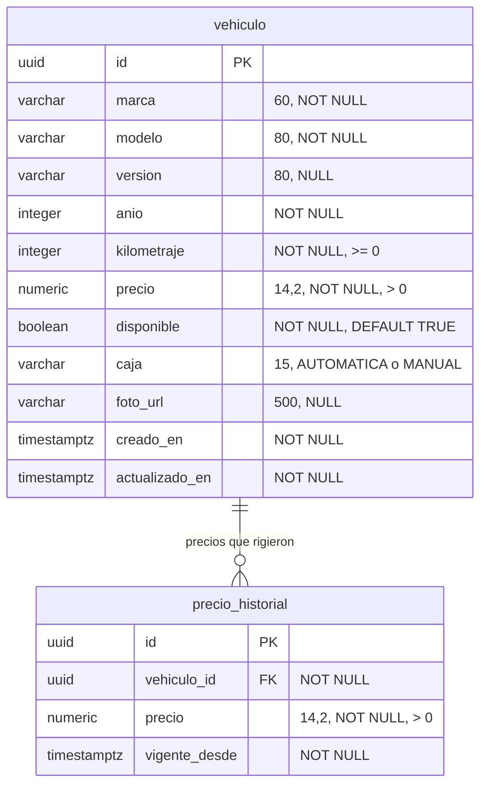
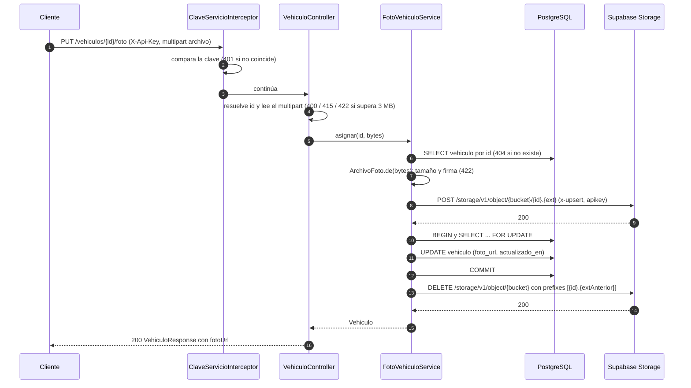

# Microservicio `vehiculos`: referencia técnica

Referencia para quien consume el servicio (`calificacion`, `gateway`, frontend) sin abrir el código. Todo lo que sigue sale del código del commit `646fc94` (rama `dev`) y de respuestas reales capturadas el 2026-10-11 (ver [§14](#14-cómo-se-generó-este-documento)). Donde el código y otro documento no coinciden, manda el código y la diferencia está en [§13](#13-inconsistencias-detectadas).

**Abreviaturas de rutas en las líneas `Fuente:`**

| Prefijo | Ruta real |
|---|---|
| `[M]` | `vehiculos-service/src/main/java/com/uade/crm/vehiculos` |
| `[R]` | `vehiculos-service/src/main/resources` |
| `[T]` | `vehiculos-service/src/test/java/com/uade/crm/vehiculos` |

## Índice

1. [Resumen](#1-resumen)
2. [Endpoints](#2-endpoints)
3. [Modelo de datos](#3-modelo-de-datos)
4. [Campos del vehículo](#4-campos-del-vehículo)
5. [Carga de imágenes](#5-carga-de-imágenes)
6. [Historial de precios](#6-historial-de-precios)
7. [Concurrencia y transacciones](#7-concurrencia-y-transacciones)
8. [Errores](#8-errores)
9. [Seguridad](#9-seguridad)
10. [Configuración](#10-configuración)
11. [Datos iniciales (seed)](#11-datos-iniciales-seed)
12. [Observabilidad](#12-observabilidad)
13. [Inconsistencias detectadas](#13-inconsistencias-detectadas)
14. [Cómo se generó este documento](#14-cómo-se-generó-este-documento)

---

## 1. Resumen

`vehiculos` es el inventario de la agencia: guarda las unidades (marca, modelo, año, kilometraje, caja, precio, disponibilidad y foto), registra cada precio que rigió en un historial y sube las fotos a Supabase Storage. Las lecturas son abiertas; las escrituras exigen el header `X-Api-Key`. No publica ni consume eventos y no llama a otros servicios.

| Dato | Valor |
|---|---|
| Puerto interno | `8083` (fijo en `application.yml`, `EXPOSE 8083` en el `Dockerfile`) |
| Path base interno | `/vehiculos` |
| Path vía gateway | `/api/vehiculos` (convención: el gateway quita `/api`). **No determinado** en código: el gateway no existe todavía en ningún repo revisado |
| Base de datos | PostgreSQL, schema `vehiculos`, migrado con Flyway |
| Stack | Java 21, Spring Boot 3.5.16, Hibernate 6.6.53, springdoc-openapi 2.9.1 |

**Perfiles de Spring**

| Perfil | Dónde se define | Qué activa |
|---|---|---|
| `local` | `application-local.yml`. Es el perfil **por defecto** (`spring.profiles.default: local`) | Datasource desde `VEHICULOS_DB_URL`, `VEHICULOS_DB_USUARIO`, `VEHICULOS_DB_CLAVE`. Logs `DEBUG` para `com.uade.crm.vehiculos` |
| `docker` | `application-docker.yml`. Lo fija el compose (`SPRING_PROFILES_ACTIVE: docker`) | El mismo datasource que `local`, sin el `DEBUG` |
| `seed` | `application-seed.yml` | Suma `classpath:db/seed` a `spring.flyway.locations` (carga 10 unidades ficticias, ver [§11](#11-datos-iniciales-seed)). Se combina: `SPRING_PROFILES_ACTIVE=local,seed`. Solo `seed` deja al servicio sin datasource |
| `test` | `src/test/resources/application-test.yml` (solo tests) | Pool de Hikari de 2 conexiones |
| `supabase` | `src/test/resources/application-supabase.yml` (solo tests, `-Psupabase`) | Corre los tests contra el schema `vehiculos_test` de Supabase |

**Levantarlo en local** (necesita las variables de [§10](#10-configuración); Spring no lee `.env` solo):

```bash
cp infra/.env.example infra/.env      # completar los valores
source scripts/cargar-env.sh          # en Windows: scripts/cargar-env.ps1
mvn -pl vehiculos-service spring-boot:run
```

**Levantarlo en Docker** (contexto en la raíz del repo, lee `infra/.env`):

```bash
docker compose -f infra/docker-compose.yml up --build
```

El contenedor publica `8083:8083`, usa siempre el perfil `docker` (nunca carga el seed) y se conecta a la base de Supabase; el compose no levanta Postgres. Swagger UI queda en `http://localhost:8083/swagger-ui.html`.

Fuente: `[R]/application.yml:1-8`, `[R]/application-local.yml:4-8`, `[R]/application-docker.yml:3-7`, `[R]/application-seed.yml:4-6`, `vehiculos-service/src/test/resources/application-test.yml:1-4`, `vehiculos-service/src/test/resources/application-supabase.yml:1-16`, `pom.xml:7-11,27`, `vehiculos-service/pom.xml:88-122`, `Dockerfile:1-19`, `infra/docker-compose.yml:1-28`, `scripts/cargar-env.sh:1-51`, `docs/arquitectura.md:41`.

---

## 2. Endpoints

**Índice.** Los endpoints de negocio salen de buscar `@RequestMapping`, `@GetMapping`, `@PostMapping`, `@PutMapping`, `@PatchMapping` y `@DeleteMapping` en `src/main`: hay un solo controller (`VehiculoController`) y ningún `@PatchMapping` ni `@DeleteMapping`. Los de Actuator y springdoc salen de `application.yml` y se confirmaron con requests reales.

| Método | Ruta interna | Ruta vía gateway | Requiere `X-Api-Key` | Descripción |
|---|---|---|---|---|
| GET | `/vehiculos` | `/api/vehiculos` | No | Lista de unidades, opcionalmente filtrada por `disponible` |
| GET | `/vehiculos/{id}` | `/api/vehiculos/{id}` | No | Detalle de una unidad (200 aunque no esté disponible) |
| GET | `/vehiculos/{id}/precio` | `/api/vehiculos/{id}/precio` | No | Precio actual y disponibilidad (lo usa `calificacion`) |
| GET | `/vehiculos/{id}/historial-precios` | `/api/vehiculos/{id}/historial-precios` | No | Precios que rigieron, del más nuevo al más viejo |
| POST | `/vehiculos` | `/api/vehiculos` | **Sí** | Alta de una unidad |
| PUT | `/vehiculos/{id}` | `/api/vehiculos/{id}` | **Sí** | Cambia `precio` y/o `disponible` |
| PUT | `/vehiculos/{id}/foto` | `/api/vehiculos/{id}/foto` | **Sí** | Carga o reemplaza la foto (multipart, campo `archivo`) |
| GET | `/actuator` | No determinado | No | Índice de endpoints de Actuator expuestos |
| GET | `/actuator/health` | No determinado | No | Salud agregada (`UP`/`DOWN`), sin detalle |
| GET | `/actuator/health/liveness` | No determinado | No | Probe de liveness |
| GET | `/actuator/health/readiness` | No determinado | No | Probe de readiness |
| GET | `/v3/api-docs` y `/v3/api-docs.yaml` | No determinado | No | Especificación OpenAPI 3 (JSON y YAML) |
| GET | `/swagger-ui.html` | No determinado | No | Redirige (302) a `/swagger-ui/index.html` |

Las rutas vía gateway siguen la convención de `docs/arquitectura.md` §1.3 y del documento de arquitectura del equipo (§8): el front llama a `/api/vehiculos/...` y el gateway quita `/api`. Si el gateway expone o no Actuator y springdoc es una decisión del gateway: **No determinado**.

Cualquier otro método sobre una ruta existente responde `405` con `Allow` (por ejemplo `DELETE /vehiculos/{id}` → `Allow: GET, PUT`), y una ruta inexistente responde `404` con `codigo` `SOLICITUD_INVALIDA` (no `VEHICULO_NO_ENCONTRADO`). Ver [§8](#8-errores).

**Headers comunes a todos los endpoints**

| Header | Dirección | Comportamiento |
|---|---|---|
| `X-Correlation-Id` | Request (opcional) | Se usa si cumple `[A-Za-z0-9._-]{1,64}`. Si falta o no cumple (espacios, saltos de línea, más de 64 caracteres), se descarta y se genera un UUID |
| `X-Correlation-Id` | Response (siempre) | El valor recibido o el generado. También viaja como `correlationId` en todo `ProblemDetail` |
| `Content-Type` | Response | `application/json` en las respuestas exitosas, `application/problem+json` en los errores, `application/vnd.spring-boot.actuator.v3+json` en Actuator |
| `Accept` | Request | Solo hay representación JSON. `Accept: application/xml` responde `406` (`SOLICITUD_INVALIDA`, `detail` `No acceptable representation`) |

El servicio no configura CORS (no hay `@CrossOrigin` ni `CorsConfiguration` en `src/main`): según el documento de arquitectura del equipo, lo resuelve el gateway.

Fuente: `[M]/api/VehiculoController.java:45-192`, `[M]/config/CorrelationIdFilter.java:22-45`, `[M]/api/error/ApiExceptionHandler.java:126-136`, `[R]/application.yml:50-64`, `[T]/config/CorrelationIdFilterTest.java:33-76`, `[T]/api/error/ApiExceptionHandlerTest.java:110-137`, `[T]/config/ConfiguracionTransversalTest.java:28-60`, captura en vivo (§14).

### 2.1 GET /vehiculos

**Propósito.** Lista para el selector del preformulario (frontend, con `disponible=true`) y para administración. El servidor solo filtra por `disponible`: el resto del filtrado (marca, modelo, caja, año, precio, kilometraje) lo hace el front en memoria. Sin paginación.

**Headers.** No requiere `X-Api-Key`. Lee y devuelve `X-Correlation-Id`.

**Query**

| Parámetro | Tipo | Obligatorio | Default | Formato inválido |
|---|---|---|---|---|
| `disponible` | booleano | No | Sin filtro: devuelve todas | `400 SOLICITUD_INVALIDA` (por ejemplo `?disponible=si`) |

El parámetro pasa por el conversor estándar de Spring, así que además de `true` y `false` acepta (probado) `1`, `yes` y `TRUE` como verdadero y `0` como falso; `?disponible=` vacío equivale a no mandarlo.

**Orden.** De la más nueva a la más vieja por `creado_en`; a igual `creado_en`, por `id` ascendente.

**Respuestas**

| HTTP | Cuándo | Body |
|---|---|---|
| 200 | Siempre que el parámetro sea válido. Sin resultados: `[]` | Arreglo de `VehiculoResponse` |
| 400 | `disponible` no convertible a booleano | `ProblemDetail` `SOLICITUD_INVALIDA` |
| 500 | Error inesperado o un dato guardado que viola las invariantes del dominio | `ProblemDetail` `ERROR_INTERNO` |

Ejemplo real (`GET /vehiculos?disponible=false` sobre el seed, captura en vivo; mismo resultado que `VehiculoApiSeedTest:69-78`):

```json
[
  {"id":"a0000000-0000-4000-8000-000000000008","marca":"Honda","modelo":"Civic","version":null,"anio":2009,"kilometraje":178000,"precio":7200000.00,"disponible":false,"caja":"MANUAL","fotoUrl":null},
  {"id":"a0000000-0000-4000-8000-000000000005","marca":"Renault","modelo":"Sandero","version":"Stepway","anio":2018,"kilometraje":81000,"precio":11500000.00,"disponible":false,"caja":"MANUAL","fotoUrl":null}
]
```

Ejemplo real del `400`:

```json
{"type":"https://crm.uade.local/errores/solicitud-invalida","title":"Solicitud inválida","status":400,"detail":"Failed to convert 'disponible' with value: 'si'","instance":"/vehiculos","codigo":"SOLICITUD_INVALIDA","correlationId":"5db7b4f8-b892-4f8e-90ec-3d84c8487102"}
```

**Efectos secundarios.** Ninguno. Transacción de solo lectura.

```bash
curl -s "http://localhost:8083/vehiculos?disponible=true"
curl -s "http://localhost:8080/api/vehiculos?disponible=true"
```

Fuente: `[M]/api/VehiculoController.java:65-75`, `[M]/application/ConsultaVehiculoService.java:15-31`, `[M]/infrastructure/persistence/VehiculoRepositorioJpa.java:33,45-52`, `[M]/infrastructure/persistence/VehiculoJpaRepository.java:15`, `[T]/api/VehiculoControllerTest.java:58-115`, `[T]/api/VehiculoApiSeedTest.java:42-78`.

### 2.2 GET /vehiculos/{id}

**Propósito.** Detalle de una unidad (frontend). Responde `200` aunque `disponible` sea `false`: quien consulta decide qué hacer.

**Headers.** No requiere `X-Api-Key`. Lee y devuelve `X-Correlation-Id`.

**Ruta**

| Parámetro | Tipo | Obligatorio | Formato inválido |
|---|---|---|---|
| `id` | UUID | Sí | `400 SOLICITUD_INVALIDA` (no llega al servicio) |

**Respuestas**

| HTTP | Cuándo | Body |
|---|---|---|
| 200 | La unidad existe | `VehiculoResponse` |
| 400 | `id` no es UUID | `ProblemDetail` `SOLICITUD_INVALIDA` |
| 404 | No existe una unidad con ese `id` | `ProblemDetail` `VEHICULO_NO_ENCONTRADO` |
| 500 | Error inesperado o dato guardado fuera de las invariantes (por ejemplo `anio` 1900 insertado a mano) | `ProblemDetail` `ERROR_INTERNO`, sin detalle |

Ejemplo real (Chevrolet Onix del seed, captura en vivo):

```json
{"id":"a0000000-0000-4000-8000-000000000004","marca":"Chevrolet","modelo":"Onix","version":null,"anio":2019,"kilometraje":64000,"precio":13200000.00,"disponible":true,"caja":"MANUAL","fotoUrl":null}
```

Ejemplo real del `404` (los mismos campos que valida `VehiculoControllerTest:183-198`):

```json
{"type":"https://crm.uade.local/errores/vehiculo-no-encontrado","title":"Vehículo no encontrado","status":404,"detail":"No existe un vehículo con id a0000000-0000-4000-8000-000000000099","instance":"/vehiculos/a0000000-0000-4000-8000-000000000099","codigo":"VEHICULO_NO_ENCONTRADO","correlationId":"f7d1530e-e6d5-45fe-b2da-3bc5e07f0d40"}
```

Ejemplo real del `400` por id inválido, con `X-Correlation-Id: ref-001` en el request:

```json
{"type":"https://crm.uade.local/errores/solicitud-invalida","title":"Solicitud inválida","status":400,"detail":"Failed to convert 'id' with value: 'no-es-un-uuid'","instance":"/vehiculos/no-es-un-uuid","codigo":"SOLICITUD_INVALIDA","correlationId":"ref-001"}
```

**Efectos secundarios.** Ninguno.

```bash
curl -s http://localhost:8083/vehiculos/a0000000-0000-4000-8000-000000000001
curl -s http://localhost:8080/api/vehiculos/a0000000-0000-4000-8000-000000000001
```

Fuente: `[M]/api/VehiculoController.java:77-88`, `[M]/application/ConsultaVehiculoService.java:33-36`, `[M]/domain/model/VehiculoNoEncontradoException.java:10-13`, `[T]/api/VehiculoControllerTest.java:117-153,183-242`, `[T]/api/VehiculoApiSeedTest.java:80-94,117-146`.

### 2.3 GET /vehiculos/{id}/precio

**Propósito.** Precio vigente y disponibilidad. Lo consume `calificacion` para calcular la cobertura. Responde `200` aunque la unidad ya no esté disponible.

**Headers, ruta y errores.** Iguales a [2.2](#22-get-vehiculosid): `400` si el id no es UUID, `404 VEHICULO_NO_ENCONTRADO`, `500 ERROR_INTERNO`.

**Respuesta 200.** Exactamente dos campos:

| Campo | Tipo JSON | Notas |
|---|---|---|
| `precio` | número | Siempre con 2 decimales (`11500000.00`) |
| `disponible` | booleano | Nunca `null` |

Ejemplo real (Renault Sandero, no disponible; idéntico a la aserción de `VehiculoApiSeedTest:93`):

```json
{"precio":11500000.00,"disponible":false}
```

**Efectos secundarios.** Ninguno. Una lectura por clave primaria, sin caché.

```bash
curl -s http://localhost:8083/vehiculos/a0000000-0000-4000-8000-000000000005/precio
curl -s http://localhost:8080/api/vehiculos/a0000000-0000-4000-8000-000000000005/precio
```

Fuente: `[M]/api/VehiculoController.java:90-102`, `[M]/api/dto/PrecioResponse.java:10-14`, `[M]/api/dto/Precios.java:16-18`, `[T]/api/VehiculoControllerTest.java:155-166,200-207`, `[T]/api/VehiculoApiSeedTest.java:80-94`.

### 2.4 GET /vehiculos/{id}/historial-precios

**Propósito.** Precios que rigieron para la unidad, del más nuevo al más viejo (administración, auditoría).

**Headers, ruta y errores.** Iguales a [2.2](#22-get-vehiculosid). Primero comprueba que la unidad exista: si no, `404`.

**Respuesta 200.** Arreglo de:

| Campo | Tipo JSON | Notas |
|---|---|---|
| `precio` | número | 2 decimales |
| `vigenteDesde` | string ISO-8601 UTC | Termina en `Z`. Los decimales de segundo son variables: `2026-09-01T10:00:00Z` (seed) o `2026-10-11T05:35:03.891685Z` (hasta microsegundos) |

Ejemplo real (unidad creada y luego cambiada de precio, captura en vivo):

```json
[{"precio":10500000.00,"vigenteDesde":"2026-10-11T05:35:03.891685Z"},{"precio":10000000.00,"vigenteDesde":"2026-10-11T05:34:44.807707Z"}]
```

Ejemplo del test `VehiculoControllerTest:168-181`:

```json
[{"precio":10500000.00,"vigenteDesde":"2026-10-07T18:20:00Z"},{"precio":10000000.00,"vigenteDesde":"2026-09-22T14:03:11Z"}]
```

Ver [§6](#6-historial-de-precios) para cuándo se escribe cada fila.

```bash
curl -s http://localhost:8083/vehiculos/a0000000-0000-4000-8000-000000000001/historial-precios
curl -s http://localhost:8080/api/vehiculos/a0000000-0000-4000-8000-000000000001/historial-precios
```

Fuente: `[M]/api/VehiculoController.java:104-115`, `[M]/api/dto/PrecioHistoricoResponse.java:11-15`, `[M]/application/ConsultaVehiculoService.java:38-42`, `[M]/infrastructure/persistence/VehiculoRepositorioJpa.java:89-95`, `[T]/api/VehiculoControllerTest.java:168-181,209-216`, `[T]/api/VehiculoApiSeedTest.java:96-115`.

### 2.5 POST /vehiculos

**Propósito.** Alta de una unidad (administración, desde Swagger o Postman; no hay pantalla de alta). Registra también el precio inicial en el historial.

**Headers**

| Header | Obligatorio | Notas |
|---|---|---|
| `X-Api-Key` | Sí | Se valida **antes** de leer el cuerpo: sin clave o con clave incorrecta, `401` aunque el JSON sea inválido |
| `Content-Type` | Sí | `application/json`. Otro tipo: `415` |
| `X-Correlation-Id` | No | Ver tabla de headers comunes |

**Body.** Ejemplo del test (`VehiculoControllerEscrituraTest:397-408`):

```json
{
  "marca": "Toyota",
  "modelo": "Corolla",
  "version": "XEI CVT",
  "anio": 2021,
  "kilometraje": 45000,
  "precio": 10000000,
  "disponible": true,
  "caja": "AUTOMATICA"
}
```

| Campo | Tipo JSON | Obligatorio | Validaciones | Notas |
|---|---|---|---|---|
| `marca` | string | Sí | No vacío ni en blanco; máximo 60 caracteres después de recortar | Se recortan los espacios de los extremos (`"  Toyota "` → `"Toyota"`) |
| `modelo` | string | Sí | No vacío; máximo 80 | Se recorta |
| `version` | string o `null` | No | Máximo 80 | Se recorta; en blanco (`"  "`) se guarda como `null` |
| `anio` | entero | Sí | Entre 1950 y 2027 (DTO). El dominio exige además ≤ año UTC actual + 1 | Ver [§4](#4-campos-del-vehículo) |
| `kilometraje` | entero | Sí | ≥ 0 | Hasta 2 147 483 647 (`int` de Java) |
| `precio` | número | Sí | > 0, hasta 12 dígitos enteros y 2 decimales | Se normaliza a 2 decimales |
| `disponible` | booleano o `null` | No | — | Ausente o `null` → `true` |
| `caja` | string | Sí | `AUTOMATICA` o `MANUAL`, exacto y en mayúsculas | `"Automática"`, `"automatica"` o `"CVT"` → 422 con los valores aceptados |

**Cómo se comporta Jackson** (configuración global en `application.yml`):

- **Campos desconocidos:** se rechazan con `422`, `errores: [{campo: "<nombre>", mensaje: "campo no admitido"}]`. Incluye `id`, `fotoUrl` y `creadoEn`: el cliente no puede fijarlos.
- **Corta en el primer error de lectura:** si el JSON tiene un campo desconocido o un valor de otro tipo, la respuesta trae solo ese error, aunque haya otros campos inválidos (probado: `anio` 2028 + `precio` 100.001 + `"id":"x"` devuelve un único error, el de `id`). Los errores de Bean Validation, en cambio, se informan todos juntos (`{}` devuelve 6).
- **`null`:** en un campo obligatorio da `422` del campo (`no debe ser nulo` / `no debe estar vacío`); en `version` y `disponible` equivale a no mandarlo.
- **Coerción de tipos:** un número como string (`"precio":"10000000"`, `"anio":"2021"`), un booleano como string (`"disponible":"false"`) o un decimal en un entero (`"anio":2021.0`, `"kilometraje":45000.7`) dan `422` con `mensaje` `el valor no tiene el tipo esperado`. **Al revés no**: un número en un campo de texto se acepta y se guarda como texto (probado: `"marca":123` crea la unidad con `"marca":"123"`).
- **Desborde de entero:** `"kilometraje":3000000000` responde `400 JSON_INVALIDO`, no `422` (probado).
- **Mensajes de Bean Validation** en español, porque el locale está fijo en `es`.

**Respuestas**

| HTTP | Cuándo | Body / headers |
|---|---|---|
| 201 | Alta correcta | `VehiculoResponse`; `Location: <scheme>://<host>/vehiculos/{id}` |
| 400 | JSON mal formado, cuerpo ausente o entero desbordado | `ProblemDetail` `JSON_INVALIDO` |
| 401 | Falta `X-Api-Key` o no coincide | `ProblemDetail` `CLAVE_SERVICIO_INVALIDA` |
| 415 | `Content-Type` distinto de JSON | `ProblemDetail` `SOLICITUD_INVALIDA`, header `Accept: application/json, application/yaml, application/*+json` |
| 422 | Bean Validation, tipo inválido, enum fuera de rango o campo no admitido | `ProblemDetail` `VALIDACION` con `errores` |
| 422 | Regla del dominio que el DTO no cubrió | `ProblemDetail` `VALIDACION` con el mensaje en `detail` y **sin** `errores`. Hoy no se alcanza: el DTO cubre todas las reglas del Builder |
| 500 | Error inesperado | `ProblemDetail` `ERROR_INTERNO` |

Ejemplo real del `201` (captura en vivo; la marca se mandó como `"  Ficticia "` y `version` como `"  "`):

```http
HTTP/1.1 201
X-Correlation-Id: 15f69f16-008b-4737-bcbc-9c5ed752fbcf
Location: http://localhost:8083/vehiculos/7c6e415c-5bf0-4afc-a212-363980f8e0ec
Content-Type: application/json

{"id":"7c6e415c-5bf0-4afc-a212-363980f8e0ec","marca":"Ficticia","modelo":"Referencia","version":null,"anio":2021,"kilometraje":45000,"precio":10000000.00,"disponible":true,"caja":"MANUAL","fotoUrl":null}
```

`Location` se arma con el host del request que llega al servicio e ignora `X-Forwarded-*` (probado). Detrás del gateway va a apuntar al host interno y sin `/api`: ver [§13](#13-inconsistencias-detectadas).

Ejemplo real del `422` con `{}`:

```json
{"type":"https://crm.uade.local/errores/validacion","title":"Datos inválidos","status":422,"detail":"Hay campos que no cumplen las validaciones","instance":"/vehiculos","codigo":"VALIDACION","correlationId":"9d007fec-b1a6-478d-8d75-bda25d5dc24f","errores":[{"campo":"caja","mensaje":"no debe ser nulo"},{"campo":"marca","mensaje":"no debe estar vacío"},{"campo":"kilometraje","mensaje":"no debe ser nulo"},{"campo":"modelo","mensaje":"no debe estar vacío"},{"campo":"precio","mensaje":"no debe ser nulo"},{"campo":"anio","mensaje":"no debe ser nulo"}]}
```

El orden de `errores` no está garantizado (Bean Validation no lo fija). Otros `errores` reales:

| Entrada | `errores` |
|---|---|
| `"caja":"Automática"` | `[{"campo":"caja","mensaje":"valor inválido, los valores aceptados son: AUTOMATICA, MANUAL"}]` |
| `"precio":100.001` | `[{"campo":"precio","mensaje":"valor numérico fuera de límites (se esperaba <12 dígitos>.<2 dígitos>)"}]` |
| `"anio":2028,"kilometraje":-1,"precio":0` | `[{"campo":"precio","mensaje":"debe ser mayor que 0"},{"campo":"anio","mensaje":"debe ser menor que o igual a 2027"},{"campo":"kilometraje","mensaje":"debe ser mayor que o igual a 0"}]` |
| `"precio":"10000000"` | `[{"campo":"precio","mensaje":"el valor no tiene el tipo esperado"}]` |
| `"id":"x"` | `[{"campo":"id","mensaje":"campo no admitido"}]` |

**Efectos secundarios.** En una sola transacción: inserta la fila en `vehiculo` (con `creado_en` = `actualizado_en` = ahora) y la fila inicial en `precio_historial`. Si algo falla, no queda nada. No toma locks de fila (el `id` es un UUID nuevo).

```bash
curl -s -i -X POST http://localhost:8083/vehiculos \
  -H "X-Api-Key: $VEHICULOS_CLAVE_ESCRITURA" -H "Content-Type: application/json" \
  -d '{"marca":"Toyota","modelo":"Corolla","version":"XEI CVT","anio":2021,"kilometraje":45000,"precio":10000000,"caja":"AUTOMATICA"}'

curl -s -i -X POST http://localhost:8080/api/vehiculos \
  -H "X-Api-Key: $VEHICULOS_CLAVE_ESCRITURA" -H "Content-Type: application/json" \
  -d '{"marca":"Toyota","modelo":"Corolla","version":"XEI CVT","anio":2021,"kilometraje":45000,"precio":10000000,"caja":"AUTOMATICA"}'
```

Que el gateway reenvíe `X-Api-Key` es **No determinado** (el gateway no existe todavía).

Fuente: `[M]/api/VehiculoController.java:117-138`, `[M]/api/dto/AltaVehiculoRequest.java:17-36`, `[M]/application/AltaVehiculoService.java:24-48`, `[M]/api/error/ApiExceptionHandler.java:68-77,106-118,162-165,216-228`, `[R]/application.yml:9-11,19-24`, `[T]/api/VehiculoControllerEscrituraTest.java:73-259`, `[T]/api/VehiculoEscrituraApiTest.java:60-81,162-171`, `[T]/api/seguridad/ClaveServicioTest.java:67-86,109-113`, captura en vivo.

### 2.6 PUT /vehiculos/{id}

**Propósito.** Cambia el precio, la disponibilidad o ambos (administración). Es una actualización parcial: los demás campos no se pueden tocar.

**Headers.** Como en [2.5](#25-post-vehiculos): `X-Api-Key` obligatoria y evaluada antes que todo (incluso antes de validar que `id` sea UUID), `Content-Type: application/json`.

**Ruta.** `id` UUID; inválido → `400 SOLICITUD_INVALIDA` (con clave válida) o `401` (sin clave).

**Body.** Ejemplo de `docs/arquitectura.md` §5.3, igual a lo que ejercita `VehiculoControllerEscrituraTest:279-285`:

```json
{ "precio": 10500000, "disponible": false }
```

| Campo | Tipo JSON | Obligatorio | Validaciones | Notas |
|---|---|---|---|---|
| `precio` | número o `null` | No | > 0, hasta 12 enteros y 2 decimales | `null` equivale a no mandarlo |
| `disponible` | booleano o `null` | No | — | `null` equivale a no mandarlo |
| (regla) | — | — | Al menos uno de los dos no nulo | Si no: `422` con `errores: [{campo: "precioODisponible", mensaje: "hay que informar precio, disponible o ambos"}]` |

Cualquier otro campo (`marca`, `anio`, `fotoUrl`, `id`...) da `422 campo no admitido`. Coerción, nulos y desbordes: igual que en el alta.

**Respuestas**

| HTTP | Cuándo | Body |
|---|---|---|
| 200 | Actualizada, o pedido sin cambios reales | `VehiculoResponse` con el estado final |
| 400 | JSON mal formado (`JSON_INVALIDO`) o `id` no UUID (`SOLICITUD_INVALIDA`) | `ProblemDetail` |
| 401 | Falta `X-Api-Key` o no coincide | `CLAVE_SERVICIO_INVALIDA` |
| 404 | No existe la unidad | `VEHICULO_NO_ENCONTRADO` |
| 405 | `PATCH` u otro método | `SOLICITUD_INVALIDA`, `Allow: GET, PUT` |
| 415 | `Content-Type` no JSON | `SOLICITUD_INVALIDA` |
| 422 | Validación del DTO o regla del dominio | `VALIDACION` |
| 500 | Error inesperado, dato guardado inválido, o falla al registrar el precio en el historial (se revierte todo) | `ERROR_INTERNO` |

Ejemplo real (`{"precio":10500000}` sobre la unidad del ejemplo de alta):

```json
{"id":"7c6e415c-5bf0-4afc-a212-363980f8e0ec","marca":"Ficticia","modelo":"Referencia","version":null,"anio":2021,"kilometraje":45000,"precio":10500000.00,"disponible":true,"caja":"MANUAL","fotoUrl":null}
```

Ejemplo real del `422` con `{}`:

```json
{"type":"https://crm.uade.local/errores/validacion","title":"Datos inválidos","status":422,"detail":"Hay campos que no cumplen las validaciones","instance":"/vehiculos/7c6e415c-5bf0-4afc-a212-363980f8e0ec","codigo":"VALIDACION","correlationId":"658bccbc-f499-4c0b-863b-52d394566595","errores":[{"campo":"precioODisponible","mensaje":"hay que informar precio, disponible o ambos"}]}
```

**Efectos secundarios**

| Pedido | Escribe `vehiculo` | `actualizado_en` | Fila en `precio_historial` |
|---|---|---|---|
| Precio distinto del actual | Sí | Se renueva | Sí, una |
| Mismo precio, aunque en otra escala (`10500000` vs `10500000.00`) | No | No cambia | No |
| Solo `disponible`, distinto del actual | Sí | Se renueva | No |
| Solo `disponible`, igual al actual | No | No cambia | No |
| Precio distinto y `disponible` | Sí, una vez | Se renueva | Sí, una |

Siempre toma un lock de fila (`SELECT … FOR UPDATE`) hasta el commit, aunque no haya cambios. Ver [§7](#7-concurrencia-y-transacciones).

```bash
curl -s -X PUT http://localhost:8083/vehiculos/a0000000-0000-4000-8000-000000000001 \
  -H "X-Api-Key: $VEHICULOS_CLAVE_ESCRITURA" -H "Content-Type: application/json" \
  -d '{"precio":25000000}'

curl -s -X PUT http://localhost:8080/api/vehiculos/a0000000-0000-4000-8000-000000000001 \
  -H "X-Api-Key: $VEHICULOS_CLAVE_ESCRITURA" -H "Content-Type: application/json" \
  -d '{"disponible":false}'
```

Fuente: `[M]/api/VehiculoController.java:140-158`, `[M]/api/dto/ActualizacionVehiculoRequest.java:10-18`, `[M]/application/ActualizacionVehiculoService.java:27-57`, `[M]/infrastructure/persistence/VehiculoJpaRepository.java:17-18`, `[T]/api/VehiculoControllerEscrituraTest.java:261-369`, `[T]/api/VehiculoEscrituraApiTest.java:83-160`, `[T]/api/AtomicidadActualizacionTest.java:46-79`, `[T]/api/seguridad/ClaveServicioTest.java:88-124`, `[T]/application/ActualizacionVehiculoServiceTest.java:50-160`, captura en vivo.

### 2.7 PUT /vehiculos/{id}/foto

**Propósito.** Carga o reemplaza la foto de la unidad (administración). El flujo completo está en [§5](#5-carga-de-imágenes).

**Headers.** `X-Api-Key` obligatoria (evaluada antes de leer el archivo). `Content-Type: multipart/form-data; boundary=...` (lo arma el cliente HTTP; no ponerlo a mano sin `boundary`).

**Ruta.** `id` UUID.

**Body.** Multipart con una parte llamada exactamente `archivo`. El nombre del archivo y el `Content-Type` de la parte se ignoran.

**Respuestas**

| HTTP | Cuándo | `codigo` / `detail` real |
|---|---|---|
| 200 | Foto subida y asignada | `VehiculoResponse` con `fotoUrl` |
| 400 | Falta la parte `archivo` | `SOLICITUD_INVALIDA`, `Required part 'archivo' is not present.` |
| 400 | Multipart mal formado (por ejemplo sin `boundary`) | `SOLICITUD_INVALIDA`, `El cuerpo multipart está mal formado` |
| 400 | `id` no es UUID | `SOLICITUD_INVALIDA` |
| 401 | Falta `X-Api-Key` o no coincide (también con archivos de más de 3 MB) | `CLAVE_SERVICIO_INVALIDA` |
| 404 | No existe la unidad | `VEHICULO_NO_ENCONTRADO` |
| 415 | El cuerpo no es multipart | `SOLICITUD_INVALIDA`, `El cuerpo debe ser multipart/form-data`, header `Accept: multipart/form-data` |
| 422 | Archivo vacío | `FOTO_INVALIDA`, `La foto está vacía` |
| 422 | No es JPEG, PNG ni WebP | `FOTO_INVALIDA`, `La foto debe ser JPEG, PNG o WebP` |
| 422 | Más de 2 MiB (incluye más de 3 MB, que corta Spring) | `FOTO_INVALIDA`, `La foto supera el tamaño máximo de 2 MB` |
| 500 | Error inesperado | `ERROR_INTERNO` |
| 503 | Storage no responde, rechazó la subida o el modo es `deshabilitado` | `ALMACENAMIENTO_NO_DISPONIBLE`; `detail` `El almacenamiento de fotos está deshabilitado` o `El almacenamiento de fotos no está disponible` |

Nunca responde `413`. Orden real de evaluación: `401` → `400` id / `415` / `400` multipart / `422` por más de 3 MB → `404` → `422` (vacío, tipo, más de 2 MiB) → `503`. Por eso un archivo de 4 MB sobre un id inexistente da `422`, y un PDF sobre un id inexistente da `404` (ambos probados).

Ejemplo de `200` (ejemplo construido a partir de `VehiculoResponse` con la unidad de `VehiculoControllerFotoTest:148-159`; el test valida `id` y `fotoUrl`):

```json
{"id":"9e8d7c6b-5a4f-4e3d-8c1b-0a9f8e7d6c5b","marca":"Toyota","modelo":"Corolla","version":null,"anio":2021,"kilometraje":45000,"precio":10000000.00,"disponible":true,"caja":"AUTOMATICA","fotoUrl":"https://proyecto-ficticio.supabase.co/storage/v1/object/public/vehiculos-fotos/9e8d7c6b-5a4f-4e3d-8c1b-0a9f8e7d6c5b.png"}
```

Ejemplo real del `503` en modo `deshabilitado`:

```json
{"type":"https://crm.uade.local/errores/almacenamiento-no-disponible","title":"Almacenamiento no disponible","status":503,"detail":"El almacenamiento de fotos está deshabilitado","instance":"/vehiculos/7c6e415c-5bf0-4afc-a212-363980f8e0ec/foto","codigo":"ALMACENAMIENTO_NO_DISPONIBLE","correlationId":"039fbaa8-2d02-4ef5-8d3c-c3b3df2eb353"}
```

**Efectos secundarios.** Sube el objeto a Storage (fuera de transacción), actualiza `foto_url` y `actualizado_en` en una transacción con lock de fila, y si la URL cambió borra el objeto anterior. No escribe en el historial de precios.

```bash
curl -s -X PUT http://localhost:8083/vehiculos/a0000000-0000-4000-8000-000000000001/foto \
  -H "X-Api-Key: $VEHICULOS_CLAVE_ESCRITURA" -F "archivo=@corolla.jpg"

curl -s -X PUT http://localhost:8080/api/vehiculos/a0000000-0000-4000-8000-000000000001/foto \
  -H "X-Api-Key: $VEHICULOS_CLAVE_ESCRITURA" -F "archivo=@corolla.jpg"
```

Fuente: `[M]/api/VehiculoController.java:160-192`, `[M]/application/FotoVehiculoService.java:34-63`, `[M]/domain/model/ArchivoFoto.java:5,15-25`, `[M]/api/error/ApiExceptionHandler.java:120-124,138-150,167-176`, `[M]/infrastructure/storage/FotoStorageDeshabilitado.java:11-21`, `[R]/application.yml:12-18`, `[T]/api/VehiculoControllerFotoTest.java:63-141`, `[T]/api/FotoApiTest.java:71-121`, `[T]/application/FotoVehiculoServiceTest.java:63-112`, captura en vivo.

### 2.8 Actuator

Solo se expone `health` (`management.endpoints.web.exposure.include: health`) con los probes habilitados. `/actuator/info`, `/actuator/env`, `/actuator/beans` y `/actuator/configprops` responden `404`.

| Ruta | Respuesta real |
|---|---|
| `GET /actuator` | `{"_links":{"self":{...},"health":{"href":"http://localhost:8083/actuator/health"},"health-path":{"href":"http://localhost:8083/actuator/health/{*path}","templated":true}}}` |
| `GET /actuator/health` | `{"status":"UP","groups":["liveness","readiness"]}` |
| `GET /actuator/health/liveness` | `{"status":"UP"}` |
| `GET /actuator/health/readiness` | `{"status":"UP"}` |

`/actuator/health` no muestra componentes (`show-details` queda en el valor por defecto de Spring Boot), pero incluye internamente el chequeo de la base (`db`), verificado en `ConfiguracionTransversalTest:37-43`. Con la base caída, el status agregado pasa a `DOWN`; el código HTTP en ese caso (503, valor por defecto de Spring Boot) no se probó.

```bash
curl -s http://localhost:8083/actuator/health
```

Fuente: `[R]/application.yml:50-58`, `infra/docker-compose.yml:22-28`, `[T]/config/ConfiguracionTransversalTest.java:28-50`, captura en vivo.

### 2.9 springdoc (OpenAPI y Swagger UI)

| Ruta | Respuesta real |
|---|---|
| `GET /v3/api-docs` | `200`, OpenAPI 3 en JSON. `info.title` `Servicio de Vehículos`, versión `0.1.0`. Esquema de seguridad `claveServicio` (`apiKey` en header `X-Api-Key`), aplicado solo a `POST /vehiculos`, `PUT /vehiculos/{id}` y `PUT /vehiculos/{id}/foto` |
| `GET /v3/api-docs.yaml` | `200`, lo mismo en YAML |
| `GET /swagger-ui.html` | `302` a `/swagger-ui/index.html` (`200`) |

Fuente: `[R]/application.yml:60-64`, `[M]/config/OpenApiConfig.java:17-32`, `[T]/api/VehiculoEscrituraApiTest.java:173-198`, `[T]/api/VehiculoApiSeedTest.java:148-162`, captura en vivo.

---

## 3. Modelo de datos

**Schema y creación.** Todo vive en el schema `vehiculos` de PostgreSQL. Flyway lo usa como schema por defecto (`spring.flyway.schemas: vehiculos`, con `create-schemas` en su valor por defecto, así que lo crea si no existe) y Hibernate lo fija con `hibernate.default_schema: vehiculos`. Hibernate no crea nada: `ddl-auto: validate` solo comprueba que entidades y tablas coincidan en nombres y tipos (largo, precisión y nulabilidad los verifica `MigracionesTest`). Hay una sola migración versionada, `V1__vehiculo.sql`, y una repetible de seed en otra ubicación ([§11](#11-datos-iniciales-seed)). Flyway ignora solo la repetible faltante (`ignore-migration-patterns: "*:future,repeatable:missing"`), para que una base ya sembrada arranque sin el perfil `seed`. La tabla `flyway_schema_history` también queda en `vehiculos`.

### Tabla `vehiculo`

| Columna | Tipo SQL | NULL | Default | Restricciones | Descripción |
|---|---|---|---|---|---|
| `id` | `UUID` | NOT NULL | — | PK | Identificador; lo genera el dominio (`UUID.randomUUID()`) |
| `marca` | `VARCHAR(60)` | NOT NULL | — | — | Marca |
| `modelo` | `VARCHAR(80)` | NOT NULL | — | — | Modelo |
| `version` | `VARCHAR(80)` | NULL | — | — | Versión comercial (por ejemplo `XEI 2.0 CVT`). No es una versión de concurrencia |
| `anio` | `INTEGER` | NOT NULL | — | Sin `CHECK` | Año del modelo |
| `kilometraje` | `INTEGER` | NOT NULL | — | `CHECK (kilometraje >= 0)` | Kilómetros |
| `precio` | `NUMERIC(14, 2)` | NOT NULL | — | `CHECK (precio > 0)` | Precio vigente |
| `disponible` | `BOOLEAN` | NOT NULL | `TRUE` | — | Si está a la venta |
| `caja` | `VARCHAR(15)` | NOT NULL | — | `CHECK (caja IN ('AUTOMATICA', 'MANUAL'))` | Tipo de caja |
| `foto_url` | `VARCHAR(500)` | NULL | — | — | URL pública de la foto en Storage |
| `creado_en` | `TIMESTAMPTZ` | NOT NULL | — | No se actualiza (`updatable = false`) | Alta; lo fija el adaptador con el `Clock` |
| `actualizado_en` | `TIMESTAMPTZ` | NOT NULL | — | — | Última escritura real; lo fija el adaptador con el `Clock` |

### Tabla `precio_historial`

| Columna | Tipo SQL | NULL | Default | Restricciones | Descripción |
|---|---|---|---|---|---|
| `id` | `UUID` | NOT NULL | — | PK | Identificador de la fila (`UUID.randomUUID()`) |
| `vehiculo_id` | `UUID` | NOT NULL | — | FK → `vehiculo(id)` (`precio_historial_vehiculo_id_fkey`), sin `ON DELETE` | Unidad |
| `precio` | `NUMERIC(14, 2)` | NOT NULL | — | `CHECK (precio > 0)` | Precio que rigió |
| `vigente_desde` | `TIMESTAMPTZ` | NOT NULL | — | — | Desde cuándo rigió. El adaptador exige que sea posterior a la última fila de la unidad |

Las filas son de solo agregado: la entidad marca las columnas como `updatable = false` y no hay endpoint que las borre o modifique.

### Índices

| Índice | Tabla | Columnas | Para qué consulta |
|---|---|---|---|
| `vehiculo_pkey` (implícito) | `vehiculo` | `id` | Detalle, precio, lock de las escrituras |
| `ix_vehiculo_disponible` | `vehiculo` | `disponible` | `GET /vehiculos?disponible=...` (`findByDisponible`) |
| `precio_historial_pkey` (implícito) | `precio_historial` | `id` | — |
| `ix_precio_historial_vehiculo` | `precio_historial` | `vehiculo_id, vigente_desde DESC` | Historial ordenado (`findByVehiculoIdOrderByVigenteDesdeDesc`) y fila vigente (`findFirstByVehiculoIdOrderByVigenteDesdeDesc`, usada para validar el orden al registrar un precio) |

No hay índice sobre `creado_en`, que ordena el listado.

### Diagrama entidad-relación



### Correspondencia entre capas

| Columna SQL | Entidad JPA | Dominio | JSON de la API |
|---|---|---|---|
| `vehiculo.id` | `VehiculoEntity.id` | `Vehiculo.id()` | `id` |
| `marca` | `marca` | `marca()` | `marca` |
| `modelo` | `modelo` | `modelo()` | `modelo` |
| `version` | `version` | `version()` (`Optional`) | `version` (`null` si falta) |
| `anio` | `anio` (`int`) | `anio()` | `anio` |
| `kilometraje` | `kilometraje` (`int`) | `kilometraje()` | `kilometraje` |
| `precio` | `precio` (`BigDecimal`) | `precio()` (escala 2) | `precio` (número, 2 decimales) |
| `disponible` | `disponible` | `disponible()` | `disponible` |
| `caja` | `caja` (`@Enumerated(STRING)`) | `caja()` (`Caja`) | `caja` |
| `foto_url` | `fotoUrl` | `fotoUrl()` (`Optional`) | `fotoUrl` (`null` si falta) |
| `creado_en` | `creadoEn` | **No existe** | **No se expone** |
| `actualizado_en` | `actualizadoEn` | **No existe** | **No se expone** |
| — | `nueva` (`@Transient`, solo en memoria) | — | — |
| `precio_historial.id` | `PrecioHistorialEntity.id` | **No existe** | **No se expone** |
| `vehiculo_id` | `vehiculoId` (sin relación JPA) | parámetro del puerto | va en la ruta (`/vehiculos/{id}/historial-precios`) |
| `precio_historial.precio` | `precio` | `PrecioHistorico.precio` | `precio` |
| `vigente_desde` | `vigenteDesde` | `PrecioHistorico.vigenteDesde` | `vigenteDesde` |

`GET /vehiculos/{id}/precio` devuelve un subconjunto (`precio`, `disponible`) de la misma fila de `vehiculo`.

Fuente: `[R]/db/migration/V1__vehiculo.sql:1-29`, `[R]/application.yml:25-39`, `[M]/infrastructure/persistence/VehiculoEntity.java:28-72`, `[M]/infrastructure/persistence/PrecioHistorialEntity.java:16-31`, `[M]/infrastructure/persistence/PrecioHistorialJpaRepository.java:11-14`, `[M]/infrastructure/persistence/VehiculoRepositorioJpa.java:76-124`, `[M]/domain/model/Vehiculo.java:21-30`, `[M]/domain/model/PrecioHistorico.java:8`, `[M]/api/dto/VehiculoResponse.java:12-36`, `[T]/infrastructure/persistence/MigracionesTest.java:44-175`, nombre de la FK tomado del log de `VehiculoRepositorioJpaTest:364` en la corrida de tests.

---

## 4. Campos del vehículo

| Campo | Tipo | Obligatorio en el alta | Modificable después | Validación en el DTO | Validación en el dominio (Builder) | Restricción en la base | Default |
|---|---|---|---|---|---|---|---|
| `id` | UUID | No se manda (si viene: `422 campo no admitido`) | No | No está en el DTO | Si no se informa, `UUID.randomUUID()` | PK | Generado |
| `marca` | texto | Sí | No | `@NotBlank`, `@Size(max = 60)`, recorte | No vacío; recorte | `VARCHAR(60) NOT NULL` | — |
| `modelo` | texto | Sí | No | `@NotBlank`, `@Size(max = 80)`, recorte | No vacío; recorte | `VARCHAR(80) NOT NULL` | — |
| `version` | texto | No | No | `@Size(max = 80)`, recorte | En blanco → `null`; recorte | `VARCHAR(80)` | `null` |
| `anio` | entero | Sí | No | `@NotNull`, `@Min(1950)`, `@Max(2027)` | 1950 ≤ anio ≤ año actual (UTC) + 1 | `INTEGER NOT NULL`, sin `CHECK` | — |
| `kilometraje` | entero | Sí | No | `@NotNull`, `@PositiveOrZero` | ≥ 0 | `INTEGER NOT NULL CHECK (>= 0)` | — |
| `precio` | decimal | Sí | Sí, `PUT /vehiculos/{id}` | `@NotNull` (solo alta), `@Positive`, `@Digits(integer = 12, fraction = 2)` | > 0, ≤ 2 decimales, ≤ 12 enteros; normaliza a escala 2 | `NUMERIC(14,2) NOT NULL CHECK (> 0)` | — |
| `disponible` | booleano | No | Sí, `PUT /vehiculos/{id}` | Ausente o `null` → `true` (alta) | Builder: `true` por defecto | `BOOLEAN NOT NULL DEFAULT TRUE` | `true` |
| `caja` | enum | Sí | No | `@NotNull`; Jackson rechaza valores fuera del enum | No nula | `VARCHAR(15) NOT NULL CHECK (IN ...)` | — |
| `fotoUrl` | texto (URL) | No se manda (si viene: `422 campo no admitido`) | Sí, `PUT /vehiculos/{id}/foto` | No está en el DTO | `asignarFoto`: no vacía | `VARCHAR(500)` | `null` |
| `creadoEn` / `actualizadoEn` | instante | Interno | Interno | — | No existen en el dominio | `TIMESTAMPTZ NOT NULL` | Los fija el adaptador |

Ningún campo descriptivo (`marca`, `modelo`, `version`, `anio`, `kilometraje`, `caja`) se puede cambiar después del alta: el `PUT` solo admite `precio` y `disponible`.

**Enum `Caja`.** Valores `AUTOMATICA` y `MANUAL`. En JSON viajan como string ASCII en mayúsculas, sin tilde, en la entrada y en la salida. En la base se guardan igual (`EnumType.STRING`). La comparación es exacta: `"automatica"` o `"Automática"` dan `422` con `mensaje` `valor inválido, los valores aceptados son: AUTOMATICA, MANUAL`.

**Precio.**

- Tipo Java `BigDecimal`; en la base `NUMERIC(14, 2)`.
- Rango: de `0.01` a `999999999999.99` (12 dígitos enteros, 2 decimales).
- Redondeo: **ninguno**. Un precio con más de 2 decimales significativos se rechaza (`422`). Ceros de más se aceptan: `10000000.000` y `1E+7` quedan en `10000000.00`.
- Salida: siempre número JSON (sin comillas) con escala 2: `10000000.00`. En JavaScript, `JSON.parse` lo convierte en `10000000`; el valor no cambia, solo se pierden los ceros.
- Moneda: **No determinado** en el código; el servicio no modela moneda. El documento de arquitectura del equipo usa pesos en sus ejemplos y el front formatea con `ARS` (`../DDA2/src/utils/formatters.js:1`).

**Reglas de rango y de dónde salen**

| Regla | Límite | Origen |
|---|---|---|
| Año mínimo | 1950 | Constante `Vehiculo.ANIO_MINIMO` y `@Min(1950)` en el DTO |
| Año máximo (DTO) | 2027 | Literal `@Max(2027)` en `AltaVehiculoRequest` |
| Año máximo (dominio) | Año actual + 1 | `Year.now(clock)`, con el `Clock` del bean `DominioConfig` en UTC. El año cambia a la medianoche UTC (21:00 de Argentina) |
| Kilometraje | 0 a 2 147 483 647 | `@PositiveOrZero`, el dominio y el `CHECK`; el máximo es el `int` de Java (más grande: `400 JSON_INVALIDO`) |
| Precio | 0.01 a 999999999999.99 | `@Digits(12, 2)` y `@Positive` en los DTO; `Vehiculo.ENTEROS_PRECIO = 12`, `DECIMALES_PRECIO = 2`; `NUMERIC(14,2)` |
| Largo de textos | 60 / 80 / 80 | `@Size` y `VARCHAR` |

**Diferencias entre DTO, dominio y base**

1. **Tope del año.** El DTO fija `2027`; el dominio usa el año actual (UTC) + 1. En 2026 coinciden. Desde el 1 de enero de 2027 (UTC) el dominio aceptaría 2028, pero el DTO lo sigue rechazando con `422` y `errores` en `anio`.
2. **La base no restringe `anio`.** Una fila con `anio` 1900 insertada por SQL rompe la lectura de esa unidad con `500 ERROR_INTERNO` (el adaptador reconstruye con el Builder, que revalida).
3. **Largo de los textos.** Lo validan el DTO y la base; el dominio no tiene tope de largo.
4. **`disponible` por defecto.** El `DEFAULT TRUE` de la base no se usa desde la aplicación: el DTO y el Builder siempre mandan un valor.
5. **Marca y modelo vacíos.** Los rechazan el DTO y el dominio; la base solo exige `NOT NULL` (acepta `''`).
6. **Precio en el `PUT`.** El DTO de actualización no tiene `@NotNull` (es opcional), pero sí `@Positive` y `@Digits`; el dominio repite las tres reglas.
7. **Números en campos de texto.** Ni el DTO ni el dominio lo impiden: `"marca":123` se guarda como `"123"`.

Fuente: `[M]/api/dto/AltaVehiculoRequest.java:17-36`, `[M]/api/dto/ActualizacionVehiculoRequest.java:10-18`, `[M]/domain/model/Vehiculo.java:16-19,32-43,90-121,129-227`, `[M]/domain/model/Caja.java:4-7`, `[M]/config/DominioConfig.java:17-20`, `[M]/infrastructure/persistence/VehiculoEntity.java:57-59`, `[R]/db/migration/V1__vehiculo.sql:4-17`, `[T]/domain/model/VehiculoBuilderTest.java:87-230`, `[T]/api/VehiculoControllerEscrituraTest.java:126-242`, `[T]/api/VehiculoApiSeedTest.java:127-146`, captura en vivo.

---

## 5. Carga de imágenes

**Endpoint.** `PUT /vehiculos/{id}/foto`, `Content-Type: multipart/form-data`, una parte llamada `archivo`. Requiere `X-Api-Key`.

**Formatos y detección.** JPEG, PNG o WebP. El tipo se detecta **por los primeros bytes** (magic numbers), no por la extensión del nombre ni por el `Content-Type` de la parte:

| Tipo | Firma | Extensión del objeto | `Content-Type` de la subida |
|---|---|---|---|
| JPEG | `FF D8 FF` al inicio | `jpg` | `image/jpeg` |
| PNG | `89 50 4E 47 0D 0A 1A 0A` al inicio | `png` | `image/png` |
| WebP | `RIFF` en el byte 0 y `WEBP` en el byte 8 | `webp` | `image/webp` |

Un PDF renombrado `.png` o enviado con `type=image/png` da `422 FOTO_INVALIDA` (probado).

**Tamaño máximo.** 2 MiB = 2 097 152 bytes, inclusive (`ArchivoFoto.TAMANIO_MAXIMO`). Hay dos barreras:

| Tamaño | Quién lo corta | Respuesta |
|---|---|---|
| Hasta 2 097 152 bytes | — | Se acepta |
| Más de 2 MiB y hasta 3 MB | El servicio (`ArchivoFoto.de`) | `422 FOTO_INVALIDA`, `La foto supera el tamaño máximo de 2 MB` |
| Más de 3 MB | Spring (`spring.servlet.multipart.max-file-size` y `max-request-size: 3MB`) | El handler traduce `MaxUploadSizeExceededException` al mismo `422`, nunca `413` |

El multipart se resuelve en diferido (`resolve-lazily: true`), así que la clave se valida antes de leer el archivo: un archivo de 4 MB sin clave da `401`. El archivo entero se carga en memoria (`MultipartFile.getBytes()`).

**Estrategias de `FotoStorage`.** Se elige con `VEHICULOS_FOTOS_MODO` (propiedad `vehiculos.modo-fotos`), sin distinguir mayúsculas. La elige `FotoStorageConfig` al arrancar.

| Valor | Implementación | Comportamiento |
|---|---|---|
| `supabase` | `SupabaseFotoStorage` | Sube y borra en Supabase Storage por HTTPS. Exige `VEHICULOS_SUPABASE_URL` y `VEHICULOS_SUPABASE_CLAVE_SECRETA` |
| `deshabilitado` | `FotoStorageDeshabilitado` | Toda carga válida responde `503 ALMACENAMIENTO_NO_DISPONIBLE` (`El almacenamiento de fotos está deshabilitado`). Las validaciones previas (`401`, `404`, `422`) se aplican igual |

**Dónde queda el archivo**

| Dato | Valor |
|---|---|
| Bucket | El de `VEHICULOS_FOTOS_BUCKET` (`.env.example`: `vehiculos-fotos`). Tiene que ser público |
| Nombre del objeto | `{vehiculoId}.{ext}`, con `ext` según el tipo detectado (`jpg`, `png`, `webp`) |
| Subida | `POST {SUPABASE_URL}/storage/v1/object/{bucket}/{vehiculoId}.{ext}` con `x-upsert: true` y la clave en el header `apikey` |
| Borrado | `DELETE {SUPABASE_URL}/storage/v1/object/{bucket}` con `{"prefixes":["{nombre}"]}` |
| URL que queda en `fotoUrl` | `{SUPABASE_URL}/storage/v1/object/public/{bucket}/{vehiculoId}.{ext}` (una barra final en `SUPABASE_URL` se descarta) |
| ¿Pasa por el gateway? | **No.** Es una URL absoluta a Supabase; el navegador la pide directo a la CDN de Supabase, sin clave |
| Timeouts | 5 s para conectar y 15 s para leer (constantes, no configurables) |

Ejemplo de `fotoUrl` (`VehiculoControllerFotoTest:44-45`, proyecto ficticio):

```
https://proyecto-ficticio.supabase.co/storage/v1/object/public/vehiculos-fotos/9e8d7c6b-5a4f-4e3d-8c1b-0a9f8e7d6c5b.png
```

**Reemplazo de la foto anterior y orden de las operaciones**

1. Busca la unidad sin lock (`404` si no existe).
2. Valida el archivo (`422`).
3. Sube a Storage con `x-upsert: true` (`503` si falla). Si el nombre coincide con el de la foto anterior (misma extensión), el objeto se pisa en este paso.
4. Abre una transacción corta, relee la unidad con `SELECT … FOR UPDATE`, asigna la URL y guarda (`foto_url` y `actualizado_en`). Commit.
5. Después del commit, si la URL anterior existía y es distinta de la nueva (cambió la extensión), borra el objeto anterior. Si la URL es la misma, no borra nada.

**Manejo de fallas**

| Falla | Resultado | ¿Archivo huérfano? |
|---|---|---|
| La subida falla (4xx, 5xx o timeout de Storage) | `503`; la base no cambia | No |
| La subida sale bien y la transacción falla (por ejemplo la unidad se borró en el medio, o error de base) | `404` o `500`; la base no cambia | **Sí**, si la extensión es nueva: queda `{id}.{ext}` sin referencia. Si la extensión es la misma que la anterior, el objeto viejo ya fue pisado: la base sigue apuntando a la misma URL, que ahora sirve la imagen nueva |
| Falla el borrado de la anterior | `200` igual; se loguea `WARN No se pudo eliminar la foto anterior ...` | **Sí**, el objeto anterior |
| La URL anterior no es de este proyecto y bucket (o tiene subcarpetas) | No se intenta borrar | Depende de dónde viva |

No hay compensación ni reintento automático.

**Diagrama de secuencia (caso exitoso, reemplazo con otra extensión)**



**Ejemplo con `curl -F`**

```bash
curl -s -X PUT http://localhost:8083/vehiculos/a0000000-0000-4000-8000-000000000001/foto \
  -H "X-Api-Key: $VEHICULOS_CLAVE_ESCRITURA" \
  -F "archivo=@corolla.jpg"
```

`curl -F` arma el `Content-Type` con el `boundary`. En Postman, no dejar un `Content-Type: multipart/form-data` escrito a mano: sin `boundary` el servicio responde `400` (ver [§13](#13-inconsistencias-detectadas)).

**Qué hacer en el frontend si `fotoUrl` es `null`.** `null` significa que la unidad no tiene foto (todas las del seed están así). El front no debe pedir nada al servicio: tiene que mostrar un reemplazo. El front actual ya lo hace en `VehicleThumb.jsx`: si no hay `fotoUrl` o la imagen falla al cargar, muestra un bloque de color con las iniciales. Como al reemplazar una foto con la misma extensión la URL no cambia, el navegador o la CDN de Supabase pueden seguir mostrando la imagen anterior durante un tiempo (el TTL de la CDN es **No determinado**).

Fuente: `[M]/api/VehiculoController.java:160-192`, `[M]/application/FotoVehiculoService.java:34-66`, `[M]/domain/model/ArchivoFoto.java:5-25`, `[M]/domain/model/TipoFoto.java:7-56`, `[M]/domain/port/FotoStorage.java:7-12`, `[M]/infrastructure/storage/FotoStorageConfig.java:17-33`, `[M]/infrastructure/storage/SupabaseFotoStorage.java:29-90`, `[M]/infrastructure/storage/FotoStorageDeshabilitado.java:9-22`, `[M]/api/error/ApiExceptionHandler.java:62,120-124,138-150`, `[R]/application.yml:12-18,43-48`, `infra/.env.example:4-7`, `[T]/application/FotoVehiculoServiceTest.java:63-218`, `[T]/infrastructure/storage/SupabaseFotoStorageTest.java:67-156`, `[T]/infrastructure/storage/FotoStorageConfigTest.java:34-51`, `[T]/domain/model/ArchivoFotoTest.java:19-103`, `[T]/api/FotoApiTest.java:71-121`, `../DDA2/src/components/VehicleThumb.jsx:3-11`, `CLAUDE.md` (lección sobre la CDN de Supabase), captura en vivo.

---

## 6. Historial de precios

**Cuándo se escribe una fila**

| Operación | ¿Agrega fila? | Detalle |
|---|---|---|
| Alta (`POST /vehiculos`) | Sí | Precio inicial, en la misma transacción que el `INSERT` de la unidad |
| `PUT` con un precio distinto del actual | Sí | En la misma transacción que el `UPDATE` |
| `PUT` con el mismo precio (aunque cambie la escala, `10500000` contra `10500000.00`) | No | Se compara con `compareTo`. Tampoco guarda la unidad ni renueva `actualizado_en` |
| `PUT` que solo cambia `disponible` | No | Guarda la unidad y renueva `actualizado_en` |
| `PUT` con precio distinto y `disponible` | Sí, una | |
| `PUT /vehiculos/{id}/foto` | No | |
| Seed | Sí, una por unidad | Con el mismo precio y `vigente_desde = creado_en` |

**Qué guarda cada fila.** `id` (UUID nuevo), `vehiculo_id`, `precio` (`NUMERIC(14,2)`) y `vigente_desde`. `vigente_desde` es `clock.instant()` (UTC, resolución de microsegundos), tomado por el caso de uso después de leer la unidad y antes de guardarla, así que queda unos microsegundos antes que `actualizado_en`. La fila más reciente siempre coincide con `vehiculo.precio`.

**Orden y unicidad.** El endpoint devuelve las filas por `vigente_desde` descendente (del más nuevo al más viejo). El adaptador rechaza registrar un precio cuyo `vigente_desde` no sea estrictamente posterior al de la última fila de la unidad (`IllegalStateException`): en ese caso la transacción entera se revierte y la API responde `500 ERROR_INTERNO` sin modificar la unidad.

**API.** `GET /vehiculos/{id}/historial-precios` responde `404` si la unidad no existe. Una unidad sin filas devolvería `[]`, pero por la API no se puede crear una unidad sin su fila inicial.

Ejemplo real, dos cambios de precio (secuencia de `VehiculoEscrituraApiTest:142-153`): alta a `10000000`, `PUT` a `10500000`, `PUT` a `9900000.50` con `disponible:false`. El historial queda `9900000.50`, `10500000.00`, `10000000.00`, en ese orden.

Fuente: `[M]/application/AltaVehiculoService.java:24-31`, `[M]/application/ActualizacionVehiculoService.java:27-49`, `[M]/infrastructure/persistence/VehiculoRepositorioJpa.java:76-95`, `[M]/infrastructure/persistence/PrecioHistorialJpaRepository.java:11-14`, `[M]/config/DominioConfig.java:17-20`, `[M]/domain/port/VehiculoRepositorio.java:34-41`, `[T]/api/VehiculoEscrituraApiTest.java:60-153`, `[T]/api/AtomicidadActualizacionTest.java:46-79`, `[T]/infrastructure/persistence/VehiculoRepositorioJpaTest.java:236-307`, `[T]/application/ActualizacionVehiculoServiceTest.java:60-142`, `[R]/db/seed/R__seed_vehiculos.sql:24-37`.

---

## 7. Concurrencia y transacciones

**Dónde hay transacciones**

| Clase | Método | Transacción |
|---|---|---|
| `ConsultaVehiculoService` | todos (anotación de clase) | `@Transactional(readOnly = true)` |
| `AltaVehiculoService` | `registrar` | `@Transactional` |
| `ActualizacionVehiculoService` | `actualizar` | `@Transactional` |
| `FotoVehiculoService` | `asignar` | Sin `@Transactional`. Solo el paso de base va en `TransactionOperations.execute(...)`; la llamada HTTP a Storage queda afuera para no retener una conexión |
| `VehiculoRepositorioJpa` | `buscar`, `buscarPorId`, `historialDePrecios` | `readOnly = true` (se suman a la del caso de uso o abren una propia) |
| `VehiculoRepositorioJpa` | `buscarPorIdParaActualizar`, `guardar`, `registrarPrecio` | `Propagation.MANDATORY`: sin transacción abierta fallan con `IllegalTransactionStateException` |

**Locks.** `VehiculoJpaRepository.findParaActualizarById` tiene `@Lock(PESSIMISTIC_WRITE)`; con el dialecto PostgreSQL de Hibernate 6.6 se traduce a `SELECT … FOR UPDATE`, sin timeout. Lo usan el `PUT /vehiculos/{id}` y la transacción de la foto. El lock dura hasta el commit. No hay `@Version` (sin control optimista) ni `lock_timeout` configurado: una escritura espera lo que tarde la otra. Las lecturas no toman locks. El alta no bloquea nada: el `id` es nuevo.

**Dos `PUT` simultáneos sobre la misma unidad.** El segundo queda esperando en el `SELECT … FOR UPDATE` hasta que el primero confirma; después lee lo que dejó el primero y aplica solo los campos que trae. Resultado: cada campo queda con el valor del último `PUT` que lo mandó, y un `PUT` que solo cambia `disponible` no revierte el precio que confirmó el otro. Si los dos cambian el precio, quedan dos filas en el historial y la última coincide con `vehiculo.precio`. Lo mismo vale entre un `PUT` y la transacción de la foto: la foto relee la unidad con lock antes de guardar, así no pisa un precio cambiado durante la subida.

**Test que lo verifica.** `CarreraDePutsTest` (contra PostgreSQL real) reemplaza el repositorio por uno que pausa 1,5 s dentro de `guardar` y lanza un cambio de precio en el medio: `unPutDeDisponibilidadNoRevierteUnCambioDePrecioConcurrente` y `unaFotoNoRevierteUnCambioDePrecioConcurrente` comprueban que el precio final y la última fila del historial son los del cambio concurrente. `AtomicidadActualizacionTest` comprueba que si falla `registrarPrecio`, la unidad no queda modificada.

**No cubierto.** Dos cargas de foto simultáneas con la misma extensión escriben el mismo objeto fuera de transacción: qué contenido queda depende de cuál termina último en Storage, no del orden de los commits. **No determinado** (no hay test).

Fuente: `[M]/application/ConsultaVehiculoService.java:15-17`, `[M]/application/AltaVehiculoService.java:24`, `[M]/application/ActualizacionVehiculoService.java:27-49`, `[M]/application/FotoVehiculoService.java:34-51`, `[M]/infrastructure/persistence/VehiculoJpaRepository.java:17-18`, `[M]/infrastructure/persistence/VehiculoRepositorioJpa.java:45-87`, `[M]/infrastructure/persistence/VehiculoEntity.java:21-22`, `[T]/api/CarreraDePutsTest.java:86-205`, `[T]/api/AtomicidadActualizacionTest.java:46-79`, `[T]/infrastructure/persistence/VehiculoRepositorioJpaTest.java:319-362`, `hibernate-core-6.6.53.Final` (`PostgreSQLDialect` hereda `getForUpdateString()` = ` for update`).

---

## 8. Errores

**Formato.** Todo error responde `Content-Type: application/problem+json` con un `ProblemDetail` (RFC 9457, antes 7807):

| Campo | Tipo | Siempre | Contenido |
|---|---|---|---|
| `type` | URI | Sí | `https://crm.uade.local/errores/{slug}` (el slug sale de `CodigoError`). No es una URL navegable |
| `title` | string | Sí | Título fijo del código (por ejemplo `Datos inválidos`) |
| `status` | entero | Sí | El mismo status HTTP de la respuesta |
| `detail` | string | Sí | Mensaje legible. Los propios están en español; los que arma Spring (`400` de conversión, `405`, `406`, `415`, ruta inexistente) quedan en inglés |
| `instance` | URI | Sí | La ruta del request, sin query string |
| `codigo` | string | Sí | Código estable para programar contra él (tabla de abajo) |
| `correlationId` | string | Sí | El de la respuesta (`X-Correlation-Id`) |
| `errores` | arreglo de `{campo, mensaje}` | Solo en `VALIDACION` originada en el DTO o en Jackson | Un elemento por campo inválido. No aparece en el `422` del dominio ni en `FOTO_INVALIDA` |

Ejemplo real:

```json
{
  "type": "https://crm.uade.local/errores/validacion",
  "title": "Datos inválidos",
  "status": 422,
  "detail": "Hay campos que no cumplen las validaciones",
  "instance": "/vehiculos/7c6e415c-5bf0-4afc-a212-363980f8e0ec",
  "codigo": "VALIDACION",
  "correlationId": "cdb5267d-444c-4e5d-a7d8-034354d31682",
  "errores": [{ "campo": "marca", "mensaje": "campo no admitido" }]
}
```

**Catálogo**

| Código | HTTP | Cuándo ocurre | Ejemplo de `detail` (real) |
|---|---|---|---|
| `VALIDACION` | 422 | Bean Validation del cuerpo; valor de otro tipo; enum fuera de rango; campo no admitido. Trae `errores` | `Hay campos que no cumplen las validaciones` |
| `VALIDACION` | 422 | Regla del dominio que el DTO no cubrió (`DatosInvalidosException`). Sin `errores`. Hoy inalcanzable | `El año debe estar entre 1950 y 2027` (del test `VehiculoControllerEscrituraTest:251-259`) |
| `JSON_INVALIDO` | 400 | Cuerpo ilegible: JSON mal formado, ausente o con un entero que desborda | `El cuerpo de la solicitud no es un JSON válido` |
| `SOLICITUD_INVALIDA` | 400 | Parámetro o id de ruta no convertible (`disponible=si`, id no UUID); falta la parte `archivo`; multipart mal formado | `Failed to convert 'id' with value: 'no-es-un-uuid'`; `Required part 'archivo' is not present.`; `El cuerpo multipart está mal formado` |
| `SOLICITUD_INVALIDA` | 404 | Ruta inexistente | `No static resource no-existe.` |
| `SOLICITUD_INVALIDA` | 405 | Método no soportado (con header `Allow`) | `Request method 'DELETE' is not supported` |
| `SOLICITUD_INVALIDA` | 406 | `Accept` sin representación posible | `No acceptable representation` |
| `SOLICITUD_INVALIDA` | 415 | `Content-Type` no soportado (JSON esperado), o cuerpo no multipart en la foto | `Content-Type 'text/plain;charset=UTF-8' is not supported`; `El cuerpo debe ser multipart/form-data` |
| `CLAVE_SERVICIO_INVALIDA` | 401 | Escritura sin `X-Api-Key` o con una clave distinta | `Falta el header X-Api-Key o la clave no es válida` |
| `VEHICULO_NO_ENCONTRADO` | 404 | El id no existe | `No existe un vehículo con id a0000000-0000-4000-8000-000000000099` |
| `FOTO_INVALIDA` | 422 | Archivo vacío, de otro tipo o de más de 2 MiB (también más de 3 MB) | `La foto está vacía`; `La foto debe ser JPEG, PNG o WebP`; `La foto supera el tamaño máximo de 2 MB` |
| `ALMACENAMIENTO_NO_DISPONIBLE` | 503 | Storage respondió 4xx/5xx o no respondió; modo `deshabilitado` | `El almacenamiento de fotos no está disponible`; `El almacenamiento de fotos está deshabilitado` |
| `ERROR_INTERNO` | 500 | Excepción no controlada, dato guardado fuera de las invariantes, falla al registrar el historial. Se loguea en `ERROR` con la traza y se responde sin detalles técnicos | `Ocurrió un error inesperado` |

`SOLICITUD_INVALIDA` conserva el status real que resuelve Spring MVC: para distinguir un `404` de ruta de un `404` de unidad hay que mirar `codigo`.

Fuente: `[M]/api/error/CodigoError.java:11-46`, `[M]/api/error/ApiExceptionHandler.java:55-240`, `[M]/api/seguridad/ClaveServicioInvalidaException.java:5-7`, `[M]/domain/model/ArchivoFoto.java:15-25`, `[M]/infrastructure/storage/SupabaseFotoStorage.java:82-90`, `[M]/infrastructure/storage/FotoStorageDeshabilitado.java:11`, `[T]/api/error/ApiExceptionHandlerTest.java:46-170`, `[T]/api/VehiculoControllerTest.java:183-242`, captura en vivo.

---

## 9. Seguridad

**Qué exige clave.** Solo los métodos anotados con `@RequiereClaveServicio`: `POST /vehiculos`, `PUT /vehiculos/{id}` y `PUT /vehiculos/{id}/foto`. Quedan abiertos los cuatro `GET` de `/vehiculos`, `/actuator/**`, `/v3/api-docs` y Swagger UI.

**Cómo se valida.** Un `HandlerInterceptor` (`ClaveServicioInterceptor`) corre después de elegir el handler y antes de resolver sus argumentos. Compara los bytes UTF-8 del header `X-Api-Key` con la clave configurada usando `MessageDigest.isEqual` (tiempo constante para claves del mismo largo). Consecuencias:

- **Header faltante, vacío, en blanco o incorrecto:** la misma respuesta, `401 CLAVE_SERVICIO_INVALIDA` con `detail` `Falta el header X-Api-Key o la clave no es válida`. No hay `403`.
- **Antes que todo lo demás:** el `401` sale antes de validar el JSON, el tipo de contenido, el id de ruta y el tamaño del archivo (`PUT /vehiculos/no-es-un-uuid` sin clave da `401`, no `400`).
- **Sin `WWW-Authenticate`** en la respuesta.
- **La clave nunca se loguea** ni aparece en respuestas; `VehiculosProperties.toString()` la muestra como `****`.

**Dónde se configura.** Variable `VEHICULOS_CLAVE_ESCRITURA` (propiedad `vehiculos.clave-escritura`), obligatoria, de al menos 32 caracteres y sin placeholders (`<...>` o `${...}`). Es una sola clave compartida para todos los clientes que escriben; no hay rotación ni varias claves.

**Qué no es.** No es autenticación de usuarios: no identifica a una persona ni tiene roles o sesiones. Es un secreto compartido entre servicios para proteger las escrituras. Las lecturas no tienen ninguna protección en el servicio; si hace falta restringirlas, le toca al gateway.

**Otros puntos.** El servicio no configura CORS. Los secretos de Supabase (`VEHICULOS_SUPABASE_CLAVE_SECRETA`) viajan solo en el header `apikey` hacia Storage y no aparecen en los logs de error (`SecretosEnLogsTest`).

Fuente: `[M]/api/seguridad/ClaveServicioInterceptor.java:13-35`, `[M]/api/seguridad/RequiereClaveServicio.java:9-13`, `[M]/api/seguridad/ClaveServicioInvalidaException.java:5-7`, `[M]/config/WebConfig.java:10-23`, `[M]/config/VehiculosProperties.java:35-39,42,62-69`, `[M]/config/OpenApiConfig.java:26-31`, `[M]/api/VehiculoController.java:118,141,161`, `[T]/api/seguridad/ClaveServicioTest.java:67-152`, `[T]/infrastructure/storage/SecretosEnLogsTest.java:144-170`, captura en vivo.

---

## 10. Configuración

Spring no lee `.env`: las variables tienen que estar en el entorno del proceso (`scripts/cargar-env.sh` o `.ps1` en local; `infra/.env` vía compose en Docker).

| Variable o propiedad | Obligatoria | Default | Perfil | Para qué sirve |
|---|---|---|---|---|
| `VEHICULOS_DB_URL` → `spring.datasource.url` | Sí | — | `local`, `docker` | JDBC de PostgreSQL. En Supabase: session pooler, puerto 5432, `sslmode=require` |
| `VEHICULOS_DB_USUARIO` → `spring.datasource.username` | Sí | — | `local`, `docker` | Rol de la base (`vehiculos_app.<project-ref>`) |
| `VEHICULOS_DB_CLAVE` → `spring.datasource.password` | Sí | — | `local`, `docker` | Contraseña del rol |
| `VEHICULOS_FOTOS_MODO` → `vehiculos.modo-fotos` | Sí | — | todos | `supabase` o `deshabilitado` (sin distinguir mayúsculas) |
| `VEHICULOS_FOTOS_BUCKET` → `vehiculos.bucket-fotos` | Sí | — | todos | Bucket público de Storage (`.env.example`: `vehiculos-fotos`) |
| `VEHICULOS_SUPABASE_URL` → `vehiculos.supabase-url` | Solo en modo `supabase` | vacío | todos | URL del proyecto de Supabase (`https://<project-ref>.supabase.co`) |
| `VEHICULOS_SUPABASE_CLAVE_SECRETA` → `vehiculos.supabase-clave-secreta` | Solo en modo `supabase` | vacío | todos | Clave `sb_secret_...` para Storage; viaja en el header `apikey` |
| `VEHICULOS_CLAVE_ESCRITURA` → `vehiculos.clave-escritura` | Sí, 32 caracteres o más | — | todos | Valor esperado en `X-Api-Key` |
| `SPRING_PROFILES_ACTIVE` | No | `local` (`spring.profiles.default`) | — | El compose la fija en `docker`. Para el seed: `local,seed` |
| `server.port` | Fija | `8083` | todos | Puerto HTTP. No tiene variable propia en `application.yml` |
| `spring.servlet.multipart.max-file-size` / `max-request-size` | Fija | `3MB` | todos | Corte de Spring para el multipart |
| `spring.servlet.multipart.resolve-lazily` | Fija | `true` | todos | Lee el archivo después del interceptor de la clave |
| `spring.jackson.deserialization.fail-on-unknown-properties` | Fija | `true` | todos | Campos desconocidos → `422` |
| `spring.jackson.deserialization.accept-float-as-int` | Fija | `false` | todos | Decimales en enteros → `422` |
| `spring.jackson.mapper.allow-coercion-of-scalars` | Fija | `false` | todos | Strings en campos numéricos o booleanos → `422` |
| `spring.web.locale` / `locale-resolver` | Fija | `es` / `fixed` | todos | Mensajes de Bean Validation en español |
| `spring.jpa.open-in-view` | Fija | `false` | todos | |
| `spring.jpa.hibernate.ddl-auto` | Fija | `validate` | todos | Hibernate no crea ni altera tablas |
| `spring.jpa.properties.hibernate.default_schema` | Fija | `vehiculos` | todos (`vehiculos_test` en el perfil de test `supabase`) | Schema |
| `spring.flyway.locations` | Fija | `classpath:db/migration` (`+ classpath:db/seed` con `seed`) | todos | Migraciones |
| `spring.flyway.schemas` | Fija | `vehiculos` | todos | Schema de Flyway |
| `spring.flyway.ignore-migration-patterns` | Fija | `*:future,repeatable:missing` | todos | Permite arrancar sin `seed` sobre una base sembrada |
| `management.endpoints.web.exposure.include` | Fija | `health` | todos | Único endpoint de Actuator |
| `management.endpoint.health.probes.enabled` | Fija | `true` | todos | `/actuator/health/liveness` y `/readiness` |
| `springdoc.api-docs.path` / `swagger-ui.path` | Fija | `/v3/api-docs` / `/swagger-ui.html` | todos | Documentación |
| Timeouts de Storage | Fija (constantes) | 5 s conexión, 15 s lectura | todos | `FotoStorageConfig` |

**Si falta una obligatoria.** En `application.yml` las obligatorias se referencian sin valor por defecto (`${VAR}`); si falta, Spring entrega el texto literal `${VAR}` y:

- `VEHICULOS_FOTOS_MODO`, `VEHICULOS_FOTOS_BUCKET`, `VEHICULOS_CLAVE_ESCRITURA`: el arranque falla por la validación de `VehiculosProperties` (`@NotNull`, `@NotBlank`, `@Size(min = 32)`, rechazo de `<...>` y `${`), con un mensaje que nombra la variable (por ejemplo `VEHICULOS_CLAVE_ESCRITURA debe tener al menos 32 caracteres`).
- Modo `supabase` sin `VEHICULOS_SUPABASE_URL` o sin `VEHICULOS_SUPABASE_CLAVE_SECRETA`: falla con `... es obligatoria en modo supabase`.
- `VEHICULOS_DB_*`: falla al conectar (Flyway y JPA se conectan antes de que se valide `VehiculosProperties`, así que ese error aparece primero). El mensaje exacto es **No determinado** (no se probó).
- En Docker, el compose ni siquiera arranca el contenedor: las seis obligatorias usan `${VAR:?mensaje}`, que también rechaza el valor vacío. Las dos de Supabase usan `${VAR:-}` (vacío por defecto). El contenedor se reinicia hasta 3 veces si falla (`restart: on-failure:3`).

Fuente: `[R]/application.yml:1-64`, `[R]/application-local.yml:1-8`, `[R]/application-docker.yml:1-7`, `[R]/application-seed.yml:1-6`, `[M]/config/VehiculosProperties.java:22-70`, `[M]/infrastructure/storage/FotoStorageConfig.java:17-18`, `infra/.env.example:1-8`, `infra/docker-compose.yml:10-21`, `[T]/config/VehiculosPropertiesTest.java:55-122`, `[T]/infrastructure/storage/FotoStorageConfigTest.java:34-51`, `docs/mejoras.md` (entrada de la etapa 8 sobre el orden de validación), `CLAUDE.md` (lecciones sobre placeholders y compose).

---

## 11. Datos iniciales (seed)

**Script.** `vehiculos-service/src/main/resources/db/seed/R__seed_vehiculos.sql`, una migración **repetible** de Flyway (prefijo `R__`). Corre después de las versionadas y se vuelve a ejecutar solo si cambia su contenido.

**Cuándo corre.** Solo con el perfil `seed`, que suma `classpath:db/seed` a `spring.flyway.locations`. Se activa con `SPRING_PROFILES_ACTIVE=local,seed`. **No corre en Docker**: el compose fija `SPRING_PROFILES_ACTIVE: docker`. En los tests corre solo en las clases anotadas con `@PruebaIntegracionSeed`.

**Idempotencia.** Ids fijos y `ON CONFLICT (id) DO NOTHING`: no duplica filas, pero tampoco actualiza las ya cargadas.

**Contenido.** 10 unidades ficticias, todas con `foto_url` en `NULL`, `creado_en = actualizado_en` (un día por unidad, del 1 al 10 de septiembre de 2026 a las 10:00 UTC) y una fila en `precio_historial` con el mismo precio y `vigente_desde = creado_en` (ids `b0000000-0000-4000-8000-0000000000NN`). 8 disponibles y 2 no disponibles (Sandero y Civic).

| `id` | Marca | Modelo | Versión | Año | Km | Precio | Disponible | Caja |
|---|---|---|---|---|---|---|---|---|
| `a0000000-0000-4000-8000-000000000001` | Toyota | Corolla | XEI 2.0 CVT | 2022 | 28 000 | 24500000.00 | Sí | AUTOMATICA |
| `a0000000-0000-4000-8000-000000000002` | Ford | Fiesta | SE 1.6 | 2015 | 96 000 | 9800000.00 | Sí | MANUAL |
| `a0000000-0000-4000-8000-000000000003` | Volkswagen | Amarok | V6 Highline | 2023 | 15 000 | 52000000.00 | Sí | AUTOMATICA |
| `a0000000-0000-4000-8000-000000000004` | Chevrolet | Onix | — | 2019 | 64 000 | 13200000.00 | Sí | MANUAL |
| `a0000000-0000-4000-8000-000000000005` | Renault | Sandero | Stepway | 2018 | 81 000 | 11500000.00 | **No** | MANUAL |
| `a0000000-0000-4000-8000-000000000006` | Peugeot | 208 | Allure Pack | 2021 | 39 000 | 17900000.00 | Sí | AUTOMATICA |
| `a0000000-0000-4000-8000-000000000007` | Fiat | Cronos | Drive 1.3 | 2020 | 52 000 | 14800000.00 | Sí | MANUAL |
| `a0000000-0000-4000-8000-000000000008` | Honda | Civic | — | 2009 | 178 000 | 7200000.00 | **No** | MANUAL |
| `a0000000-0000-4000-8000-000000000009` | Nissan | Kicks | Exclusive CVT | 2025 | 8 000 | 31500000.00 | Sí | AUTOMATICA |
| `a0000000-0000-4000-8000-000000000010` | Citroën | C3 | Feel 1.6 | 2017 | 110 000 | 8900000.00 | Sí | MANUAL |

En el listado el orden es inverso al de la tabla (Citroën C3 primero, Toyota Corolla último).

Fuente: `[R]/db/seed/R__seed_vehiculos.sql:1-37`, `[R]/application-seed.yml:1-6`, `infra/docker-compose.yml:11-12`, `[T]/PruebaIntegracionSeed.java:12-19`, `[T]/infrastructure/persistence/SeedTest.java:47-117`, `[T]/api/VehiculoApiSeedTest.java:42-78`.

---

## 12. Observabilidad

**Actuator.** Solo `health`, con probes. Ver [2.8](#28-actuator).

| Endpoint | Uso |
|---|---|
| `/actuator/health` | Salud agregada (incluye la base). La usa el `healthcheck` del compose: `curl -fsS http://localhost:8083/actuator/health` cada 15 s, timeout 5 s, 4 reintentos, `start_period` 60 s |
| `/actuator/health/liveness` | Probe de liveness |
| `/actuator/health/readiness` | Probe de readiness |

**Formato de log.** Una línea por evento en la consola, UTF-8, con el patrón:

```
%d{yyyy-MM-dd'T'HH:mm:ss.SSSXXX} %5p [%X{correlationId:-}] %logger{36} - %msg%n%wEx
```

Nivel raíz `INFO`. Con el perfil `local`, `com.uade.crm.vehiculos` baja a `DEBUG` (por ejemplo, registra el motivo de un cuerpo ilegible). El perfil `docker` no cambia niveles.

**`correlationId` en los logs.** `CorrelationIdFilter` corre primero (`HIGHEST_PRECEDENCE`), pone el id en el MDC con la clave `correlationId` y lo saca al terminar el request. Toda línea escrita durante un request lo lleva entre corchetes; fuera de un request (arranque, tareas) queda `[]`. Líneas reales:

```
2026-10-11T02:34:44.610-03:00  WARN [2fac926a-4739-43a9-beeb-0511ddbaea67] o.s.web.servlet.PageNotFound - Request method 'DELETE' is not supported
2026-10-11T02:34:44.701-03:00 DEBUG [089847f2-32ee-43e8-99d1-67c4f81afd1d] c.u.c.v.a.error.ApiExceptionHandler - Cuerpo ilegible: JSON parse error: Unexpected end-of-input within/between Object entries
2026-10-11T02:34:31.347-03:00  INFO [] o.a.c.c.C.[Tomcat].[localhost].[/] - Initializing Spring DispatcherServlet 'dispatcherServlet'
```

**Qué se loguea**

| Evento | Nivel | Logger |
|---|---|---|
| Error `500` | `ERROR`, con la traza (`Error no controlado al procesar {ruta}`) | `ApiExceptionHandler` |
| Storage respondió con error o no respondió | `WARN`, con status y cuerpo de la respuesta, sin headers | `SupabaseFotoStorage` |
| No se pudo borrar la foto anterior | `WARN` | `FotoVehiculoService` |
| Cuerpo JSON o multipart ilegible | `DEBUG` | `ApiExceptionHandler` |

No hay métricas, trazas distribuidas ni logs en JSON.

Fuente: `[R]/logback-spring.xml:1-23`, `[M]/config/CorrelationIdFilter.java:17-45`, `[M]/api/error/ApiExceptionHandler.java:116,134,147,180`, `[M]/infrastructure/storage/SupabaseFotoStorage.java:82-90`, `[M]/application/FotoVehiculoService.java:53-59`, `[R]/application.yml:50-58`, `infra/docker-compose.yml:22-28`, `[T]/config/CorrelationIdFilterTest.java:33-76`, `[T]/config/ConfiguracionTransversalTest.java:28-50`, log de la captura en vivo.

---

## 13. Inconsistencias detectadas

Solo se describen; no se corrigió nada.

### Entre capas del código

1. **Tope del año.** `AltaVehiculoRequest` fija `@Max(2027)`; el Builder usa el año actual (UTC) + 1. Coinciden solo en 2026. (`[M]/api/dto/AltaVehiculoRequest.java:21`, `[M]/domain/model/Vehiculo.java:212-219`)
2. **La base no restringe `anio` ni impide `marca`/`modelo` vacíos.** Un dato cargado por SQL fuera de las invariantes rompe la lectura de esa unidad con `500`, y también el listado completo que la incluya. (`[R]/db/migration/V1__vehiculo.sql:4-17`, `[M]/infrastructure/persistence/VehiculoRepositorioJpa.java:51,111-124`)
3. **El dominio no valida largos de texto;** solo el DTO y la base. (`[M]/domain/model/Vehiculo.java:123-127,200-210`)
4. **`DEFAULT TRUE` de `disponible` en la base** no lo usa la aplicación. (`[R]/db/migration/V1__vehiculo.sql:12`)

### Código contra `docs/arquitectura.md`

5. **Desborde de entero da `400`, no `422`.** §3.3 (línea 144) dice que un valor que no se puede convertir al tipo del campo da `422 VALIDACION`. Un entero fuera del rango de `int` (`"kilometraje":3000000000`) responde `400 JSON_INVALIDO` (probado).
6. **Número en campo de texto.** §3.3 enumera las coerciones rechazadas (decimal en entero, texto en número o booleano). No menciona el caso inverso, que se acepta: `"marca":123` se guarda como `"123"` (probado).
7. **Tabla de endpoints incompleta.** §5.1 (líneas 200-201) lista para `POST` solo `201` y `422`, y para `PUT /vehiculos/{id}` solo `200`, `404` y `422`. El código también responde `400`, `401`, `415` y `500` (y `405` a `PATCH`).
8. **Falla parcial de la foto.** §7 (línea 292) dice que si la base falla después de subir "queda un objeto huérfano. Es aceptable: el reintento escribe el mismo nombre". Con la misma extensión no queda huérfano sino que la foto anterior ya fue pisada; con otra extensión, el huérfano no lo limpia un reintento que use una tercera extensión.
9. **`Location` detrás del gateway.** El documento no lo menciona. `Location` se arma con el host del request e ignora `X-Forwarded-*` (no hay `server.forward-headers-strategy`); detrás del gateway apuntaría al host interno del servicio y sin `/api` (probado enviando `X-Forwarded-Host`, `X-Forwarded-Prefix` y `X-Forwarded-Port`).

### Código contra el documento de arquitectura del equipo (`v1.1_Documento_de_arquitectura_CRM_leads.docx`)

10. **Rutas de escritura.** §8.3 lista `POST / PUT /vehiculos`. El código expone `POST /vehiculos`, `PUT /vehiculos/{id}` y `PUT /vehiculos/{id}/foto`, y además `GET /vehiculos/{id}/historial-precios`, que el documento no menciona.
11. **Despliegue.** §13.3 dice que los servicios (8081 a 8084) solo son accesibles desde la red interna y que hay un Postgres en contenedor con una base por servicio. El compose de este repo publica `8083:8083` en el host y no levanta Postgres: usa Supabase.
12. **Estructura del repositorio.** §14.1 describe un monorepo con módulo `contracts/`. `vehiculos` está en un repo propio y sin `contracts` (decisión registrada en `CLAUDE.md`).

### Código contra la colección de Postman (`docs/Servicio de Vehículos.postman_collection.json`)

13. **Ejemplos de respuesta generados al azar.** Los ejemplos de `200`/`201` traen `"marca":"string"`, `"anio":5040`, `"precio":10000000` sin decimales; los `422` traen `"status":1463`, `"properties":null` y no tienen `codigo`, `correlationId` ni `errores`. No reflejan lo que responde la API.
14. **`PUT /vehiculos/{id}/foto` con `Content-Type: multipart/form-data` fijo,** sin `boundary`. Si Postman respeta ese header, el servicio responde `400 El cuerpo multipart está mal formado`. Cómo combina Postman ese header con un body *form-data* es **No determinado** (no se probó); `CLAUDE.md` registra que un header puesto a mano gana sobre el que arma Postman.
15. **El archivo de la foto es un PDF de una ruta absoluta local** (`.../pruebas-vehiculos/Grupo_6_Etapa_1.pdf`): en otra máquina no existe y, si existe, la respuesta es `422 FOTO_INVALIDA`.
16. **Variables sin definir.** La colección define solo `baseUrl`; `idCorolla`, `idFicticio` y `apiKey` tienen que venir de un entorno que no está en el repo.
17. **Descripción del `400` de la foto desactualizada:** dice "Falta el campo `archivo` o el id no es UUID"; el código también responde `400` por multipart mal formado.
18. **Solo apunta al servicio directo** (`http://localhost:8083`), no al gateway.

### Código contra su propia documentación OpenAPI (`/v3/api-docs`)

19. **El esquema `ProblemDetail` publicado no tiene `codigo`, `correlationId` ni `errores`,** y sí tiene un campo `properties` que la API nunca devuelve (verificado en `/v3/api-docs`). Un cliente generado desde OpenAPI no va a ver esos campos.
20. **Las respuestas exitosas se documentan con content type `*/*`** en lugar de `application/json` (`VehiculoApiSeedTest:154`).

### Código contra lo que espera el frontend (`../DDA2`)

21. **Valores de `caja`.** `docs/contratos-backend.md:60` espera `Automática` o `Manual`, y el filtro compara contra `"Automática"` (`VehicleFilters.jsx:32`, `VehicleSelection.jsx:14`). La API devuelve `AUTOMATICA` y `MANUAL`.
22. **Nombres de campos.** El mock usa `brand`, `model`, `year`, `km`, `transmission`, `price` y `detail` (`src/data/vehicles.js`); la API usa `marca`, `modelo`, `anio`, `kilometraje`, `caja`, `precio` y `version`. El contrato del front ya lo marca como adaptación pendiente.
23. **Ids.** El mock usa ids como `'kicks'`; la API usa UUID.
24. **Errores por campo.** `contratos-backend.md:30` supone `errors: { campo: mensaje }`; la API devuelve `errores: [{ campo, mensaje }]`.
25. **Fotos.** `contratos-backend.md:63` dice que `vehiculos` "sirve los archivos como estáticos" y la línea 77 propone `LocalFotoStorage`. El servicio no sirve archivos: `fotoUrl` es una URL absoluta a Supabase Storage.
26. **Rutas de escritura.** `contratos-backend.md:48` lista `POST / PUT /vehiculos`; el `PUT` real es `/vehiculos/{id}` (el front no escribe, así que no lo afecta hoy).
27. **Autenticación.** `contratos-backend.md:33` dice "Sin autenticación en la Primera Parte"; las escrituras exigen `X-Api-Key`. No afecta al front mientras solo lea.

Fuente: las citadas en cada punto, más `docs/arquitectura.md:41,144,200-201,286,292`, `../DDA2/docs/contratos-backend.md:30-77`, `../DDA2/src/data/vehicles.js:1-14`, `../DDA2/src/components/VehicleFilters.jsx:32`, `../DDA2/src/components/VehicleSelection.jsx:14`, `~/Downloads/v1.1_Documento_de_arquitectura_CRM_leads.docx` §8.3, §13.3 y §14.1, `docs/Servicio de Vehículos.postman_collection.json`, captura en vivo.

---

## 14. Cómo se generó este documento

**Archivos leídos**

- `vehiculos-service/src/main` completo: los 56 `.java` (controller, DTOs, `ApiExceptionHandler`, `CodigoError`, seguridad, servicios de aplicación, dominio, puertos, persistencia, storage y configuración), `application.yml`, `application-local.yml`, `application-docker.yml`, `application-seed.yml`, `logback-spring.xml`, `db/migration/V1__vehiculo.sql` y `db/seed/R__seed_vehiculos.sql`.
- `pom.xml`, `vehiculos-service/pom.xml`, `Dockerfile`, `.dockerignore`, `.gitignore`, `infra/docker-compose.yml`, `infra/.env.example`, `scripts/cargar-env.sh`.
- Tests: `VehiculoApiSeedTest`, `VehiculoControllerTest`, `VehiculoControllerEscrituraTest`, `VehiculoEscrituraApiTest`, `VehiculoControllerFotoTest`, `FotoApiTest`, `CarreraDePutsTest`, `AtomicidadActualizacionTest`, `ClaveServicioTest`, `ApiExceptionHandlerTest`, `CorrelationIdFilterTest`, `ConfiguracionTransversalTest`, `FotoVehiculoServiceTest`, `SupabaseFotoStorageTest` completos; nombres y partes relevantes de `MigracionesTest`, `SeedTest`, `ArranqueSinSeedTest`, `VehiculosPropertiesTest`, `VehiculoBuilderTest`, `VehiculoRepositorioJpaTest`, `SecretosEnLogsTest`, `FotoStorageConfigTest`, `ArchivoFotoTest`, `ActualizacionVehiculoServiceTest`; y `RelojDePrueba`, `FotosDePrueba`, `PruebaIntegracion`, `PruebaIntegracionSeed`, `PropiedadesDePrueba`, `application-test.yml`, `application-supabase.yml`.
- Contexto: `docs/arquitectura.md` (§1 a §12), `docs/mejoras.md`, índice de `docs/auditoria-vehiculos-vs-arquitectura.md`, `docs/Servicio de Vehículos.postman_collection.json`, `CLAUDE.md`, `README.md` (partes), `~/Downloads/v1.1_Documento_de_arquitectura_CRM_leads.docx` (texto extraído), y del frontend `../DDA2`: `README.md`, `docs/contratos-backend.md`, `src/api/axiosClient.js`, `src/utils/constants.js`, `src/utils/formatters.js`, `src/data/vehicles.js` y los componentes de selección de vehículos.
- `hibernate-core-6.6.53.Final.jar` (`PostgreSQLDialect`, con `javap`) para confirmar el SQL del lock.

**Comandos ejecutados**

| Comando | Resultado |
|---|---|
| `mvn -q -pl vehiculos-service -am test` | **Exit 0. 360 tests en 31 clases: 0 fallas, 0 errores, 0 omitidos.** Las líneas `ERROR` del log de la corrida son de tests que provocan errores a propósito (500, FK violada, arranque fallido) |
| `docker run postgres:17-alpine` (contenedor descartable en `127.0.0.1:55432`) y `mvn -q -pl vehiculos-service spring-boot:run` con `SPRING_PROFILES_ACTIVE=local,seed`, `VEHICULOS_FOTOS_MODO=deshabilitado` y una clave ficticia | Servicio levantado contra una base local vacía con el seed. Unas 60 requests con `curl` para capturar las respuestas reales de este documento (lecturas, alta, `PUT`, foto con PNG, PDF, archivo vacío, 2,5 MB y 4 MB, multipart sin `boundary`, cuerpo JSON en la foto, métodos y rutas inexistentes, `Accept: application/xml`, conversión de `disponible`, coerciones, desborde de entero, headers `X-Forwarded-*`, Actuator y springdoc). Después se apagaron el servicio y el contenedor. Ningún request llegó a Supabase |
| `javap -c` sobre `PostgreSQLDialect` | `PESSIMISTIC_WRITE` → ` for update` |

No se modificó código, configuración ni tests. El único archivo creado en el repo es este; la compilación y los tests solo escribieron en `vehiculos-service/target/` (ignorado por git).

**No determinado**

- **Rutas, headers y Actuator a través del gateway:** el gateway no existe en ningún repo revisado. Las rutas `/api/vehiculos/...` siguen la convención documentada; si reenvía `X-Api-Key` y `X-Correlation-Id`, y qué host queda en `Location`, depende de su implementación.
- **Moneda del precio:** el código no la modela.
- **Comportamiento real de Supabase Storage:** ningún test automático lo llama (por regla del proyecto) y esta captura usó el modo `deshabilitado`. Lo documentado sale del código y de `SupabaseFotoStorageTest` (`MockRestServiceServer`).
- **TTL de la CDN de Supabase** para fotos reemplazadas o borradas.
- **Dos cargas de foto simultáneas con la misma extensión:** sin test.
- **Status HTTP de `/actuator/health` con la base caída:** no se probó.
- **Mensaje exacto de arranque cuando faltan `VEHICULOS_DB_*`:** no se probó.
- **Cómo combina Postman el header `Content-Type` fijo con un body *form-data*:** no se probó.
